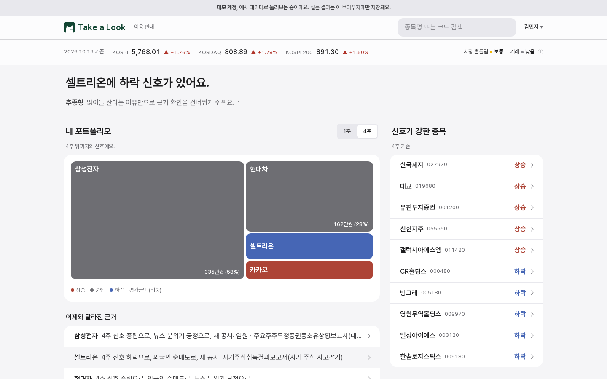
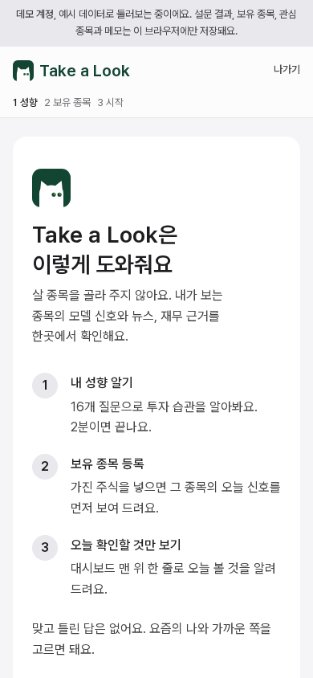
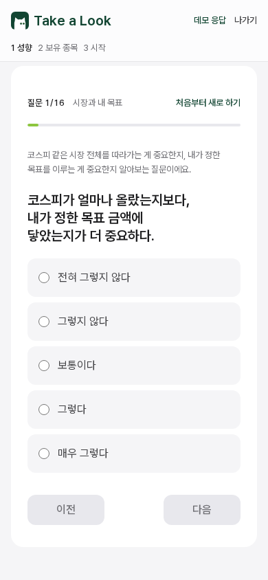
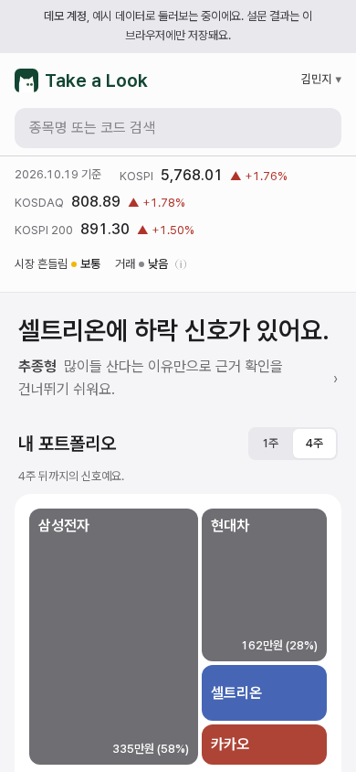
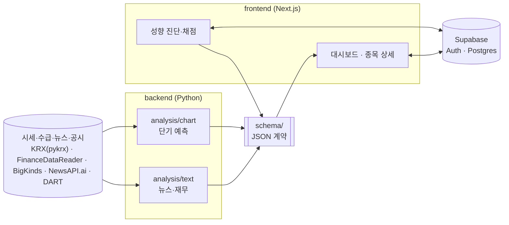

# Take a Look

**초보 투자자를 위한 판단 근거 서비스**

행동재무학 기반 투자 판단 보조 플랫폼 · 성균관대 소프트웨어학과 2026 졸업작품.
투자 성향을 진단해 근거를 보여 주는 순서를 사람마다 다르게 하고, 주가 예측 모델은 여러 근거 중 하나로만 씁니다.

[](https://github.com/2026Graduation-Work/take_a_look/actions/workflows/web-ci.yml)
[](https://github.com/2026Graduation-Work/take_a_look/actions/workflows/python-ci.yml)
[](LICENSE)

> **v1.1.0 최종 제출본(2026-10-27 코드 동결).** 지금 main에는 치명 버그 수정과 문서만 들어가고 v1.1.x로 올립니다. 이어서 할 개선과 연구는 [Co-Deep 2026-2](https://github.com/2026Graduation-Work/take_a_look/milestone/1) 마일스톤에 있습니다.

**라이브 데모 → https://takealook-skku.vercel.app** (가입 없이 "데모로 둘러보기"로 모든 화면을 볼 수 있습니다. 처음이라면 [이용 안내](https://takealook-skku.vercel.app/guide)부터 보세요. 기존 주소 https://stock-prediction-v2-chi.vercel.app 도 그대로 동작합니다)

<p>
  
</p>

## 무엇을 하나

- **성향 진단**: 16문항(8축) 진단으로 투자 유형을 정합니다. '추가 질문 8개'로 남은 문항만 더 답하면 24문항 진단이 됩니다. 결과는 숫자 대신 5칸 단계 막대로 보이고, 나와 다르면 축마다 칸을 눌러 직접 조정합니다.
- **읽는 순서가 정해진 대시보드**: 결론(요약 한 문장) → 나에게 해당하는 것(성향 한 줄, 내 포트폴리오, 어제와 달라진 근거) → 둘러볼 것(신호가 강한 종목) 순서로 읽힙니다. 1주, 4주 신호를 바꿔 볼 수 있고 화면 전체가 같은 기간을 따릅니다.
- **성향에 맞춘 근거**: 종목마다 네 가지 근거(시장 분위기, 누가 사고팔았나, 재무 상태, 모델이 본 이유)를 성향에 맞는 순서와 확인할 것으로 보여 줍니다. 종목을 걸러 내지는 않습니다. '모델이 본 이유'는 항목마다 쉬운 설명을 ⓘ에 두고, 계산 근거에서 각 항목의 영향 비중을 %로 보여 줍니다.
- **설명 가능한 숫자**: 모든 수치에 비교 기준과 출처를 붙입니다. 재무 지표는 코스피 중간값과 견주고("코스피 중간값 11.2배보다 높아요"), 용어는 ⓘ에 정의와 읽는 법을 둡니다. "상승 확률 70%" 대신 "과거 비슷한 경우 10번 중 7번은 이 범위였어요"처럼 말하고, 미래 가격 곡선은 그리지 않습니다.
- **보유 종목 넣기**: 검색으로 넣거나 증권 앱 캡처를 올리면 기기 안에서 글자를 읽어 종목과 수량을 채웁니다(사진은 어디에도 보내지 않음). 처음 한 번 읽는 도구를 받는 동안 단계(1/3~3/3)와 남은 시간을 보여 주고, 두 번째부터는 바로 읽습니다. ETF, 해외 주식은 아직 다루지 않는다고 따로 알려 줍니다. 수량과 평균 매입가에 음수나 문자처럼 잘못된 값을 넣으면 고쳐 저장하지 않고 그대로 보여 주며 저장을 막습니다.
- **코스피 전 종목**: 검색으로 코스피 전 종목의 상세(모델 신호, 최근 공시, 수급, 가격 흔들림)를 보고 보유 종목으로 넣을 수 있습니다. 2026-10-26 게시 기준으로 서빙 대상 912종목 중 793종목에 1주, 4주 신호가 나오고, 나머지 119종목은 수급 기록이 모자라거나 피처를 만들 수 없어 "이 종목은 오늘 모델 신호가 없어요"로 안내합니다. 보유, 관심 종목은 뉴스 분위기와 최신 정기보고서 재무도 매일, 매주 채워집니다.
- **원으로 읽는 숫자**: 수익률 범위 끝과 전일 대비 등락을 원으로도 씁니다("−9.5% (약 249,000원)", "+1,200원 (+1.8%)"). 내부 점수는 화면 본문에 쓰지 않고 '계산 근거' 안에서만 범위와 함께 씁니다.
- **이용 안내**: 서비스 취지, 시작하는 순서, 하루 5분 공부 루틴, 화면 읽는 법, 용어 모음을 한 페이지([/guide](https://takealook-skku.vercel.app/guide))에 모았습니다. 로그인 없이 열립니다.

<p>
  
  
  
</p>

### 설계 원칙

- **화이트박스**: 점수는 전부 규칙으로 계산합니다(결정론). LLM은 설명 문장에만 씁니다.
- **사람이 결정**: 매수·매도 지시나 자동 매매는 하지 않습니다. 근거와 출처를 보여 주고 판단은 사용자가 합니다.
- **데이터 정직성**: 실데이터가 아닌 값에는 화면에 "예시 데이터"를 표시합니다. 어떤 수치가 실데이터인지는 [docs/data-inventory.md](docs/data-inventory.md)에 있습니다.
- **화면 규칙**: 색과 글자 크기, 읽는 순서, 용어 설명 단계는 [frontend/DESIGN.md](frontend/DESIGN.md)가 정합니다. 화면 문구의 금지 표현은 테스트(`frontend/lib/copy-rules.ts`)가 막습니다.

### 화면 주소

| 화면 | 주소 | 로그인 |
|---|---|---|
| 대시보드 | [/](https://takealook-skku.vercel.app/) | 필요(데모 가능) |
| 성향 진단 | [/survey](https://takealook-skku.vercel.app/survey) | 필요(데모 가능) |
| 내 투자 성향, 계정 설정 | [/profile](https://takealook-skku.vercel.app/profile) | 필요(데모 가능) |
| 보유 종목 | [/portfolio](https://takealook-skku.vercel.app/portfolio) | 필요(데모 가능) |
| 종목 상세 | [/stocks/005930](https://takealook-skku.vercel.app/stocks/005930) | 필요(데모 가능) |
| 모델 성적표 | [/performance](https://takealook-skku.vercel.app/performance) | 필요(데모 가능) |
| 이용 안내 | [/guide](https://takealook-skku.vercel.app/guide) | 없음 |
| 개인정보 처리방침 | [/privacy](https://takealook-skku.vercel.app/privacy) | 없음 |
| 로그인, 가입 | [/login](https://takealook-skku.vercel.app/login) | 없음 |

### 버전

| 버전 | 날짜 | 내용 |
|---|---|---|
| [v1.0.0](https://github.com/2026Graduation-Work/take_a_look/releases/tag/v1.0.0) | 2026-10-21 | MVP 기준선 |
| [v1.1.0](https://github.com/2026Graduation-Work/take_a_look/releases/tag/v1.1.0) | 2026-10-27 | 최종 제출본, `3d988e0` (사용자 테스트 반영, 보안 권고 대응) |

바뀐 내용은 [CHANGELOG.md](CHANGELOG.md)에 있습니다.

## 빠르게 시작하기

### 웹 앱 실행

Node 22(10/21 보안 패치가 들어간 22.23.4 이상)와 pnpm이 필요합니다. CI는 최신 22.x, 운영(Vercel)은 24.x를 씁니다.

```bash
git clone https://github.com/2026Graduation-Work/take_a_look.git
cd take_a_look/frontend
pnpm install
cp .env.example .env.local
pnpm dev   # http://localhost:3000
```

환경변수 없이도 데모 계정으로 모든 화면이 동작합니다. 이메일 가입·로그인을 쓰려면 `.env.local`에 Supabase URL과 anon 키를 넣고 [docs/auth-setup.md](docs/auth-setup.md)대로 DB를 준비하세요(마이그레이션: `supabase/migrations/`).

### 테스트

```bash
# frontend/
pnpm lint && npx tsc --noEmit && pnpm test:unit && pnpm build && pnpm test:e2e

# 파이썬 블록 (Python 3.12, 각 블록 디렉토리에서)
pip install -r requirements.txt   # profiling/survey는 requirements-dev.txt
ruff check . && pytest
```

### 분석 블록 실행

모델 학습·추론과 뉴스·재무 분석은 블록별 문서를 따릅니다.

| 블록 | 하는 일 | 문서 |
|---|---|---|
| `backend/analysis/chart` | 가격, 거래량 피처 + LightGBM 단기 예측, 백테스트, 운영 기록 채점(`experiments/live_record.py`) | [README](backend/analysis/chart/README.md) |
| `backend/analysis/text` | 뉴스 감성(과거 BigKinds, 최근 NewsAPI.ai, KR-FinBERT), 재무(DART) 분석, 코스피 재무 중간값(`value_pipeline/kospi_medians.py`) | [README](backend/analysis/text/README.md) |
| `backend/profiling` | 성향 설문 정의와 출력 스키마 | [README](backend/profiling/README.md) |

API 키(`DART_API_KEY`, `NEWSAPI_AI_KEY` 등)는 저장소 루트의 `.env`에 둡니다. `.env`는 gitignore되어 있으니 절대 커밋하지 마세요.

## 구조



```
backend/
  analysis/chart/   단기 예측 모델, 공용 평가·백테스트
  analysis/text/    뉴스 감성·재무 분석 파이프라인
  profiling/        성향 설문 정의
frontend/           Next.js 웹 앱 (화면 규칙: frontend/DESIGN.md)
schema/             블록 사이 JSON 계약 (버전 고정, 변경은 팀 합의)
supabase/           DB 마이그레이션·시드
docs/               설계·데이터·설정 문서 (색인: docs/README.md)
```

- 별도 API 서버 없이 프론트가 Supabase를 직접 조회하고, 블록 사이는 `schema/`의 JSON 스키마로만 주고받습니다.
- 새 데이터 소스나 모델을 붙이려면 해당 스키마를 맞춰 출력하면 화면에 그대로 연결됩니다.
- 모든 서비스는 2027-02-01까지 무료 한도 안에서 돌립니다. 한도와 보존 정책은 [docs/ops/free-tier-budget.md](docs/ops/free-tier-budget.md)에 있고, 주 1회 감시 워크플로가 기준을 넘으면 이슈를 남깁니다.
- 보안: 모든 public 테이블에 RLS가 켜져 있고 개인 데이터는 본인만 읽고 씁니다(2026-10 점검에서 익명, 다른 사용자로 직접 시험). 주간 감시는 RLS가 꺼진 테이블이 하나라도 있으면 실패합니다. 점검 결과는 [docs/security/2026-10-audit.md](docs/security/2026-10-audit.md)에 있습니다.
- 차트 신호는 평일 저녁 정기 실행으로 게시하고, 늦어지면 다음 날 06:17 예비 실행이 이어 받습니다. 게시 데이터는 Supabase에서 읽으므로 화면을 다시 배포하지 않아도 바뀝니다.
- Vercel은 `frontend/`가 바뀐 커밋만 다시 빌드합니다(Ignored Build Step `git diff --quiet HEAD^ HEAD -- .`). 문서나 백엔드만 바뀐 커밋은 배포를 건너뜁니다.

**기술 스택**: Next.js 16 · React 19 · TypeScript · Tailwind CSS v4 · Recharts · Supabase · Vercel / Python · LightGBM · KR-FinBERT · FinanceDataReader

## 기여하기

브랜치·커밋·PR 규칙은 [docs/CONTRIBUTING.md](docs/CONTRIBUTING.md), 아키텍처 원칙과 금지 표현은 [AGENTS.md](AGENTS.md)에 있습니다. 보안 문제는 [SECURITY.md](SECURITY.md)를, 접근성 불편은 [ACCESSIBILITY.md](ACCESSIBILITY.md)를 봐 주세요.

## 팀

| 이름 | 역할 | 주요 담당 |
|---|---|---|
| 최중현 | 팀장 · 프로젝트 매니저 | 기획·설계, 성향 진단, 웹 개발·배포 |
| 서진세 | 차트 분석 | 차트 모델·백테스트, 시장 심리 특성·A/B 실험 |
| 김서환 | 텍스트·재무 분석 | 뉴스 감성 분석, DART 재무 지표 |
| 임성우 | 프론트엔드·QA | 초기 대시보드, Supabase 환경, QA |

## 라이선스

[MIT](LICENSE)

> Take a Look은 투자 자문이 아닙니다. 모든 신호는 과거 데이터에 기반한 통계적 참고 정보이며, 투자 판단과 책임은 사용자에게 있습니다.
