# Take a Look 모바일 QA 개선 전후 비교

모바일 QA에서 발견한 M01부터 M06까지를 수정했다. 보유 검색, 신호 기간 일치, 차트 가독성, 공개 데이터 조회 상태, 데모 삭제 안내, 감성 툴팁을 개선했으며 관련 E2E 48개와 단위 테스트 178개를 통과했다.

2026년 10월 26일 · 브랜치 fix/mobile-qa-m01-m06 · 기준 커밋 5543f64 · 수정 화면 http://localhost:3100/

## 비교 조건

개선 전 이미지는 정식 배포에서, 개선 후 이미지는 로컬 수정 빌드에서 촬영했다. 전후 데모 성향·보유 수량·선택 기간·조회 시점이 모두 같지는 않으므로 금액이나 점수의 차이를 수익 변화 또는 같은 입력의 A/B 결과로 해석하지 않는다. 이 문서는 각 문제의 동작과 표시 방식이 어떻게 달라졌는지를 비교한다. 실제 iOS/Android 기기, 모바일 UA, 소프트 키보드와 실사용자 계정은 검증하지 않았다.

## 범위

보유 캡처 사진을 업로드해 종목을 인식·분석하는 기능은 사용자 요청으로 제외했다. 기존 열린 이슈 #425(상단 검색의 종목 정보 보기 URL), #426(보유 수량·평단 숫자 입력), #427(보유 제거 후 상세 예시 수량)은 이 PR의 수정 대상이 아니다.

## 항목별 요약

| 항목 | 개선 전 | 개선 후 |
| --- | --- | --- |
| M01 | 예시 외 종목 확정이 무반응 | 공개 종목 검색과 입력 상태 안내 |
| M02 | 1주 선택 후 상세는 4주 | 기간과 같은 기간의 근거 유지 |
| M03 | 축·날짜 글자가 약 3~5px | 13px 이상과 차트 내부 스크롤 |
| M04 | 조회 중 예시 신호·임시 금액 노출 | 일치한 응답만 표시하고 상태 구분 |
| M05 | 삭제 범위 안내 불일치 | 실제 삭제되는 네 항목 명시 |
| M06 | 감성 툴팁 왼쪽 잘림 | 보이는 차트 안에 툴팁 표시 |

## M01 보유 종목 검색 범위와 입력 피드백

우선순위 P2

**QA 재현 방법**

데모 설문을 마친 뒤 보유 등록 또는 보유 편집에서 SK하이닉스와 000660을 입력하고 Enter로 확정한다.

**개선 전**

검색 후보가 예시 4종목에 한정돼 있었다. SK하이닉스를 확정해도 입력만 남고 행 추가나 오류 안내가 없었다.

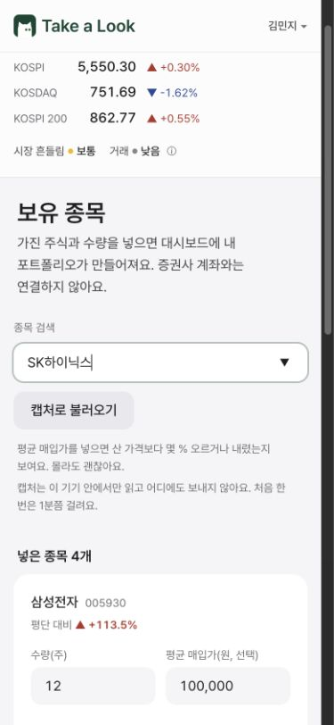

SK하이닉스 입력이 남아 있고 보유 목록은 4개다.

**개선 후**

데모와 계정이 같은 공개 종목 목록을 사용한다. 정확한 이름이나 코드로 선택하면 보유 행을 추가하고 기존 종목이면 수량 칸으로 이동한다. 조회 중 상태와 미일치·조회 실패 안내를 표시하며 검색어가 바뀌면 이전 선택을 취소한다.

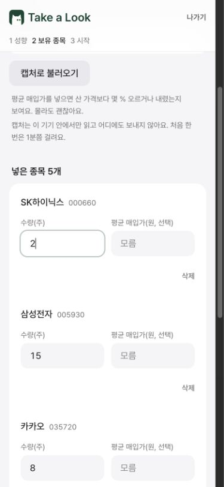

SK하이닉스 000660이 추가되어 보유 목록이 5개가 됐다.

**검증 결과**

Computer Use로 온보딩에서 SK하이닉스 행 생성, 가상 수량 2주 입력과 저장을 확인했다. E2E로 이름·코드·중복·미일치·늦은 응답 취소를 검증했다.

## M02 대시보드와 상세의 신호 기간 일치

우선순위 P2

**QA 재현 방법**

대시보드에서 1주를 선택하고 삼성전자 하락 타일을 눌러 상세로 이동한다. 상세에서 4주로 바꾸고 대시보드로 돌아온다.

**개선 전**

대시보드의 1주 하락 신호를 열면 상세는 4주 상승으로 표시됐다. 상세에 기간 선택이 없어 방금 선택한 신호의 근거를 바로 보기 어려웠다.

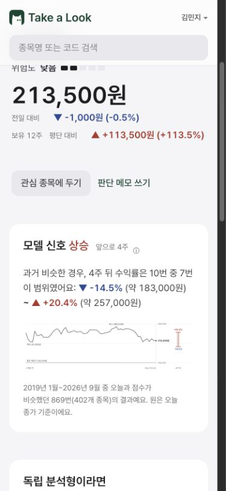

대시보드 1주 선택 후 상세가 4주 상승으로 열렸다.

**개선 후**

기기에 기억한 기간을 대시보드와 상세가 공유한다. 방향·수익률 범위·기여도·출처를 같은 기간의 스냅샷에서 읽고 상세에서도 기간을 바꿀 수 있다. 검색 결과 행도 선택 기간을 따르며 저장소 쓰기가 막혀도 현재 선택은 유지한다.

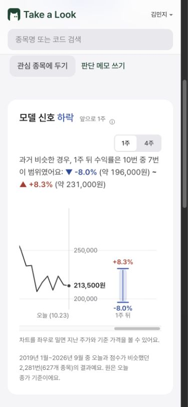

상세에서도 1주 하락과 해당 기간 범위를 보여준다.

**검증 결과**

실제 공개 데이터에서 1주 하락과 범위 -8.0%~+8.3%가 유지됨을 확인했다. 상세의 4주 전환 시 상승과 -14.5%~+20.4%로 함께 변경됐고 대시보드 복귀 후 선택도 유지됐다. E2E로 검색 행·상세 이동·쓰기 실패를 검증했다.

**개선 전 진입 맥락**

아래 대시보드의 1주 하락 타일을 눌렀지만 개선 전 상세는 위의 4주 상승으로 열렸다.

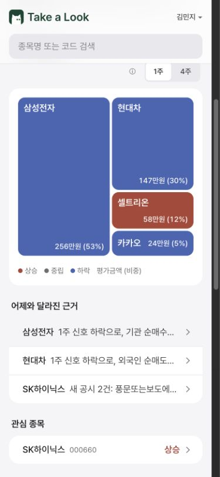

## M03 작은 화면의 주가 차트 글자 가독성

우선순위 P2

**QA 재현 방법**

삼성전자 상세의 주가 차트를 320px, 390px, 430px 화면에서 확인하고 날짜와 가격 표시를 읽는다.

**개선 전**

860px SVG를 카드 폭에 맞춰 통째로 축소해 축·날짜 글자가 약 3~5px 높이로 표시됐다.

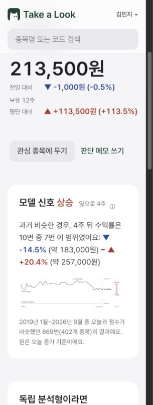

320px에서 차트와 글자가 함께 작아진 상태다.

**개선 후**

차트는 최소 860px 폭을 유지하고 카드 안에서 좌우로 탐색한다. 축·날짜는 13px, 강조 글자는 14px로 표시한다. 처음에는 최신 구간을 보여주고 과거 구간은 가로 스크롤로 확인한다.

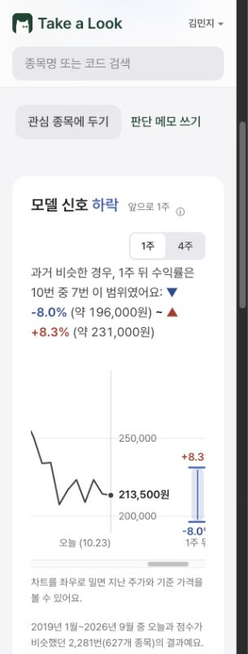

320px에서도 글자 크기를 유지하고 차트 내부에서 탐색한다.

**검증 결과**

320px 실제 화면에서 축·날짜의 렌더링 박스 높이 15.5px와 강조 글자 17px를 확인했다. E2E는 320/390/430px에서 변환 후 글자 크기 13px 이상과 페이지 가로 넘침 없음을 확인했다.

## M04 공개 신호 조회 상태와 금액 표시

우선순위 P2

**QA 재현 방법**

대시보드에 재진입하거나 기간을 바꾸고 조회 전후의 요약·신호·금액·비중을 비교한다. 지연·빈 응답·실패 후 재시도도 확인한다.

**개선 전**

조회가 끝나기 전에 예시 상승·하락 신호와 매입금액이 실제 결과처럼 잠깐 표시됐다. 평단이 없는 종목에는 레이아웃용 최소값 1원이 계산에 섞였으며 비중도 왜곡됐다.

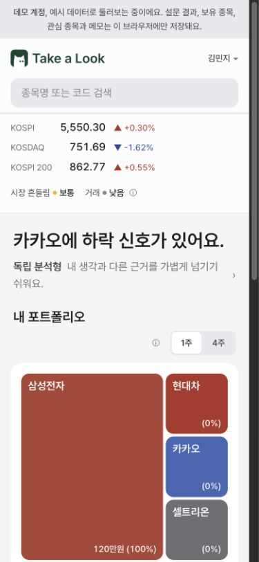

조회 전 삼성전자는 예시 상승과 매입금액 120만원·100% 비중을 표시했다.

**개선 후**

요청한 종목·기간·사용자와 일치하는 응답만 표시한다. 조회 중·실패·결과 없음 상태를 구분하고 누락된 공개 신호를 예시 값으로 채우지 않는다. 금액이 없으면 금액과 비중을 미제공으로 표시하며 부분 조회 요약은 확인한 종목 범위를 명시한다.

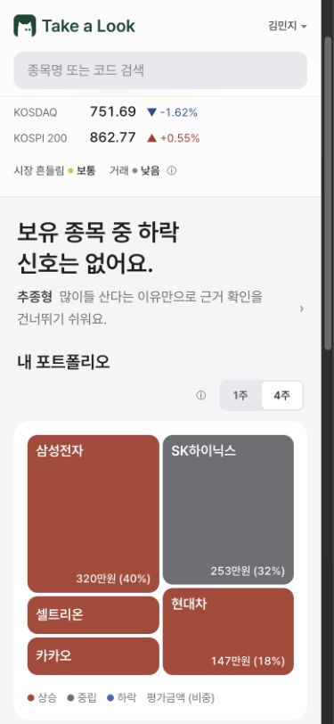

조회 완료 후 공개 종가로 계산한 평가금액과 비중을 표시한다. 삼성전자는 가상 15주 약 320만원이다.

**검증 결과**

Computer Use에서 최초 진입의 로딩 안내와 조회 후 공개 종가 기반 금액을 확인했다. E2E로 응답을 지연·실패·빈 목록으로 제어해 임시 신호 미노출, 기간 전환 시 이전 결과 숨김, 재시도 복구를 검증했다. 단위 테스트로 금액 산식과 부분 조회 요약을 검증했다.

## M05 데모 로그아웃 삭제 범위 안내

우선순위 P3

**QA 재현 방법**

개인정보 처리방침의 데모 설명과 로그아웃 확인 모달의 삭제 항목을 비교한다.

**개선 전**

처리방침은 보유 종목·설문 결과만 로그아웃으로 지우고 나머지는 브라우저 저장소를 지워야 한다고 안내했다. 로그아웃 모달은 네 항목을 모두 지운다고 안내해 내용이 달랐다.

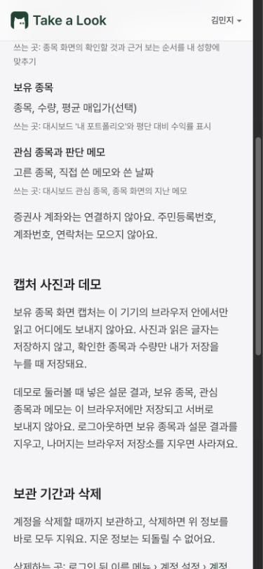

로그아웃으로 지우는 항목과 나머지 항목을 다르게 안내했다.

**개선 후**

실제 로그아웃 동작에 맞춰 성향 진단 결과·보유 종목·관심 종목·판단 메모를 이 브라우저에서 모두 지운다고 처리방침에 명시했다. 삭제 로직 자체는 변경하지 않았다.

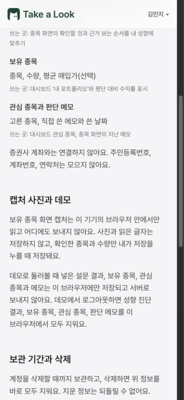

로그아웃으로 지우는 네 항목을 함께 안내한다.

**검증 결과**

Computer Use로 네 항목이 함께 표시되는 안내를 확인했다. 기존 로그아웃 E2E로 보유 종목을 포함한 데모 초기화 동작을 재검증했다.

## M06 긴 감성 차트의 툴팁 화면 경계

우선순위 P2

**QA 재현 방법**

삼성전자 상세에서 시장 분위기 탭을 연다. 가로로 긴 뉴스 감성 차트의 최신·과거 점을 누르고 Escape로 닫는다.

**개선 전**

가로 스크롤된 차트의 좌표로 툴팁이 배치돼 왼쪽 밖으로 잘렸다. 날짜와 뉴스 분위기 설명 앞부분을 읽을 수 없었다.

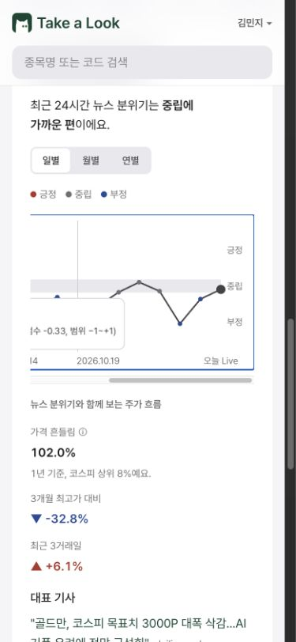

툴팁의 날짜와 설명 앞부분이 화면 왼쪽으로 잘렸다.

**개선 후**

툴팁을 스크롤되는 차트 밖의 보이는 호스트에 표시하고 폭을 제한했다. 최신·과거 지점 모두 화면 안에서 읽을 수 있고 기간을 바꾸면 이전 선택이 초기화된다.

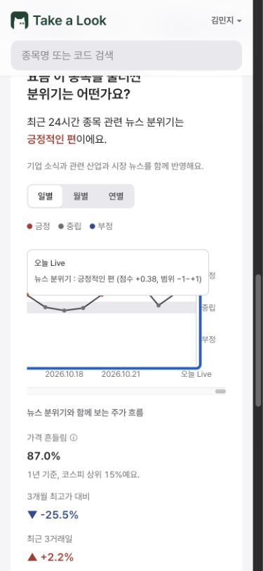

툴팁 전체가 보이는 차트 영역 안에 표시된다.

**검증 결과**

실제 366개 시점을 가진 차트에서 최신·과거 점을 클릭했다. 최신 툴팁의 x=40~310.21px가 보이는 차트 x=40~335px 안에 위치했고 Escape로 닫혔다. E2E로 양 끝 지점의 좌우 경계와 닫기를 검증했다.

**개선 후 과거 시점도 확인**

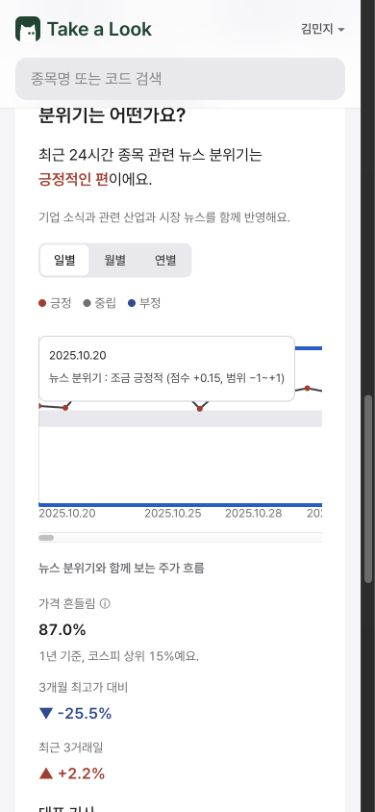

## 최종 검증

- 모바일 QA와 관련 기존 E2E 48개 통과
- 프론트엔드 단위 테스트 178개 통과
- ESLint 통과
- 프로덕션 빌드 통과
- Chrome 390×844 및 320×844 화면에서 Computer Use 수동 확인
- 자동 테스트에서 320/390/430px 차트 크기와 지연·빈 응답·조회 오류·저장소 쓰기 실패 확인

보유 수량은 데모 시험 데이터다. 외부 서비스에 실제 보유 정보를 입력하거나 실제 계정을 생성하지 않았다. 위 화면 검증은 로컬 수정 빌드 기준이며 배포 완료를 의미하지 않는다.

## 상세 기록

- 원래 재현 절차와 측정 기록: docs/qa/2026-10-26-mobile/README.md
- 수정 내용과 검증 기록: docs/qa/2026-10-26-mobile/FIX-VALIDATION.md
