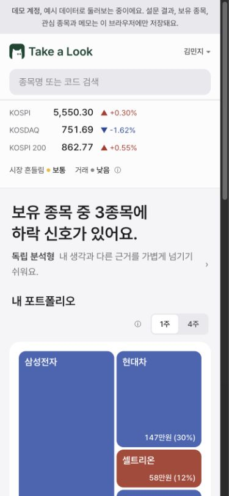
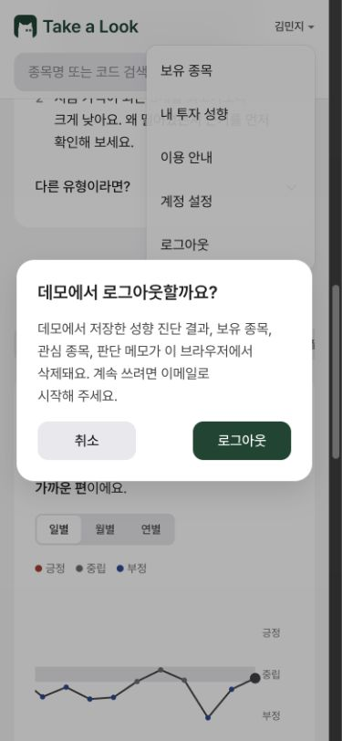

# 모바일 QA — 2026-10-26

> M01~M06 로컬 수정 브랜치의 변경 내용·검증 결과·수정 후 이미지는 [수정 검증 문서](FIX-VALIDATION.md)에 기록했다. 아래는 수정 전 관찰 기록이다.

> Notion에 옮길 수 있는 설명과 전후 이미지는 [전후 비교 문서](NOTION-REPORT.md)에 정리했다.

## 실행 범위

- 문서 형식: 항목별 QA 재현 절차, 증거 이미지, DOM·수치 기록. 증거 이미지 9장은 2026-10-26 16:55~16:56 KST에 같은 데모 조건에서 재촬영했다.
- 확인 시간: 2026-10-26 16:25~16:47 KST.
- 대상: <https://takealook-skku.vercel.app/>. 기존 브라우저의 구 배포 주소는 초기 화면만 확인하고, 아래 판정은 정식 주소에서 실행했다.
- 방법: Computer Use(`cua_repl`)로 Chrome에서 클릭, 입력, 스크롤, 새로고침, 뒤로 이동. 화면·접근성 트리·DOM을 읽어 증거를 보완했다. API 직접 호출이나 저장소 강제 주입으로 흐름을 우회하지 않았다.
- 화면: 390×844 주 검사, 320×740 및 320×844 좁은 화면 검사, 430×932 차트와 검색 보완 검사. CSS viewport 크기 변경이며 실제 iOS/Android, 모바일 UA, 터치 이벤트, 소프트 키보드를 재현한 검사는 아니다.
- 계정: 정식 주소의 새 데모. 실제 계정 생성·로그인·실제 보유 정보 입력은 하지 않았다. 삼성전자 12주/평단 100,000원, SK하이닉스 관심 등록과 `QA 가상 메모`는 시험 데이터다.
- 배포 SHA: 확인하지 못했다. 로컬 조사 시작 HEAD는 `4be122fed522d6b460128287ad3a2eb3892dc426`이나 **배포 버전과 같다는 의미는 아니다.** 일부 화면은 로컬 소스와 달랐다. 원인 코드를 단정하지 않는다.
- 문서 작업 브랜치: `chore/mobile-qa-2026-10-26`. 시작부터 있던 미커밋 변경을 유지했다. 제품 코드 수정·커밋·push·PR·배포는 하지 않았다.

판정은 실행한 데모와 화면 범위에 한정한다. ‘정상’은 해당 조작에서 관찰한 결과이며 전체 기능이나 계정 격리의 보증이 아니다. P2는 사용·판단에 영향을 주는 문제, P3는 안내·사용성 개선 항목이다. 모바일에서 발견했지만 데스크톱에도 존재할 수 있다.

## 요청에 따른 제외

**보유 종목 캡처 사진을 업로드해 종목을 인식·분석하는 기능의 QA는 사용자 요청으로 제외한다.** 파일 업로드, OCR, 인식 결과·수량 추출, 자동 채움·병합 등 관련 항목을 결함이나 미완료 QA로 집계하지 않는다. QA 증거용 화면 이미지는 제외 대상이 아니므로 아래 각 항목에 첨부한다.

GitHub의 열린 이슈 목록과 각 본문에서 작성자 `swliris` 및 범위를 확인했다. 아래 항목은 재검증·신규 결함 집계에서 제외했다.

| 이슈 | 제외 범위 |
| --- | --- |
| [#425](https://github.com/2026Graduation-Work/take_a_look/issues/425) | 종목명 검색 후 본문 ‘종목 정보 보기’가 종목명을 상세 URL에 그대로 사용하는 문제. 미일치 검색의 같은 경로도 신규 문제로 세지 않음 |
| [#426](https://github.com/2026Graduation-Work/take_a_look/issues/426) | 보유 수량·평균 매입가의 음수, 지수 표기, 문자 혼합, 자릿수 변환. 관련 숫자 오류 재현은 하지 않음 |
| [#427](https://github.com/2026Graduation-Work/take_a_look/issues/427) | 보유 제거·보유 없이 시작 후 상세에 예시 보유 수량이 남는 문제. 전체 보유 제거 흐름은 하지 않음 |

M01은 **보유 등록 검색**, M02는 **정상 종목 코드 경로에서 신호 기간 전환**, M04는 **로딩 중 신호·평가값**이므로 위 세 이슈와 구분한다.

## 발견 항목

| ID | 우선순위 | 관찰 결과 | 분류 |
| --- | --- | --- | --- |
| M01 | P2 | 보유 등록 검색이 예시 4종목에 한정되고, 다른 정상 종목 입력에 반응·안내 없음 | 재현됨. 데모 제한 정책 여부 확인 필요 |
| M02 | P2 | 대시보드 1주 하락 종목을 열면 상세는 성향 기준 4주 상승으로 열림 | 재현됨. 기간 우선순위 UX 검토 필요 |
| M03 | P2 | 주가 차트가 함께 축소되어 모바일에서 축·날짜 글자가 약 3~5px 높이 | 재현됨 |
| M04 | P2 | 대시보드 진입 직후 예시 신호·1원 매입금액이 실제 값처럼 잠깐 노출 | 재현됨. 로딩 중 현상 |
| M05 | P3 | 데모 로그아웃 모달과 개인정보 처리방침의 삭제 범위가 다름 | 문구 불일치 확인. 실제 삭제는 미검증 |
| M06 | P2 | 뉴스 차트의 날짜·감성 툴팁이 왼쪽 밖으로 나가 잘림 | 재현됨 |

### M01 — 보유 검색에서 예시 외 종목을 등록할 수 없고 안내도 없음

**환경:** 390px, 신규 데모의 온보딩 보유 단계 및 `/portfolio`.

**재현 절차**

1. 데모 설문을 마치고 보유 등록 단계에 진입한다.
2. ‘종목 검색’에 `SK하이닉스`를 입력하고 Enter로 확정한다.
3. `000660` 코드로도 입력·확정을 시도한다.
4. 기존 4개 보유를 저장한 뒤 계정 메뉴 → 보유 종목에서 같은 이름으로 재시도한다.
5. 비교를 위해 대시보드 상단 검색에 `SK하이닉스`를 넣는다.

**실제:** 온보딩·보유 편집 모두 입력 문자열이 남으며 추가 행, 수량 입력, 오류 안내가 나타나지 않았다. 화면의 datalist 후보는 삼성전자·현대차·셀트리온·카카오 4개뿐이었다. 기존 후보 삼성전자를 Enter로 확정하면 입력은 비워지며 중복 행은 생기지 않았다. 반면 대시보드 상단 검색은 `SK하이닉스 000660` 후보를 표시하고 정상 상세로 이동했다.

**기대:** 지원하는 종목이면 보유 추가 단계로 이어진다. 데모가 4종목만 지원하는 정책이라면 그 범위와 미지원 입력 이유를 명시한다. 현재 관찰만으로 실계정에서도 등록 불가하다고 단정하지 않는다.

**영향:** 초보 사용자가 검색 실패인지, Enter가 아닌 다른 조작이 필요한지, 지원하지 않는 종목인지 구분할 수 없다.

**수정 후 재확인:** 정확한 종목명·코드·부분 검색·중복 선택·미일치 입력, 온보딩/편집 및 데모/로그인 각각 확인.

**확인 기록:** [화면에 연결된 후보 4개](M01-catalog.json).

**증거 이미지 — 재촬영**

### M02 — 1주 신호에서 상세로 이동하면 4주로 맥락이 바뀜

**환경:** 독립 분석형, 320px에서 삼성전자 타일, 390px에서 SK하이닉스 자동완성 이동.

**재현 절차**

1. 대시보드의 신호 기간을 ‘1주’로 선택한다.
2. 데이터 로딩이 끝난 뒤 삼성전자 타일의 ‘앞으로 1주 하락 신호’를 확인한다.
3. 해당 타일을 누른다. 정상 코드 경로 `/stocks/005930`로 이동한다.
4. 상세 로딩이 끝나면 모델 신호와 적용 기간을 확인한다.
5. ‘더 알아보기’ → ‘기간마다 같은 방향인가요?’도 펼친다.

**실제:** 상세 주 신호는 ‘상승 / 앞으로 4주’, 범위와 모델 근거도 4주였다. 기간 선택 컨트롤은 보이지 않았다. ‘더 알아보기’ 안에서는 4주 상승과 1주 하락을 함께 보여 주고 ‘하락 때 정리하는 편이라고 답해 4주를 먼저 놓았어요’라고 설명했다. 뒤로 이동한 대시보드는 1주 선택을 유지했다. SK하이닉스도 대시보드 1주 상승에서 상세 4주 중립으로 열렸다.

**판정 주의:** 서로 다른 모델·기간의 신호가 다른 것 자체는 오류가 아니다. 성향에 따라 상세의 주 기간을 정하는 동작은 의도된 정책일 수 있다. 문제는 사용자가 방금 명시적으로 선택한 기간이 이동 시 유지되지 않고, 변경 이유가 깊은 접기 영역에 있다는 점이다.

**기대:** 선택한 기간의 상세를 열거나, 상단에서 기간 변경과 이유를 바로 알리고 선택한 1주 근거에도 접근할 수 있게 한다. 최종 방식은 기존 UI를 유지하는 범위에서 검토한다.

**영향:** 같은 종목의 하락/상승이 이동 전후 뒤집혀 보이며, 처음 온 사용자가 기간 차이를 이해하지 못할 수 있다.

**수정 후 재확인:** 1주/4주 × 보유 타일/관심 링크/어제와 달라진 근거/자동완성, 상세 재진입·뒤로 이동에서 기간과 근거 일치 확인.

**확인 기록:** 대시보드의 1주 하락 타일을 눌러 정상 코드 경로로 이동한 뒤, 로딩 완료 상태에서 상세의 4주 상승 문구를 확인했다.

**증거 이미지 — 재촬영**

### M03 — 주가 SVG 차트의 글자가 모바일에서 읽기 어려움

**환경:** 삼성전자 상세, 평균 매입가 100,000원 입력 상태, 320/390/430px.

**재현 절차**

1. 삼성전자 상세의 모델 신호 카드에서 주가 차트를 본다.
2. 화면 폭을 320px, 390px, 430px로 각각 확인한다.
3. 날짜·종가·최고/최저·평균 매입가·수익률 범위 글자를 확대 없이 읽어 본다.

**실제:** `viewBox="0 0 860 264"`인 SVG가 카드 폭에 맞춰 글자까지 축소됐다. read-only DOM으로 측정한 글자의 렌더링 bounding box는 아래와 같다. CSS font-size 자체나 글꼴의 em 크기와는 구분해야 한다.

| viewport 폭 | 차트 폭×높이 | 축·날짜 등 글자 높이 | 강조 글자 높이 |
| --- | --- | --- | --- |
| 320px | 225×69.1px | 약 3.0~3.1px | 약 4px |
| 390px | 295×90.6px | 약 4.5px | 약 5px |
| 430px | 335×102.8px | 약 5px | 약 5.5px |

**기대:** 모바일에서도 날짜·기준 가격을 읽을 수 있는 크기로 표시하고, 공간이 부족하면 축 간격·표시 항목·차트 폭 처리 등을 조정한다. 카드 본문의 큰 수익률 설명은 읽을 수 있으므로 전체 정보가 사라지는 문제는 아니다.

**영향:** 차트의 현재가·고저가·평단과 비교 기준을 눈으로 확인하기 어렵다.

**수정 후 재확인:** 세 폭에서 차트 라벨 가독성, 본문과 차트 값의 일치, 평균 매입가 유무에 따른 겹침 확인.

**확인 기록:** [폭별 측정 원본](M03-chart-measurements.json).

**증거 이미지 — 재촬영**

### M04 — 로딩 중 임시 값이 완성된 포트폴리오처럼 표시됨

**환경:** 삼성전자 12주/평단 100,000원, 나머지 예시 보유는 평단 미입력, 대시보드 1주 선택.

**재현 절차**

1. 위 보유를 저장하고 대시보드 데이터가 완전히 뜰 때까지 기다린다.
2. 내 투자 성향 또는 다른 화면으로 이동한다.
3. 로고로 대시보드에 돌아오거나 브라우저 뒤로 이동한다.
4. 진입 직후 화면과 로딩 완료 후 화면의 요약·신호·금액·비중을 비교한다.

**실제:** 여러 차례 진입 직후 아래 값이 노출됐다가 실제 데이터로 교체됐다.

| 항목 | 진입 직후 | 로딩 후 |
| --- | --- | --- |
| 요약 | 카카오에 하락 신호가 있어요 | 보유 종목 중 3종목에 하락 신호가 있어요 |
| 삼성전자 | 1주 상승, 매입금액 120만원, 비중 100% | 1주 하락, 평가금액 256만원, 비중 53% |
| 현대차 | 1주 강한 상승, 매입금액 1원, 비중 0% | 1주 하락, 평가금액 147만원, 비중 30% |
| 셀트리온 | 1주 중립, 매입금액 1원 | 1주 상승, 평가금액 58만원 |
| 카카오 | 매입금액 1원 | 평가금액 24만원 |

**상태:** 지속되는 저장 오류가 아니라 비동기 로딩 전후 현상이다. 지속 시간은 계측하지 않았고 느린 네트워크를 주입하지 않았다. ‘신호가 강한 종목’에는 로딩 안내가 있다. 초기 화면에서는 시장 바에 ‘300일 전 데이터’, 요약에 2025.12.30 기준도 표시됐다. 다만 위 포트폴리오 값에는 임시 계산임을 명확히 구별하는 안내가 없고, 미입력 평단의 1원을 실제 매입금액처럼 제시한다.

**기대:** 최신 데이터를 기다리는 영역은 로딩/미제공 상태로 구별하고, 예시 신호·레이아웃용 최소값을 실제 판단 정보처럼 표시하지 않는다.

**영향:** 잠깐 본 요약과 포트폴리오의 방향·비중이 실제 값과 달라 사용자가 잘못 이해할 수 있다.

**수정 후 재확인:** 직접 진입·클라이언트 이동·뒤로 이동·새로고침, 정상/지연/실패 응답에서 임시 데이터가 실제 데이터처럼 노출되는지 확인.

**확인 기록:** [진입 직후 DOM](M04-dashboard-initial.txt), [로딩 후 DOM](M04-dashboard-loaded.txt). DOM이 타일의 신호·금액 차이를 함께 보존한다.

**증거 이미지 — 재촬영**

### M05 — 데모 로그아웃의 삭제 범위 고지가 서로 다름

**재현 절차**

1. 개인정보 처리방침 → ‘캡처 사진과 데모’를 읽는다.
2. 데모 계정 메뉴 → 로그아웃을 눌러 최종 확인 모달만 연다.
3. 두 안내를 비교한 뒤 취소 또는 Escape로 닫는다.

**실제:** 처리방침은 ‘로그아웃하면 보유 종목과 설문 결과를 지우고, 나머지는 브라우저 저장소를 지우면 사라져요’라고 설명한다. 모달은 성향 진단 결과·보유 종목·관심 종목·판단 메모가 모두 삭제된다고 설명한다.

**기대:** 실제 정책을 확인해 두 화면에서 같은 삭제 범위를 설명한다.

**영향:** 관심 종목·메모가 로그아웃 후 남는지 사용자가 판단하기 어렵다.

**범위 구분:** 이 항목은 데모 데이터 삭제 고지 비교이며, 캡처 업로드·분석 기능의 QA가 아니다.

**미검증:** 최종 로그아웃과 저장 데이터의 실제 삭제 여부는 실행하지 않았다. 문구 불일치만 판정했으며 데이터 삭제 버그로 단정하지 않는다. 모달의 취소 버튼 및 Escape 취소는 정상 확인했다.

**확인 기록:** [처리방침 텍스트](M05-privacy.txt), [모달 텍스트](M05-logout-dialog.txt).

**증거 이미지 — 재촬영**

### M06 — 뉴스 감성 차트 툴팁이 화면 밖으로 잘림

**환경:** 390×844, SK하이닉스 상세 → 시장 분위기 → 일별, 기본적으로 오른쪽 최신 시점이 보이는 가로 스크롤 상태.

**재현 절차**

1. 해당 탭을 연 뒤 뉴스 차트가 화면에 보이도록 아래로 스크롤한다.
2. 보이는 점 중 2026.10.18 부근을 누른다.
3. 날짜와 ‘뉴스 분위기’ 설명을 읽는다.
4. 2026.10.21 부근, 가장 오른쪽 ‘오늘 Live’도 각각 누른다.

**실제:** 툴팁 앞부분이 차트 왼쪽 밖에 생성되어 클리핑된다. 날짜와 ‘뉴스 분위기’, 긍정/중립/부정 설명의 앞부분을 읽을 수 없다. 10.18은 tooltip bounding box `x=-113px`, 폭 약 `268px`; 날짜 라벨은 `x=-102px`였다. 10.21 및 오늘 Live에서도 앞부분 잘림을 화면으로 재확인했다. 값 자체는 DOM에 존재한다.

**기대:** 가로로 스크롤된 현재 보이는 영역 안에 툴팁 전체를 배치한다. 왼쪽·오른쪽 끝 점에서도 날짜, 감성 설명, 점수, 범위를 모두 읽을 수 있어야 한다.

**영향:** 모바일에서 개별 시점을 눌러 근거를 확인하는 핵심 동작을 수행해도 날짜·설명이 잘린다.

**수정 후 재확인:** 320/390/430px, 차트 가로 스크롤의 좌·중·우 위치, 과거/최신 점, 일별/월별/연별에 대해 툴팁 경계 확인.

**확인 기록:** [툴팁 DOM](M06-tooltip-dom.txt), [10.21 측정](M06-tooltip-measurement.json).

**증거 이미지 — 재촬영**

## 실행한 정상 흐름과 추가 관찰

| 영역 | 실행 내용 | 결과 |
| --- | --- | --- |
| 진입 | 비로그인 정식 홈 → 로그인 | 로그인으로 이동 |
| 로그인 | 이메일 폼, 빈 로그인 제출 | 이메일 필수 입력으로 차단 |
| 회원가입 | 가입 탭 전환 | 이름/이메일/비밀번호·8자 안내·처리방침 링크 노출. 가입 제출은 미실행 |
| 신규 데모 | 데모로 둘러보기 → 시작하기 | 16문항 설문 진입 |
| 설문 필수값 | 첫 문항 미선택, 경험 미선택 | 다음 비활성 |
| 설문 선택 | 첫 문항 선택 → 다음 → 이전 | 응답 유지 |
| 설문 복원 | 응답한 첫 문항에서 새로고침 | 선택 응답 복원 및 복원 안내 확인 |
| 기본 설문 | 16문항 직접 응답 | 모든 단계 이동 및 완료 |
| 마무리 | 경험 선택, SPAC/저유동성 선택, 가상 자유 응답 | 결과에 선택한 제외 유형 반영 |
| 결과 조정 | 손실 감수 최저로 변경 → 초기화 | 유형·요약 변경 후 원래 적극 축적형으로 복원 |
| 추가 설문 | 추가 8문항을 모두 보통으로 직접 응답 | 독립 분석형 결과, 회피 유형 유지 |
| 보유 정상값 | 삼성전자 12주/평단 100,000원 저장 | 편집 재진입에도 유지, 상세 12주, 로딩 후 평단 대비 +113.5% |
| 보유 중복 | 기존 삼성전자 검색 후 Enter | 중복 행 없음 |
| 보유 미저장 | 12→13 수정 후 로고 이동 → 뒤로 | 저장값 12 복원. 미저장 경고 없음: 개선 후보이며 저장 오류로 집계하지 않음 |
| 기간 | 대시보드 1주/4주 전환 | 로딩 후 요약·보유 신호·강한 목록이 변경됨. 상세 이동은 M02 |
| 하드 제약 | 직접 고른 제외 항목 펼침 | SPAC/저유동성 설명과 제외 종목 표시. 4주에서 저유동성 씨티알모빌리티 등이 제외됨 |
| 전역 검색 | SK하이닉스 이름·삼성전자 코드 검색, 후보 선택 | 정상 코드 경로 이동. 본문 대체 링크는 #425 범위라 제외 |
| 관심 종목 | SK하이닉스 등록·새로고침·해제·재등록 | 상태 유지·변경 정상, 보유 편집과 대시보드 관심 목록에도 표시 |
| 메모 필수값 | 공백만 입력 | 저장 비활성 |
| 메모 저장 | 줄바꿈·HTML 모양 문자열 저장 후 새로고침 | 텍스트 그대로 표시. 이 시험만으로 일반적인 XSS 안전성을 보증하지 않음 |
| 메모 편집 | 임시 수정 후 취소, 다시 고쳐 저장 | 취소 시 기존 메모 유지, 저장 시 새 메모 반영 |
| 근거 탭 | 모델/재무/시장/수급 전환 | 선택 탭과 내용 변경, 390px에서 마지막 탭 가로 이동 가능 |
| 설명 | PER 설명 팝오버·계산 근거·더 알아보기 | 설명과 숫자/출처 확장 확인 |
| 뉴스 기간 | 일별→월별→연별 | 기간과 차트 축 변경, 월·연 집계 설명 표시. 계산의 수치 정확성은 미검증 |
| 뉴스 시점 | 과거/오늘 Live 점 클릭 | 날짜·감성 값 변경, 툴팁 클리핑은 M06 |
| 성적표 | 1주/4주 × 전체/고변동일 네 조합 | 숫자·표본 수 갱신, 고변동일 백테스트 미산출 표시 |
| 성적표 표 | 320px에서 오른쪽 가로 스크롤 | B−A 열 접근. 컨테이너 273px, 표 약 398px, scrollLeft 125px 확인 |
| 재진단 | 24문항 모드 진입, 일부 수정 후 결과 화면 재방문 | 기존 확정 독립 분석형 결과와 회피 유형 유지 |
| 설문 뒤로 | 재진단 2문항에서 브라우저 뒤로 | 1문항으로 이동하고 변경 답 유지 |
| 나가기 | 재진단 나가기 | 데모 로그아웃 모달 노출. 취소로 진행 중 응답 유지 |
| 안내 | 이용 안내·개인정보 이동, 용어 모음 목차 클릭 | 문서 표시·앵커 이동, 320px에서 제목이 헤더 아래 보임 |
| 로그아웃 모달 | 취소 및 Escape | 모달 닫힘, 데모·메모 유지 |

## 미검증·후속 검사

- **실제 모바일:** iOS Safari/Android Chrome, 터치·핀치 확대, 화면 회전, 소프트 키보드, safe-area, 스크린리더, 실제 기기 성능은 별도 검사 필요.
- **인증:** 실제 계정의 가입/로그인, 메일 확인·비밀번호 복구, 로그인 계정과 데모 간 데이터 전환, 계정 격리·삭제는 미실행.
- **삭제:** 실제 계정 삭제, 최종 데모 로그아웃, 메모 최종 삭제는 실행하지 않았다. QA에서 생성한 정식 주소의 데모 데이터는 브라우저에 남아 있다. 기존 구 배포 주소의 사용자 세션은 수정하지 않았다.
- **실패 응답:** 오프라인·강제 지연·API 오류 주입은 하지 않았다. M04의 지속 시간이나 실패 시 최종 상태를 추정하지 않는다.
- **정량 정확성:** 모델 학습·원천 주가·재무/뉴스 계산 결과의 정합성 및 모든 종목 커버리지를 이 UI 검사로 검증하지 않았다.
- **현재 로컬 변경:** 로컬 수정본의 모바일 회귀 결과가 아니다. 발견 항목을 고친 뒤 별도 로컬 빌드에서 재검증해야 한다.

## 산출물 검증

제품 코드 변경이 없는 QA 기록 작업이므로 build/pytest/ruff는 실행하지 않았다. 문서와 증거 파일 존재, Markdown의 로컬 링크, JSON 증거 파싱 및 문서 내 제외 범위를 별도로 확인한다. 이 문서의 정상 판정은 위 Computer Use 관찰에 근거한다.
