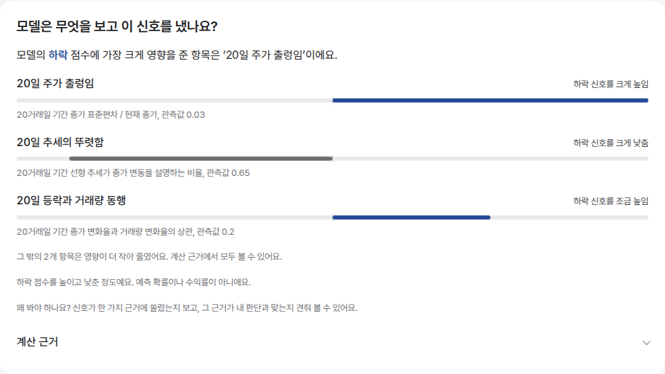
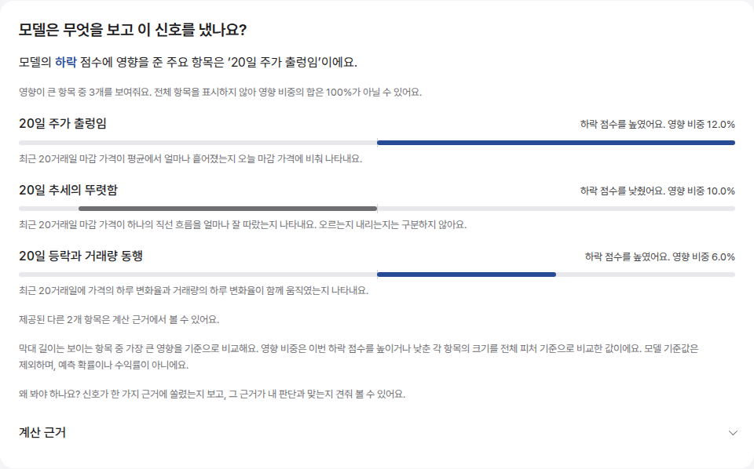
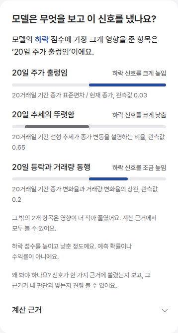
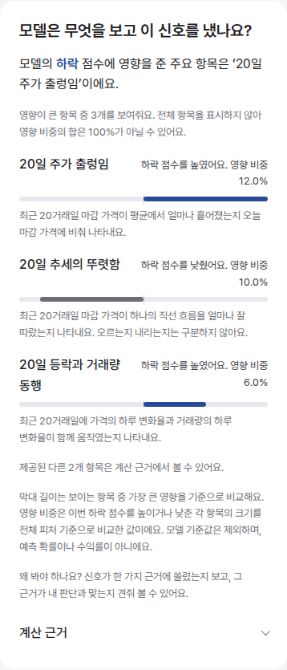
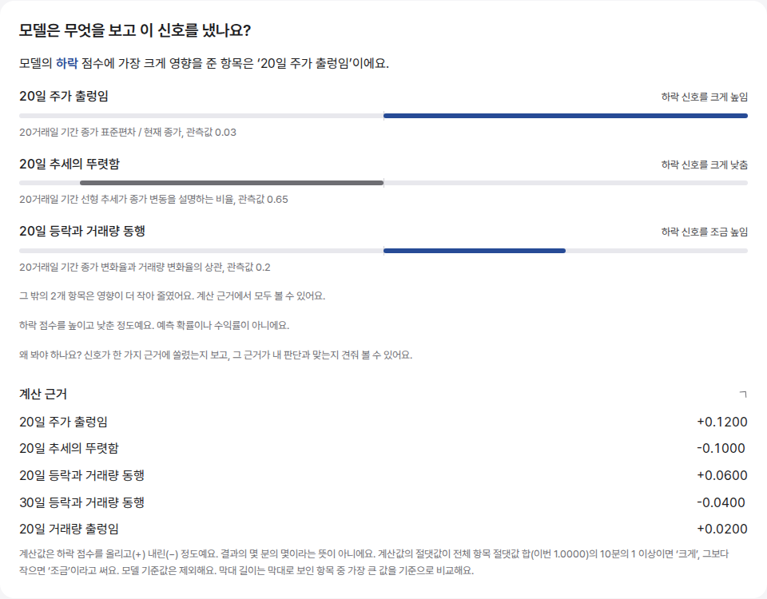
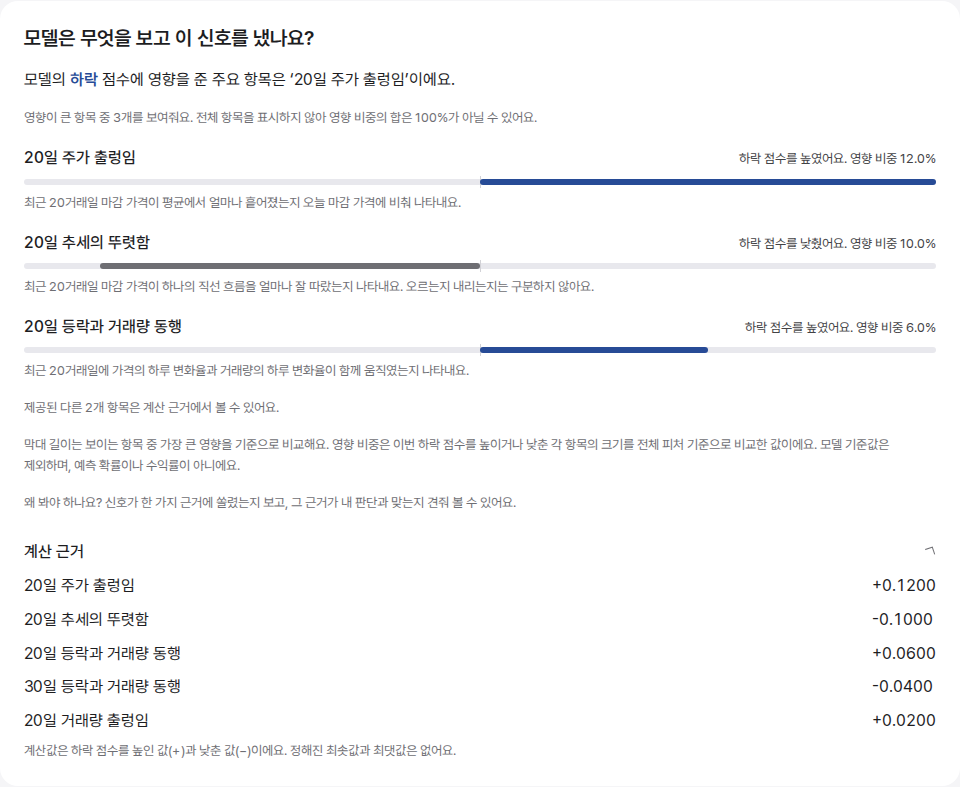
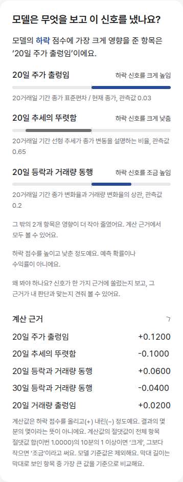
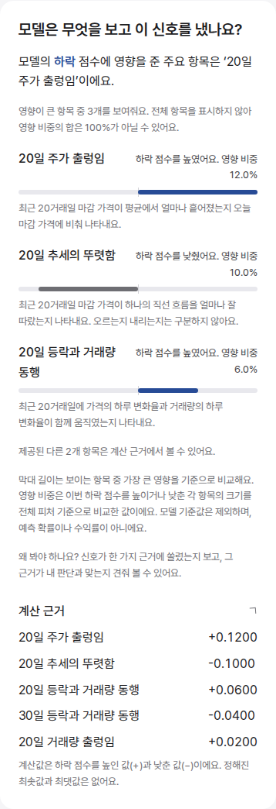

# 모델 근거 설명과 영향 비중 개선

관련 이슈: #328, #420. 사용자 합의로 기존 이름은 유지하고 설명을 쉽게 바꾸며, 기존 '크게/조금' 대신 대상 클래스의 방향과 '영향 비중'을 함께 표시한다. 이전 영향 % 보류 결정을 대체하는 표시층 변경이다. 후속 사용자 요청에 따라 기존 오른쪽 영향 문구 위치, 상대 막대 길이, 간결한 계산 근거 표를 유지한다.

## 전후 비교 조건

- 개선 전 기준: `5543f640` (작업 시작 시 origin/main), 개선 후: 이 PR의 코드.
- 두 화면 모두 로컬 Next.js에서 같은 `capture-fixture.json` 응답을 사용했다. 종목 화면은 삼성전자이며 실제 계좌, 보유 수량이나 개인 정보는 사용하지 않았다.
- 공개 과거 preview의 구조에 합성 입력을 넣었다. 하락 클래스, 전체 절댓값 합 1, 표시 기여값 +0.12/-0.10/+0.06, 입력값 0.03/0.65/0.2로 고정했다. 실제 종목 예측이나 성능 비교가 아니다. 나머지 두 항목도 고정해 전후에 같은 응답을 사용했다.
- 데스크톱 1200×1000, 모바일 390×1000 CSS viewport, Chromium, 배율 1. 패널 전체를 캡처했다. 앱의 고정 헤더와 개발 도구 배지는 캡처할 때만 숨겨 패널을 가리지 않게 했다.
- 확인 경로: `/stocks/005930` → '모델이 본 이유' → '계산 근거'. 로컬 확인 시 E2E 가짜 데이터 서버와 브라우저 응답 대체가 필요하다. 운영 화면에는 이 합성 응답을 저장하지 않는다.

| 화면 | 개선 전 | 개선 후 |
|---|---|---|
| 데스크톱 |  |  |
| 모바일 |  |  |
| 데스크톱 계산 근거 |  |  |
| 모바일 계산 근거 |  |  |

## 표시와 계산

- 영향 비중 = 이번 대상 클래스의 해당 기여값 절댓값 / 전체 피처 기여값 절댓값 합 × 100. 보이지 않는 항목을 포함하고 모델 기준값은 제외한다.
- 방향과 크기를 분리한다. 예: '하락 점수를 높였어요. 영향 비중 12.0%'. 하락 확률이 12% 증가하거나 결과의 12%를 결정했다는 뜻이 아니다.
- 가운데 0을 기준으로 낮춘 영향은 왼쪽, 높인 영향은 오른쪽이다. 기존처럼 보이는 항목의 최대 절댓값을 기준으로 각 방향 길이를 정한다. 영향 비중은 전체 피처 합, 막대는 보이는 항목 최댓값 기준이므로 서로 다른 비교임을 안내한다. 영향 문구는 기존 행 오른쪽에 둔다.
- 소수 첫째 자리까지 반올림한다. 양수 비중이 0.1% 미만이면 '0.1% 미만'으로 표시해 정확한 0과 구분한다. 분모 누락 또는 0이면 비중을 표시하지 않고 방향과 기존 상대 막대는 유지한다.
- 본문은 최대 3개, 계산 근거는 서버가 제공한 상위 최대 5개다. 전체 모델 입력 목록으로 부르지 않는다.
- 관측값과 원래 계산식은 화면에서 제거했다. 계산 근거는 기존처럼 항목명과 부호 있는 기여값만 나열하고 작은 값은 지수 표기로 보존한다. 내부 원점수의 고정 범위가 없음을 설명한다.

## 설명 사전

- [48종 설명 패턴 전체 전후 비교](FEATURE-DESCRIPTIONS.md)
- [기간별 170개 전체 전후 비교, 서버 이름 포함](FEATURE-DESCRIPTIONS-170.md)

이름과 서버 메타데이터, 계산식과 모델은 그대로다. 피처 정의는 공유 builder와 수급 계산을 참고해 작성했다. 가격 수준/변화율, 오른 날/오른 폭, 고저 범위 위치/마감 순위를 구분했다. 캔들 고가/저가 간격을 장중 이동 순서로 설명하지 않는다. 서버 설명 메타데이터와 계산은 변경하지 않는다.

## 검증

- `corepack pnpm test:unit`: 176개 통과. 170개 설명의 누락, 기간 치환과 금지 표현을 검사한다. 전체 분모, 양/음/0, 분모 누락/0, 아주 작은 비중과 기여값 표기를 검사한다.
- `corepack pnpm lint`, `corepack pnpm build`: 통과.
- `playwright test tests/e2e/chart-preview.spec.ts`: 12개 통과. 상승/중립/하락 방향, 전체 분모 기반 수치와 기존 상대 막대, 오른쪽 문구 정렬, 분모 누락/0, 작은 기여값, 간결한 계산 근거와 320/390/1200px 가로 넘침을 확인했다.
- 같은 합성 응답으로 전후 이미지 8장 캡처, 개선 후 모바일과 계산 근거 이미지 시각 확인.
- 실제 사용자 이해도 평가와 실제 iOS/Android 기기 검증은 하지 않았다. Python, 모델/pack, DB, 운영 설정은 변경하지 않았다.
