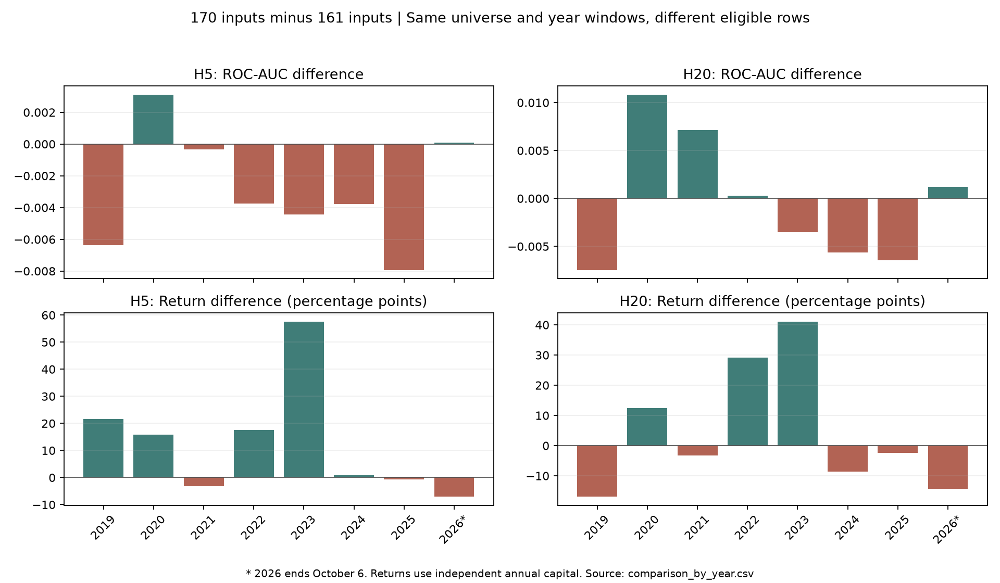

# 가격·거래량 161개 → 수급 포함 170개 결과 비교 — 2019~2026

작성일: 2026-10-14. H5·H20 기본/수급 모델의 저장 결과를 사후 비교했다. 구성·증거 정리 형식은 [PR #325](https://github.com/2026Graduation-Work/take_a_look/pull/325)를 참고했다.

## 결론

같은 KOSPI 종목 목록과 같은 평가 연도로 실행된 결과가 양쪽 모두 남아 있다. 따라서 기존 실험 결과의 비교는 가능하다. 다만 수급 입력 완전 관측 조건 때문에 실제 학습·평가 행의 집합은 다르다. 이 보고서는 기존 설정에서 기본 모델과 수급 포함 모델의 성과 차이를 정리하며, 수급 9개만의 순수 추가 효과를 검증한 통제 실험으로 부르지 않는다.

H5는 예측 지표가 소폭 낮아졌으나 백테스트 평균 수익률·Sharpe·최대낙폭은 개선됐다. H20은 pooled AUC·PR-AUC·균형 정확도가 소폭 높지만, 연도별 평균 AUC·IC와 평균 Sharpe는 낮아졌다. 수급의 전반적인 예측력 개선을 주장하기 어렵다. 백테스트 수익률의 평균 개선에는 2023년의 큰 손실 차이가 기여했으며 매년 수급 모델이 우세하지는 않았다.

## 비교 조건

| 항목 | 확인 내용 |
| --- | --- |
| 기본 | Change + Alpha158 + 배리어 2개, 총 161개 |
| 수급 | 기본 161개 + 개인·기관·외국인의 1·5·20일 수급 9개, 총 170개 |
| 원본 dataset | `local_2016_kospi_v1`, 같은 KOSPI 1,019개 종목 파일 목록, 상장폐지 포함 수집 설정 |
| 전체 입력 기간 | 2016-01-01~2026-10-06 |
| 분할 | 직전 3년 학습 → 다음 1년 평가, embargo 7일, 연도별 OOS 2019~2026 |
| 학습 | LightGBM, 시드 42, trees 1,000, learning rate 0.01, depth 5, leaves 20, min child samples 2,000, balanced class weight |
| 평가 horizon | H5·H20별 라벨·배리어 설정은 기본/수급 동일 |
| 거래 규칙 | 점수 0.65 이상 중 일별 상위 5개 후보, 다음 거래일 시가 진입, 매수·매도 각각 비용 0.105% |
| 자금 | 매년 1,000만 원으로 초기화, 연말 종가 평가 |

상위 5개는 일별 후보 제한이며 동시 보유 5종목 상한이 아니다. 기본/수급의 모델 파라미터·라벨·거래 규칙·평가 설정은 run manifest에서 일치했다. 모델은 각 연도 이전 자료로 별도로 학습한 것이며 현재 운영 pack 자체의 과거 성적이 아니다. KOSPI 전체의 역사적 구성원 이동을 완전히 복원한 point-in-time 유니버스라는 의미도 아니다.

## 수급 9개와 데이터 원천

개인·기관·외국인 각각에 대해 1·5·20 시장 거래일 창의 **순매수 거래대금 합 / 전체 거래대금 합**을 계산한다. 순매수 거래대금은 매수 거래대금에서 매도 거래대금을 뺀 값이다. 양수는 순매수, 음수는 순매도를 의미하며 이후 가격 상승을 보장하지 않는다. 창 전체 관측이 필요하고 거래대금 분모가 양수가 아니면 결측이다. 공식은 아카이브의 `shared/features/flow.py`에 있다.

조사한 수집 코드 `experiments/dataset/pipeline.py`와 `shared/data/providers.py`는 KRX 가격·거래대금과 투자자별 매수/매도 자료를 사용하며 FinanceDataReader·pykrx 어댑터를 포함한다. 이는 코드의 데이터 취득 경로 설명이다. 종목별 실제 공급자·수집 상태는 원본 collection report 및 raw 입력 manifest로 추적해야 하며, 모든 파일이 한 어댑터로 수집됐다고 단정하지 않는다. 수정 OHLC 정책은 `krx_raw_ohlc_uniform_close_ratio_v1`이다. 원거래대금을 사용한 수급 비율과 수정가격을 혼동하지 않는다.

## 같은 유니버스인데 행 수가 다른 이유

한 행은 종목 하나의 거래일 하나다. 같은 종목 목록·같은 연도 범위여도 수급 입력이 없는 종목·날짜는 수급 모델의 적격 표본에서 제외된다. 공용 피처 구성 경로는 기본 조건(거래정지 아님, Sigma 존재, 초기 관측 확보)에 더해 선택한 수급 9개가 모두 관측된 행만 적격으로 표시한다. 초기 이동 창의 부족과 원천 수급 누락이 함께 영향을 줄 수 있다.

전체 입력 저장 구간의 기본 적격 행은 2,269,713개, 수급 적격 행은 1,804,277개이며 수급 조건으로 제외된 행은 465,436개다. 이는 학습·평가 전체 입력의 수이며 아래 OOS 평가 건수와 구분한다. 종목별 근거는 [적격 표본표](sample_eligibility_by_stock.csv), 원본 조건·해시는 소스 아카이브의 두 feature manifest에 있다. 가격 수집은 완료됐고 수급 조회도 완료됐으나 dataset manifest의 `flows_complete=false`다. 조회 완료가 모든 종목·날짜 값의 완전 관측을 뜻하지 않는다.

## 전체 평가 행을 합친 예측 지표

아래는 저장된 `ml_metrics_summary.json`의 pooled 지표다. 연도별 지표 평균과 다르며, 표본 구성과 연도 간 점수 분포의 영향도 받는다. ↑는 높을수록, ↓는 낮을수록 좋다.

| 지표 | H5 기본 | H5 수급 | H20 기본 | H20 수급 |
| --- | ---: | ---: | ---: | ---: |
| 평가 행 수 | 1,665,087 | 1,432,677 | 1,650,975 | 1,420,408 |
| ROC-AUC ↑ | 0.589996 | 0.587529 | 0.569152 | 0.570240 |
| PR-AUC ↑ | 0.474326 | 0.473372 | 0.446090 | 0.449908 |
| 균형 정확도 ↑ | 0.508195 | 0.507629 | 0.504588 | 0.506033 |
| Brier 오차 ↓ | 0.238659 | 0.239322 | 0.240778 | 0.241129 |
| Rank IC ↑ | 0.072232 | 0.067802 | 0.042239 | 0.041393 |

출처: [pooled 지표](pooled_metrics.json)와 [원본 결과](originals/). 상승 라벨 `Y_Label=2`를 양성으로 평가한다. PR-AUC는 공용 평가함수의 사다리꼴 적분이다. Rank IC는 점수와 0/1/2 라벨의 일별 순위 상관이다. 이전 대화의 “이후 수익률과의 상관” 표현을 이 보고서에서 정정한다.

## 연도별 지표의 단순평균

2019~2025 완결 연도와 2026년 일부 구간을 포함한 결과를 구분한다. 수익률은 각 독립 평가 기간의 단순평균이며 연속 운용의 누적 수익률·CAGR이 아니다. Sharpe는 무위험수익률 0 기준이며 MDD는 음수로 기록돼 0에 가까울수록 낙폭이 작다.

| 구간 | horizon | AUC 기본 → 수급 | 수익률 기본 → 수급 | Sharpe 기본 → 수급 | MDD 기본 → 수급 |
| --- | --- | ---: | ---: | ---: | ---: |
| 2019~2025 | H5 | 0.587998 → 0.584636 | -2.61% → 13.02% | 0.2563 → 0.7087 | -12.87% → -6.63% |
| 2019~2025 | H20 | 0.567031 → 0.566348 | -3.37% → 3.96% | 0.1892 → 0.1093 | -17.78% → -8.84% |
| 2019~2026(일부) | H5 | 0.591780 → 0.588849 | -1.03% → 11.76% | 0.4000 → 0.6683 | -11.63% → -7.01% |
| 2019~2026(일부) | H20 | 0.572043 → 0.571595 | -0.21% → 4.41% | 0.4021 → 0.2137 | -16.54% → -8.66% |

출처: [평균 집계](comparison_mean.csv).H20의 pooled AUC는 증가하지만 연도별 평균 AUC는 감소한다. 집계 방식을 바꾸면 결론의 방향도 달라지므로 두 수치를 섞지 않는다.

## 연도별 결과 전체

수익률은 비용을 포함한 저장 백테스트 결과다. 2026년은 10월 6일까지의 구간 수익률이다.

| horizon | 연도 | AUC 기본 | AUC 수급 | 수익률 기본 | 수익률 수급 | 수익률 차이(%p) |
| --- | ---: | ---: | ---: | ---: | ---: | ---: |
| H5 | 2019 | 0.597229 | 0.590845 | 6.47% | 28.02% | +21.55 |
| H5 | 2020 | 0.578521 | 0.581622 | 20.18% | 35.99% | +15.81 |
| H5 | 2021 | 0.595228 | 0.594878 | 8.25% | 5.05% | -3.20 |
| H5 | 2022 | 0.576773 | 0.573020 | -5.77% | 11.74% | +17.52 |
| H5 | 2023 | 0.575219 | 0.570786 | -53.10% | 4.44% | +57.54 |
| H5 | 2024 | 0.602992 | 0.599206 | 6.69% | 7.60% | +0.91 |
| H5 | 2025 | 0.590021 | 0.582094 | -0.97% | -1.67% | -0.70 |
| H5 | 2026 | 0.618258 | 0.618338 | 10.01% | 2.89% | -7.13 |
| H20 | 2019 | 0.573364 | 0.565907 | 25.55% | 8.59% | -16.96 |
| H20 | 2020 | 0.570402 | 0.581213 | 0.57% | 12.97% | +12.40 |
| H20 | 2021 | 0.586564 | 0.593703 | -6.49% | -9.82% | -3.33 |
| H20 | 2022 | 0.552821 | 0.553108 | -10.92% | 18.17% | +29.08 |
| H20 | 2023 | 0.554321 | 0.550796 | -50.68% | -9.64% | +41.04 |
| H20 | 2024 | 0.566035 | 0.560426 | 17.80% | 9.24% | -8.56 |
| H20 | 2025 | 0.565708 | 0.559284 | 0.59% | -1.81% | -2.40 |
| H20 | 2026 | 0.607132 | 0.608324 | 21.92% | 7.56% | -14.36 |

출처: [32개 연도·모델 결과](comparison_by_year.csv).원본 fold 지표와 연도별 백테스트 표에서 직접 읽었다. 원본의 최종자산도 함께 보존해 `최종자산 = 1,000만 원 × (1 + 수익률)`을 대조했다.



## 2023년이 평균에 미친 영향

H5의 2019~2025 평균 수익률 차이는 +15.63%p다. 2023년 차이 +57.54%p가 평균 차이에 +8.22%p를 기여했다. 2023년을 제외한 나머지 6년의 평균 차이는 +8.65%p다.

H20의 2019~2025 평균 수익률 차이는 +7.32%p다. 2023년 차이 +41.04%p가 평균 차이에 +5.86%p를 기여했다. 2023년을 제외한 나머지 6년의 평균 차이는 +1.71%p다.

이 제외 집계는 평균이 한 해에 얼마나 민감한지 설명하는 보조 분석이며, 2023년을 제거한 결과를 새 주결과로 선택하지 않는다. 2023년 손실의 종목별 원인이나 수급 결측 종목 제거의 기여를 이 보고서에서 분리·정산하지 않았다. AUC는 전체 표본의 순위를 평가하고 거래 성과는 임계·후보 순위·보유·현금 경로에 따라 일부 거래만 반영하므로 두 결과는 다를 수 있다.

## 해석 한계와 다음 검증

- 동일 유니버스·연도·설정 비교지만 실제 적격 학습·평가 표본은 다르다. 수급 입력 추가와 표본 선택 효과가 섞여 있다. 공통 종목·날짜로 예측 결과를 재평가하면 평가 표본 차이를 줄일 수 있고, 학습 표본까지 맞춰야 추가 효과를 더 엄밀히 분리할 수 있다.
- 수급 피처 결합 코드에서는 AvailableDate를 제거하고 Date로 결합한다. 가격·수급 정보가 당시 실제로 이용 가능했던 시점과 거래 가능성을 완전히 검증한 결과로 부르지 않는다. 가격 정책도 point-in-time archive가 아닌 수정가격 스냅샷이다.
- 신규 재학습, 예측 지표 재계산, 통계적 유의성 검정, 모델 중요도·공통 거래 손익 분해는 이번 범위에 포함하지 않았다. 저장 지표의 전사·집계·출처 검증이다.
- 이미 분석한 과거 평가 기간이며 손대지 않은 최종 holdout이라고 주장하지 않는다. 이번 결과로 임계값을 바꾸거나 운영 모델의 채택 타당성을 확정하지 않는다.
- 신호는 소프트 틸트이며 사용자 하드 제약을 바꾸지 않는다. 연구 백테스트는 자동 매매 또는 매매 지시 기능이 아니다.

## 원본 출처와 검증

[provenance.json](provenance.json)에 네 run ID·dataset·종목 목록·설정 일치 검사·검증 범위를 기록했다. [originals/](originals/)에 네 run의 JSON·CSV를 바이트 그대로 복사했다. pooled 예측 지표, 연도별 fold 지표, 표본 정렬, 주문·거래·일별 수익률·자산 곡선·백테스트 결과를 함께 보존했다.

[output_artifact_hashes.csv](output_artifact_hashes.csv)는 원본 run 산출물 52개의 전체 SHA-256·크기·게시 포함 여부를 기록한다. 큰 `oos_history.parquet`는 로컬 원본에 남아 있고 Git에 넣지 않았다. 이 목록은 결과 산출물 검증이며 대용량 학습 입력을 다시 해시했다는 뜻이 아니다.

[source_manifest.json](source_manifest.json)에 연결된 [소스·입력 manifest 아카이브](source-and-input-manifests.tar.gz)는 현재 조사에 사용한 코드·설정과 dataset/processed/feature 입력 manifest의 정확한 바이트를 보존한다. 원본 공급자·가격 정책은 dataset 수집 코드·collection report, 입력별 해시는 manifest에서 확인할 수 있다. 당시 경로의 `data/datasets/`는 현재 `workspace/experiments/datasets/`로 이동돼 run manifest의 경로가 현재 파일 위치와 다르다.

**학습 당시 코드와 현재 코드의 전체 일치는 검증하지 못했다.** 원본 작업 폴더에는 미커밋 변경이 있으며 run manifest에는 전체 실행 소스 fingerprint가 없다. 이 아카이브는 조사 시점 코드 스냅샷이다. PR #325의 suite ID 일치 검증과 같은 수준의 역사적 실행 소스 확정으로 해석하면 안 된다. 전체 재학습에는 로컬에 남아 있는 raw·processed·피처·모델·예측 Parquet와 당시 실행 코드의 추가 확인이 필요하다. 출처 기록은 재실행 성공 보장이 아니다.

검증 명령:

```bash
python3 docs/research/flow-161-vs-170-2019-2026/verify_evidence.py
```

검증 스크립트는 보존한 원본·아카이브 해시, 연도별 수치 32행, 평균 8행, pooled 요약 4개, 표본 집계와 자산 정산을 확인한다. 모델 자체를 평가하는 공용 평가함수를 대체하지 않는다. 그림은 `plot_results.py`로 CSV에서 재생성한다.
