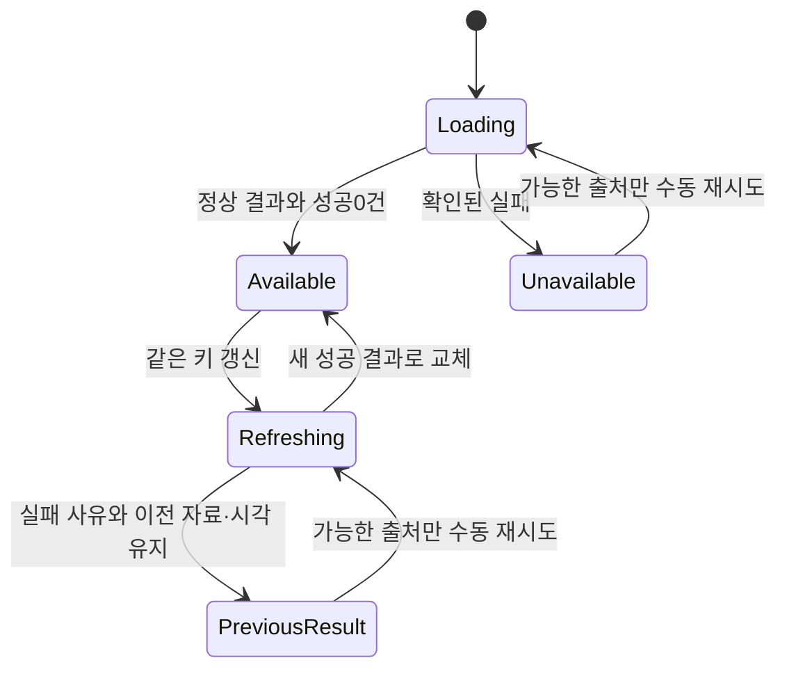

# 이슈492 자료 상태와 오류 처리

목표는 가격 변동일의 자료가 없을 때와 조회에 실패했을 때를 구분하고, 사용자가 가능한 복구 행동을 알게 하는 것이다. 정상 가격 차트와 다른 출처의 자료는 계속 표시한다. 상태는 확인한 사실만 표현하며 수집 여부·오프라인 원인·복구 예정 시간을 추측하지 않는다.

## 범위와 선택 기준

기존 공개 payload와 DB 계약, 판정 임계값, 보존 설정은 바꾸지 않는다. 클라이언트의 판정 적합성, 출처별 조회 결과, 진행 상태, 문구와 재시도를 다룬다. 전체 차트의 최초 로딩·조회 실패는 기존 상위 화면과 재시도에 맡긴다. 새 공급자 호출과 자동 재시도, 일반 오류 관리 프레임워크는 추가하지 않는다.

기존 도메인 타입을 확장하는 안과 표시 문구를 순수 함수로 모으는 안을 독립 설계했다. A의 사유 보존·경계 검증을 기본으로 하고 B의 평평한 `available.items` 유지와 작은 순수 문구 함수를 결합한다. 중첩 `data`와 비어 있지 않은 tuple 변환, 범용 표시 계층은 추가하지 않는다. 독립 검토자도 이 결합에 동의했다. 두 안의 401/403 반복 조회·429·이전 빈 결과 표현은 아래 요구에 맞게 정리한다.

## 확정한 모듈과 상태 전이

| 모듈 | 한 곳에서 소유하는 판단 |
|---|---|
| `chart-public.ts` | 선택 기준의 생략·불량·가격 구간 부족·기간별 불일치를 내부 판별 결과로 보존. 기존 wire JSON과 일반 가격은 유지 |
| `price-events.ts` | 유효한 기준의 순수 판정. 비교 0쌍과 후보 0개 구분. 기존 계산 시그니처·임계값 유지 |
| `providers/price-event-context.ts` | 응답 상태와 행 검증을 고정 사유로 변환. 성공의 `items/fetchedAt/coverage/truncated` 유지. 빈 코스피의 행 없음과 값 미제공만 작은 사유로 보존 |
| `use-price-events.ts` | 요청 대기·실행·명시적 시간 초과·취소·이전 성공 자료 보존·시도 순서. 갱신 실패에 실제 사유를 담는 판별 union 사용 |
| `price-event-messages.ts` | 이번 기능의 문구와 재시도 가능 여부를 작은 순수 함수에서 함께 결정. 데이터와 선택 상태를 다시 소유하지 않음 |
| `price-event-panel.tsx` | 기존 영역에 자료·문구·시각·복구 동작 배치. 지속적인 출처별 상태 알림과 키보드 초점 유지 |

조회 실패 사유는 `query_failed/no_response/server_error/rate_limited/access_denied/timeout/invalid_response`다. 연결 미설정과 뉴스 정책 비활성은 기존 미제공 사유다. 갱신은 `{status: "idle"}`, `{status: "loading"}`, `{status: "failed", reason}`으로 표현해 실패 사유가 사라지지 않게 한다.



대기열 등록 시부터 진행 중 상태로 바꿔 중복 행동을 막는다. `timeout`은 로컬 제한 시간이 먼저 확정한 경우이고 `dispose`는 상태를 발표하지 않는다. 새 성공은 0건이어도 이전 결과를 교체한다. 401/403·연결 미설정·뉴스 정책 비활성은 버튼과 같은 세션의 정기 재요청을 중단한다. 새 세션에서는 다시 확인할 수 있다. 429는 복구 시간을 보장하지 않으며 새 자동 재시도를 만들지 않고 기존 수동 재시도를 허용한다.

접근 거절에 같은 조건의 요청을 반복하지 않는 이유는 사용자가 그 자리에서 권한을 바꿀 수 있다는 근거가 없기 때문이다. 이 기능의 세션은 종목·차트 묶음·기준일·조회 구간으로 묶는다. 이후 사용자별 권한 변경을 반영해야 한다면 권한 변경 이벤트와 새 세션의 관계를 다시 검토한다. 429는 요청 제한을 관측한 경우라 수동 재확인과 기존 화면 갱신을 유지하며 새로운 대기 시간이나 자동 복구 루프를 만들지 않는다.

코스피 날짜 행·quote가 중복되거나 목록/숫자의 형식이 틀리면 불량이다. 검증 가능한 배열에 코스피가 없거나 유일한 코스피 값이 생략·null인 경우는 미제공이다. 식별할 수 없는 항목 때문에 부재를 확인할 수 없다면 빈 결과로 단정하지 않는다. 정상적인 다른 날짜·실제0%는 유지한다.

## 상태를 나누는 기준

- 가격 판정 가능 여부와 공시·코스피 조회 성공 여부를 분리한다.
- 성공 0건은 조회 결과다. 해당 사건이 실제로 없었다거나 완전 수집됐다는 증거가 아니다.
- 이전 성공 결과의 데이터와 확인 시각은 갱신 진행·실패 중에도 보존한다. 확인 시각은 자료의 발행 시각과 다르다.
- 시간 초과는 이 화면의 제한 시간에 도달한 사실이다. 종목 변경·화면 종료로 요청을 취소한 것은 사용자에게 오류로 알리지 않는다.
- 접근 거절은 로그인으로 해결된다고 가정하지 않는다. 확인 불가한 원문 오류·URL·키는 화면에 내보내지 않는다.
- 재시도는 복구 가능한 출처만 다시 읽는다. 판정 기준 미제공에는 새 차트 재조회 버튼을 만들지 않고 기존 차트 갱신을 사용한다.

## 케이스와 관찰 가능한 결과

아래 표는 요구 동작이다. 실제 구현·검증 결과는 마지막 절에서 별도로 기록한다.

| ID | 확인한 상황 | 화면과 동작 |
|---|---|---|
| E00 | 전체 차트 최초 로딩·조회 실패 | 기존 상위 화면의 로딩·오류·재시도 유지 |
| E01 | 가격은 있으나 판정 기준 생략 | 기준 자료 미제공 안내. 가격은 유지하고 점·공시/코스피 추가 조회 없음 |
| E02 | 판정 기준 형식·기준일·출처 식별값 불일치 | 기준 자료를 확인할 수 없다는 안내. 가격은 유지 |
| E03 | 가격 기록 부족·날짜 연결 이상·모델 기간 간 가격/기준 불일치 | 확인 가능한 사유만 안내하고 판정·추가 조회 제외 |
| E04 | 거래량·직전 가격 조건을 충족한 비교 쌍 없음 | 비교할 자료가 부족하다는 안내. 기준 초과 0건으로 표현하지 않음 |
| E05 | 비교 성공, 기준 초과 후보 0개 | 기준을 넘은 날이 없다는 정상 결과와 계산 근거 |
| E06 | 출처 최초 조회 중 | 해당 출처에 로딩 안내. 차트와 다른 출처는 사용 가능 |
| E07 | 공시 조회 성공 0건 | 조회된 공시가 없다는 안내와 수집 범위 미확인 표시 |
| E08 | 요청 날짜의 코스피 행 없음 | 그 날짜에 조회된 코스피 자료가 없다는 안내. 0% 대체 금지 |
| E09 | 정상 날짜 자료의 코스피 값 생략·미제공 | 값 미제공과 불량 형식을 구분. 실제 미수집 원인은 추정하지 않음 |
| E10 | 실제 코스피 등락률 0 | 숫자 0.00% 유지 |
| E11 | 공시 일부 행의 종목·날짜·필수 값 불량 | 검증된 행만 표시하고 일부 제외 안내 |
| E12 | 응답 전체 불량·중복 코스피 날짜/값·잘못된 숫자 | 자료를 확인하지 못했다는 안내. 성공 0건으로 표현하지 않음 |
| E13 | 조회 상한 도달 | 추가 자료가 있는지 확인하지 못했다는 안내. 반드시 더 있다고 단정하지 않음 |
| E14 | 연결 실패·원인 미확인 조회 오류 | 고정된 쉬운 안내와 해당 출처 재시도. 오프라인·DNS·수집 실패로 단정하지 않음 |
| E15 | 명시적인 10초 제한 도달 | 오래 걸려 중단했다는 안내와 해당 출처 재시도 |
| E16 | 조회 서비스 5xx | 일시 조회 실패 안내와 해당 출처 재시도 |
| E17 | HTTP429 조회 제한 | 요청 제한 안내와 수동 재시도. 별도 자동 재시도·복구 시간 확정은 없고 기존 화면 갱신은 유지 |
| E18 | HTTP401/403·명시적인 조회 접근 거절 | 이용 불가 안내. 로그인 유도나 반복 재시도 없음 |
| E19 | 공개 조회 연결 미설정 | 지금 자료를 제공할 수 없다는 안내. 기술 설정값·반복 재시도 노출 없음 |
| E20 | 뉴스 사용이 활성화되지 않음 | 뉴스 미제공 안내. 네트워크 요청과 재시도 없음 |
| E21 | 이전 성공 자료를 갱신 중 | 이전 결과와 마지막 확인 시각, 갱신 중 안내 |
| E22 | 이전 성공 자료가 있는 상태의 갱신 실패 | 이전 자료·확인 시각 보존, 실패 사유 안내와 가능한 재시도 |
| E23 | 이전 성공 0건 뒤 갱신 실패 | 이전 조회가 0건이었다는 표현. 현재도 없다고 확정하지 않음 |
| E24 | 재시도 성공, 새 결과 0건 | 이전 자료를 정상 빈 결과로 교체하고 실패 안내 해제 |
| E25 | 같은 키의 이전 요청이 늦게 도착 | 새 시도 결과를 덮지 않음 |
| E26 | 종목·배치 변경 뒤 이전 응답 도착 | 현재 종목·날짜에 옛 자료를 표시하지 않음 |
| E27 | 화면 종료·종목 변경으로 요청 취소 | 뒤늦은 상태 갱신·오류 안내·재시도 없음 |

## 수치와 영향 범위

판정 2배·60거래일·최대3일, 최초 추가 조회 최대4회, 동시4개·10초 제한, 공시 최대50행·처음3개, 기존5분 갱신은 유지한다. 새 수치 정책을 만들지 않는다. 값과 근거는 [이슈492 결정 기록](https://github.com/2026Graduation-Work/take_a_look/issues/492)에 연결한다.

기존 `not_configured`와 `usage_not_approved`는 사용자의 로그인 여부를 뜻하지 않는다. 브라우저가 받은 상태만으로 실제 수집 완료나 게시 복구 시간을 알 수 없다. SDK가 응답을 정규화해 원래 상태를 보존하지 않은 경우에도 추측으로 복원하지 않는다.

설치된 SDK를 모의 전송으로 확인한 결과, 비JSON 200은 `status:200`과 오류를 반환하고 전송 실패는 `status:0`이다. 401·403·429·503과 구조화된 권한 코드 `42501`은 분류에 사용할 수 있다. 특수한 404+배열을 SDK가 200+빈 배열로 바꾸는 경우 원래 상태는 이 기능의 loader에 전달되지 않는다. 이를 검출했다고 주장하거나 SDK 전체를 교체하지 않는다. 화면의 0건은 현재 조회 결과의 범위로만 설명한다.

| 검토한 방식 | 채택과 이유 |
|---|---|
| 기존 결과 타입을 확장해 원인을 보존 | 채택. 파서와 hook에서 이미 지워진 사유를 화면에서 추측할 수 없기 때문 |
| 평평한 항목 배열과 작은 순수 문구·복구 함수 | 채택. 기존 목록 소비를 유지하고 최초 실패·갱신 실패의 버튼 정책을 같은 곳에서 확인 |
| 중첩 빈 자료 타입·비어 있지 않은 tuple 변환 | 제외. 이번 동작에 필요하지 않은 배열 변환과 호출부 변경이 늘어남 |
| 범용 오류 프레임워크·새 수집 이력 테이블·SDK 교체 | 제외. 현재 화면 범위를 넘고 공개 계약·운영 적용이 필요하며 이번 상태 구분을 위해 필요하지 않음 |

두 후보의 독립 평가와 SDK 모의 검토는 설계 근거이며 실제 사용자 효과의 검증은 아니다. 최종 브라우저 검증은 합성 구현을 대상으로 따로 실행한다.

## 작업 순서와 소유권

먼저 독립 설계 두 안을 작성·비교하고 상태·문구·복구 규칙을 확정한다. 설계 산출물은 별도 임시 폴더에 쓴다. 구현은 loader·hook·parser·UI·연관 테스트를 한 소유자가 맡아 호출부를 함께 옮긴다. 부모는 이 문서와 감사 기록, 실제 검증을 맡는다. 같은 소스 파일을 여러 작업자가 동시에 수정하지 않는다.

## 검증 결과

2026-11-26에 `81f77fe` 다음 변경을 실제 작업 트리에서 검증했다. 새 판별 결과는 프론트 내부 타입이며 서버의 JSON·DB·정기 실행·판정 숫자는 바꾸지 않았다.

| 검사 | 실제 명령·조건 | 결과 |
|---|---|---|
| 웹 단위 | frontend에서 `pnpm test:unit` | 203 passed, 0 failed |
| 타입 | `pnpm exec tsc --noEmit --incremental false` | 종료0 |
| lint | 변경한 TS·TSX 12파일에 `pnpm exec eslint` | 출력 없이 종료0 |
| 기본 production build | 아래 모의 DB 환경에서 `pnpm build` | Next16.4.5 Turbopack·TypeScript·23개 정적 페이지 생성 통과 |
| production Chromium | 아래 명령, 가격 변동20개와 기존 차트15개 | 35 passed, 재시도0 |
| diff 공백 | `git diff --check` | 통과 |
| 가상 자료 화면 | 성공0건·최초실패·이전0건갱신실패·기준생략·기준불량 각각1280px·390px | 캡처10개. 다섯 상태의 대표 화면을 직접 확인 |

pnpm10.33.0과 기존 lockfile의 의존성을 사용했다. 빌드는 `NEXT_PUBLIC_SUPABASE_URL=http://127.0.0.1:54321`, `NEXT_PUBLIC_SUPABASE_ANON_KEY=e2e-anon-key`, `NEXT_PUBLIC_CHART_LOCAL_PREVIEW=0`, `NEXT_TELEMETRY_DISABLED=1`로 실행했다. 처음의 Turbopack 실행은 CSS 작업의 포트 바인딩 EPERM으로 실패했다. Webpack production build는 통과했다. 이후 기존 `.next` 생성물을 임시 폴더로 분리한 새 기본 빌드와, 독립 검토 수정 뒤 기본 빌드가 모두 통과했다. 원래 실패를 통과로 세지 않았으며 프로젝트 빌드 설정과 의존성을 바꾸지 않았다.

lint의 실제 대상은 다음과 같다.

```sh
pnpm exec eslint app/components/price-event-panel.tsx lib/chart-public.ts lib/chart-public.test.ts lib/copy-rules.ts lib/copy-rules.test.ts lib/price-events.ts lib/providers/price-event-context.ts lib/providers/price-event-context.test.ts lib/use-price-events.ts lib/price-event-messages.ts lib/price-event-messages.test.ts tests/e2e/price-events.spec.ts
```

```sh
CI=1 NEXT_TELEMETRY_DISABLED=1 PLAYWRIGHT_BROWSERS_PATH=/private/tmp/market-tip-playwright PRICE_EVENT_EVIDENCE_DIR=/private/tmp/issue492-errors-evidence pnpm test:e2e tests/e2e/price-events.spec.ts tests/e2e/chart-preview.spec.ts --project=chromium --retries=0
```

`CI=1`의 기존 Playwright 설정은 `pnpm start --port 3101`을 실행한다. 모의 DB와 production 서버는 Playwright가 시작·종료했다. 운영 환경을 대상으로 한 E2E는 아니다.

| 요구 케이스 | 확인한 경로 |
|---|---|
| E00~E05 | 기존 차트 초기 조회·실패·복구, 기준생략·불량·기간불일치·가격59행·비교0쌍·후보0개를 Chromium과 단위로 검증 |
| E06~E18 | 성공0건·정상0%·날짜행/값미제공·일부/전부불량·상한·401/403/42501·429·503·연결차단·2xx비JSON·10초를 provider 단위와 Chromium으로 확인 |
| E19 | 공개 연결 환경변수를 비운 실제 두 loader의 단위 검사. 전체 차트도 같은 연결을 쓰므로 별도 비현실적 화면 경로를 만들지 않음 |
| E20 | 뉴스 미제공 문구는 Chromium, 이 변동일 패널의 추가 뉴스 조회 없음은 hook의 비활성 상수 경로에서 확인 |
| E21~E27 | 이전 자료와 시각 유지·이전0건 과거형·정상0건으로 교체·같은키/종목/batch 응답 역전·대상 요청 취소를 Chromium으로 검증 |

단위 검사는 비유한 숫자·중복·식별 불가 quote 같은 JSON 경계도 포함한다. 브라우저에서는 실제 SDK를 거치는 응답을 가로채고 화면 문구·숫자·버튼·출처별 요청 수를 확인했다. 키보드 재시도 후 초점과 지속적인 상태 알림, 44px 버튼, 320px·390px 가로 넘침도 검사했다.

## 독립 검토와 남은 조건

주석 검토에서 새 주석·린트/TS 억제는 없었다. 미사용 테스트 반환값을 지웠고 확인 시각을 assertion으로 좁혔다. 취소 E2E는 종목과 날짜 구간을 지정해 지연시킨 바로 그 요청의 취소를 관찰하도록 고쳤다.

코드 검토자가 코스피 null/생략과 식별 불가 항목이 함께 있을 때 부재를 확정하는 결함을 재현했다. 이 조합은 불량으로 처리하고 실제0%는 보존하는 회귀를 추가했다. 공시 상한·일부 제외가 겹칠 때도 추가 자료 여부 미확인이라는 의미를 보존했다. 두 수정 뒤 단위·타입·lint·기본 production build·Chromium35개를 확인했다.

이 채팅의 검증 폴더에 `issue492-errors-final-build.log`, `issue492-errors-final-e2e.log`, `issue492-errors-{unit,tsc,lint}-final.log`, 실패와 새 빌드를 구분한 로그, `issue492-errors-{상태}-{1280 또는390}.png`를 남겼다. 설계 후보와 독립 비교도 같은 폴더에 보관한다.

이번에는 프론트 상태 처리만 구현했다. 운영 배포·운영 DB 쓰기·공급자 수집·120일 전환은 실행하지 않았다. 이전 운영 점검에서 확인한 `event_basis` 미제공은 새 배치 생성·게시가 필요하며 오류 문구가 이를 생성하지 않는다. 뉴스 제공 권한과 신규 기준 실데이터 대조 등 기존 운영 조건도 남아 있다.
