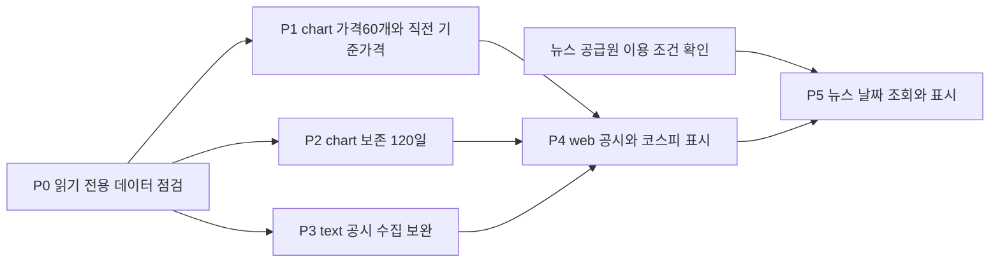
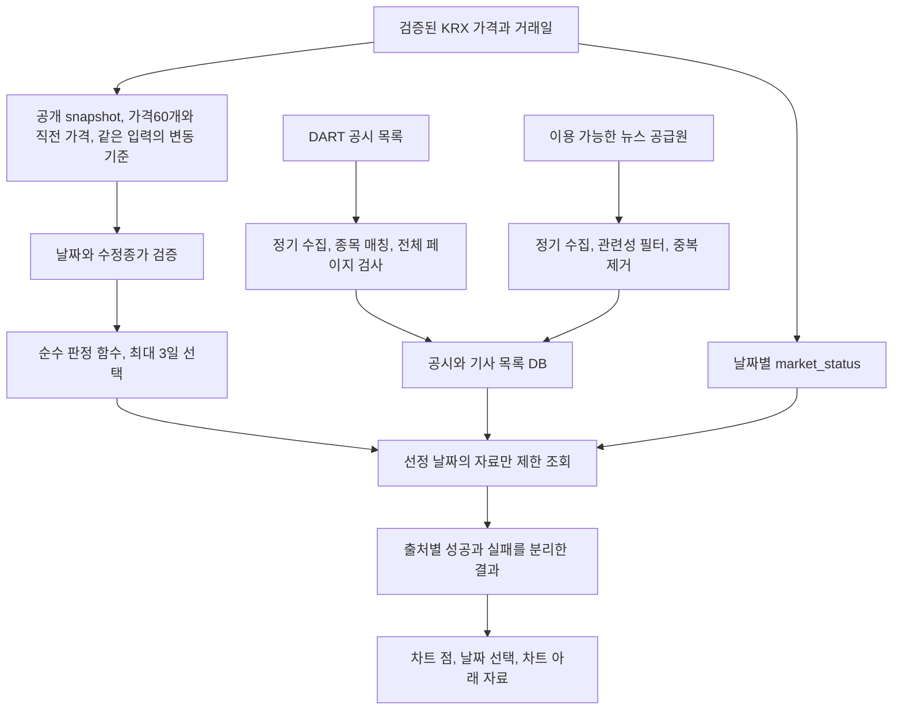

# 이슈 492 가격 변동일과 공시 뉴스 연결 구현 계획

목표는 종목 상세에서 평소보다 크게 움직인 날을 고르고, 같은 날 코스피와 날짜가 가까운 공시, 그날 뉴스를 차트 아래에서 확인하게 하는 것이다. 자료를 가격 변동의 원인으로 단정하거나 매매를 지시하지 않는다.

사용자 결정에 따라 공시와 기사 목록의 보존 목표는 120일이다. 운영 기본값은 90일을 유지하고, 로컬 구현에 `--article-days 120`과 GET 전용 dry-run을 추가했다. 실제 운영 DB의 날짜 범위와 건수는 읽기 전용으로 점검했다. 실제 용량은 공개 조회가 401로 거부되어 미확인이며 운영 전환 조건은 남아 있다. 최종 명령·결과·예비 비교의 한계는 [구현 점검 기록](issue-492-verification.md)을 본다.

## 작업 순서와 의존 관계

P0~P5는 계획상의 작업 이름이며 실제 PR 번호가 아니다. 기존의 개인 작업과 섞지 않고 각 작업에 해당하는 파일만 다룬다.



- P1~P3은 P0 이후 독립적으로 최신 main에서 분기할 수 있다. P1과 P2는 같은 chart 블록이므로 파일 충돌을 확인하고 순서대로 머지한다.
- P4의 계산·화면 개발은 고정 예시로 먼저 준비할 수 있지만, 운영 제공에는 P0~P3의 확인 결과가 필요하다.
- P5의 이용 조건이 충족되지 않아도 P4는 독립적으로 완료할 수 있다. 뉴스 전체를 이번에 제공했다고 보고하지 않는다.
- 화면을 바꾸는 P4·P5는 사용자 미리보기 검토 후 머지한다. 운영 보존·수집 동작 전환은 담당자 확인 후 진행한다.

## 1 현재 저장 구조와 보존 기간

| 자료 | 저장 내용 | 현재 제한 |
|---|---|---|
| `disclosures` | 종목, 제목, 유형, 제출일, 접수번호 | 본문·정확한 발표 시각 없음. DB 등록 종목만 매칭 |
| `news_articles` | 종목, 트랙, 제목, 언론사, URL, 발행 날짜·시각, 감성 결과 | 본문 없음. 대상 종목·검색 페이지·호출 예산에 제한 |
| `market_status` | 날짜별 지수 종가와 등락률을 담은 `index_quotes` | 필요한 날짜의 실제 적재 여부 점검 필요 |
| 공개 차트 snapshot | 수정종가, 거래량, 실제 거래 날짜 | 현재 최근 60개 가격. 일간 등락 60개에는 직전 종가가 하나 더 필요 |
| `stocks` | `volatility_annual`, `risk_as_of` | 기존 위험 표시 자료. 이번 판정은 P1에서 같은 snapshot에 묶은 기준을 사용 |

현재 정리는 `today - 90일`보다 발행일·제출일이 오래된 행을 삭제한다. 수집한 날부터 세는 것이 아니며 경계 날짜 자체는 남긴다. 정리 작업이 실패하면 더 오래된 행이 남을 수 있다. 수동 `reset-live` 등 다른 삭제 경로가 실행되면 90일 이내 기사도 없어질 수 있으므로, 모든 행을 최소 90일 보장한다는 뜻은 아니다.

120일도 같은 의미로 적용하되 날짜는 `Asia/Seoul` 기준으로 통일한다. 2026-11-25 실행의 삭제 대상은 2026-07-28보다 오래된 행이며, 07-28은 남긴다. 이는 날짜 라벨로 D-120부터 D까지 최대121개 날짜를 포함하는 규칙이다. 정확히120개 날짜를 남기려고 경계를 하루 당기지 않는다. 테스트에는 기준 날짜를 명시적으로 주입한다.

최근 60거래일에 주말·휴장일, 첫날의 직전 거래일, 공시 확인 구간을 더하면 90일을 넘을 수 있다. 120일은 여유를 두는 운영 목표다. 수집 누락이나 오래된 차트까지 완전하게 덮는 보장은 아니다. 이미 삭제된 91~120일 자료도 설정 변경만으로 복구되지 않는다.

근거는 [보존 처리](../../backend/analysis/chart/serving/retention.py), [공시 테이블](../../supabase/migrations/0011_disclosures.sql), [뉴스 테이블](../../supabase/migrations/0005_news_financial_tracks.sql), [공시 수집](../../backend/analysis/text/value_pipeline/disclosures.py), [자동 실행](../../.github/workflows/news-supabase-sync.yml)이다.

## 2 아키텍처 선택

| 선택 | 사용자가 확인할 수 있는 것 | 대가 |
|---|---|---|
| 기존 정기 수집과 DB 조회 사용, 수집 범위는 보수적으로 표시 | 저장된 자료를 확인한다. 수집을 증명할 수 없는 날짜에는 실제 자료가 없었다고 단정하지 않는다 | 새 테이블·외부 API 중계 서버 없이 가능. 완전 수집 증명은 못 함 |
| 날짜·종목·공급원별 수집 기록 테이블 추가 | 성공한 0건, 미수집, 일부 수집을 구체적으로 구분한다 | DB 계약·RLS·수집기 변경과 팀 합의 필요. 기존 과거 날짜는 여전히 미확인 |

이번에는 첫 번째를 선택한다. 기존 이슈의 새 테이블 없음 범위를 유지하고, 잘못된 날짜 연결과 거짓 빈 상태를 막는다. 수집 완료를 보장해야 한다면 두 번째를 후속 작업으로 분리한다. 최신 뉴스 트랙 상태를 과거 60거래일 전체의 수집 증거로 쓰지 않는다.

화면을 열거나 점을 누를 때 DART·뉴스 공급자 API를 호출하지 않는다. 기존 수집기는 비밀 키를 사용하는 쓰기 담당이고, 프론트는 공개 읽기가 허용된 테이블과 공개 snapshot만 읽는다. `chart_prices`는 현재 비공개이므로 브라우저 읽기 권한을 새로 열지 않는다. 서비스 키를 브라우저나 프론트 서버에 새로 배포하지 않는다.

## 3 데이터 흐름



1. 기존 `usePublicCharts`가 읽은 공개 snapshot을 재사용한다. 가격 API를 따로 만들지 않는다.
2. 종목·batch·기준일을 확정한다. P1의 공개 원천은 매번 독립 거래일과 가격 열을 대조한다. H5/H20의 가격 날짜와 값이 같아야 하며, 모델 기간 변경만으로 변동일이 달라지지 않는다.
3. 같은 snapshot의 `prices.event_basis`에서 일간 변동성, 관측 기간, 표본 수, 입력 해시를 읽는다. 현재 `stocks`의 변동성을 별도로 읽어 대체하지 않는다. 기준 자료가 없는 옛 snapshot은 가격 차트만 유지하고 변동일 판정은 미제공으로 처리한다.
4. 기존 가격 배열60개와 별도의 직전 기준 가격1개에서 등락60개를 계산한다. 기존 배열의 최대60개 계약은 유지하고 추가 기준 가격은 계산에만 쓴다.
5. 종목과 선정 날짜로 코스피·공시·뉴스를 읽는다. 기존 최신 공시 8건·기사 25건을 과거 대상 기간의 전체 자료처럼 재사용하지 않는다.
6. 출처별 결과를 독립적으로 반영한다. 공시 실패가 코스피·차트를 숨기거나 뉴스 실패가 공시를 지우지 않는다.
7. 점과 날짜 버튼은 불러온 결과의 선택만 바꾼다. 종목·batch가 바뀌면 진행 중 요청과 선택 상태를 새 기준으로 교체한다.

## 4 자료 구조와 모듈 책임

조회 경계에서 DB 응답을 다음 내부 자료로 바꾼다. 새 JSON schema나 범용 데이터 계층은 추가하지 않는다.

```ts
type DatedClose = { date: string; close: number; volume: number };
type PriceEventBasis = {
  method: "daily-log-std-250-v1";
  dailySigma: number;
  returnCount: number;
  periodStart: string;
  periodEnd: string;
  inputSha256: string;
  previousBar: DatedClose | null;
};
type PriceMove = {
  date: string;
  previousDate: string;
  close: number;
  changePercent: number;
};
type PriceMoveResult =
  | {
      status: "ready";
      moves: PriceMove[];
      evaluatedDays: number;
      excludedDays: number;
    }
  | {
      status: "unavailable";
      reason: "missing_basis" | "invalid_basis" | "incomplete_sessions"
        | "no_evaluable_returns";
    };
type SourceResult<T> =
  | { status: "loading" }
  | {
      status: "available";
      items: T[];
      fetchedAt: string;
      coverage: "unverified" | "known_partial";
      truncated: boolean;
      refresh: "idle" | "loading" | "failed";
    }
  | {
      status: "unavailable";
      reason: "query_failed" | "invalid_response" | "not_configured"
        | "usage_not_approved";
    };
type PriceEventContext = {
  stockCode: string;
  batchId: string;
  dataAsOf: string;
  date: string;
  disclosureWindow: {
    from: string;
    through: string;
    endReason: "next_session_included" | "snapshot_boundary";
  };
  market: SourceResult<{ date: string; changePercent: number }>;
  disclosures: SourceResult<Disclosure>;
  news: SourceResult<NewsHeadline>;
};
```

`Disclosure`와 `NewsHeadline`은 구현 시 기존 타입을 재사용하거나 필요한 필드로 좁힌다. 위 타입은 내부 설계안이다. 공개 payload의 `prices.event_basis` 추가는 P1의 계약 변경으로 팀 합의를 받는다. 생성 측에서는 계약을 엄격히 검사한다. 수신 측에서는 기존 가격과 추가 기준 객체를 따로 파싱해, 추가 기준이 깨져도 기존 가격 차트 전체를 거부하지 않는다. 코스피 성공 결과의 행 수는 0개 또는 1개이며, 행 없음과 실제 0%는 구분한다.

| 모듈안 | 책임 |
|---|---|
| `frontend/lib/price-events.ts` | 통신·React 없이 변동일 선정과 날짜 구간 생성. #494에서 재사용 가능 |
| `frontend/lib/providers/price-event-context.ts` | 공개 DB 읽기, 응답과 URL 검증, 출처별 결과 변환 |
| `frontend/lib/use-price-events.ts` | 로딩, 오래된 응답 폐기, 재시도, 선택 상태 관리 |
| `frontend/app/components/price-event-panel.tsx` | 선택일, 비교 수치, 자료 목록, 출처와 부족 상태 표시 |
| 기존 `price-history-chart.tsx` | 날짜에 대응하는 점과 선택 표시. 자료 통신은 하지 않음 |

상태마다 소유자는 한 곳만 둔다. 분석 키는 `{stockCode, batchId, dataAsOf}`이고 자료 키에는 출처와 조회 날짜 구간도 넣는다. 같은 자료 키에서도 시도 번호를 단조 증가시켜 가장 최신 시도의 응답만 채택한다. 선택 식별자는 배열 위치가 아니라 날짜다. 갱신 후 해당 날짜가 후보에 남으면 선택을 유지하고, 사라지면 최신 후보를 선택한다. 다른 종목·이전 batch·같은 키의 이전 시도 응답은 모두 폐기한다.

## 5 변동일 선정 규칙

- 최근 공개 차트의 60거래일을 대상으로 한다. 상장 이후 가격이61개 미만이면 최소60수익률을 충족하지 못하므로 이 기능은 판정 미제공이다. 유효한 기준이 있지만 거래량0등 제외가 있으면 실제 판정한 일수를 계산 근거에 쓴다.
- `r = (close[t] - close[t-1]) / close[t-1]`을 반올림 전에 계산한다. 수정계수의 부동소수점 오차를 가격 단위의 경계 비교와 동률 처리에 전파한다. 고정 소수 자릿수로 비교하지 않는다. 정확히 2배인 재구성 가격과 실제 초과를 구분한 검증은 [구현 점검 기록](issue-492-verification.md#재현-결함과-수정-이유)에 남겼다.
- `threshold = 2 * dailySigma`이며 `abs(r) > threshold`인 날을 후보로 둔다. `dailySigma`는 같은 입력의 최근 최대 250개 일간 로그수익률의 표본 표준편차다. 기존 `volatilityAnnual / sqrt(252)`와 같은 정의이며 최소 60개 수익률을 요구한다. 2배와 정확히 같은 날은 포함하지 않는다.
- 이는 이슈가 제안한 단순 등락률과 일간 로그수익률 기반 변동성의 근사 비교다. 엄밀한 확률 판정이라고 설명하지 않는다. 로그수익률 판정으로 변경하려면 별도 사양 합의를 한다.
- 후보를 등락 절댓값 내림차순, 동률은 최신 날짜순으로 정렬해 3일을 고른 뒤 최신순으로 표시한다. 후보 0건이면 점을 만들지 않는다.
- 가격·변동성은 양수이며 유한해야 한다. `dailySigma`와 `r`은 비율 단위로 0.02가 2%다. 표시할 때만 100을 곱한다. 코스피 `changePercent`는 이미 % 단위여서 다시 100을 곱하지 않는다. 변동성 0·미제공·기준일 불일치는 판정 불가이며 후보 0건과 다르다.
- 실제 거래 날짜가 붙은 같은 기준의 수정종가만 쓴다. 휴장일을 평일 계산으로 추정하지 않는다. 가격과 날짜 배열이 어긋나면 연결하지 않는다.
- 공개 원천에서 독립 검증한 거래일과 가격 행을 매번 대조한다. P0의 일회성 점검만으로 이후 batch까지 검증했다고 가정하지 않는다. 누락 거래일을 이어 여러 날의 등락을 하루처럼 계산하지 않는다. 전일 또는 당일 거래량 0인 쌍은 초기 버전 후보에서 제외한다. 거래재개일을 별도 원인으로 추정하지 않는다.
- 현재 DB 가격과 오래된 snapshot을 섞지 않는다. 분할 등으로 서로 다른 수정 기준이 섞이는 것을 막는다.
- P1에서 같은 검증된 수정가격 입력으로 표시가격60개, 직전가격1개, 변동 기준을 한 번에 생성한다. 입력 해시는 기존 snapshot의 출처 해시와 대조 가능하게 유지한다. 기준의 `periodEnd`와 snapshot의 `data_asof`는 같아야 한다. `periodStart`는 표준편차에 포함한 첫 수익률의 날짜이며 그 수익률 계산용 직전가격일과 다르다. 표준편차에는 기존 정의와 같이 거래량0인 날의 유효한 종가수익률도 포함하며, 후보일만 전일·당일 거래량0으로 제외한다.
- 변동성은 차트와 같은 기준일의 최근 자료로 얻은 비교 기준이다. 과거 각 날짜 당시의 판정을 재현하는 백테스트가 아니며, 관측 시작일·종료일·실제 표본 수를 계산 근거에 쓴다.
- 가격 60개라면 등락은 최대 59쌍이다. 유효한 변동 기준을 따로 주는 순수 함수 테스트에서는 부분 판정이 가능하다. 그러나 기준 없는 옛 payload나 가격 60개만 남은 archive로 1년 기준을 만들어 넣지 않는다. 기존 가격은 표시하고 이 기능의 판정은 미제공으로 둔다.
- 실제 판정한 쌍, 제외한 쌍, 후보 수를 구분한다. 판정 가능한 쌍이 0개면 자료 부족이며, 한 쌍 이상 판정하고 후보가 0개인 경우만 '기준을 넘은 날이 없어요'라고 표시한다. 거래량 0 등 제외가 있으면 계산 근거에 실제 판정 일수를 적는다.

2배와 최대 3일은 로컬 구현의 초기 제품 기준이다. 실제 4종목의 기존 반올림 변동성과 공개가격 59개 등락으로 예비 비교했지만 새 기준 전체 입력의 최종 검증과 사용자 평가는 남아 있다. 표시 개수를 채우려고 자동으로 기준을 낮추지 않는다.

### 수치 결정의 근거와 확정 상태

아래 값은 코드의 기본값으로 조용히 확정하지 않는다. 관련 이슈 또는 PR에 선택 이유·대안·실제 검증·재검토 조건을 남기고, 값이 바뀌면 이전 결정과 연결한다. 이 로컬 계획서만으로 기록 의무를 대신하지 않는다.

2026-11-25에 [이슈492의 결정 근거](https://github.com/2026Graduation-Work/take_a_look/issues/492#결정-근거와-수치-기준-2026-11-25)에 제안값·120일 계획 목표·남은 검증을 기록했다. 구현 PR은 이 기록의 D1~D10을 연결하고 최종 채택 이유와 실제 결과를 보완한다.

| 항목 | 선택 이유와 대안 | 현재 상태와 재검토 조건 |
|---|---|---|
| 종목별 일간 흔들림의 2배 초과 | 고정 ±5% 대신 평소 흔들림을 비교 기준으로 삼는다. 정확히2배는 민감도 비교를 시작할 초기 제안이다. 1.5배·2배·3배를 같은 자료로 비교할 예정이며2배가 더 좋다는 실측은 없다 | 제안·검증 전. 4종목의 자르기 전 후보 수·선정 날짜·거래정지 등 제외 사유를 비교하고 사용자 검토 뒤 확정한다. 정규분포·95%확률을 뜻한다고 설명하지 않는다 |
| 최근 최대250수익률, 최소60개, 표본표준편차ddof=1 | 기존 종목 변동성 정의와 맞춰 다른 통계로 몰래 바꾸지 않는다. 더 짧은20일 기준은 최근 움직임에 민감해지는 별도 대안이다 | 기존 정의 재사용 제안. 기존 계산과 수치 동등성 및 새 상장·수정주가를 검증한다 |
| 조회 최근60거래일 | 기존 가격차트와 같은 관찰 범위로 날짜 연결을 유지한다. 더 긴 범위는 새 UI·수집 범위 결정이 필요하다 | 기존 이슈 범위. 실제 날짜에 주말·휴장일을 포함하지 않고 직전 기준가격을 별도로 확보한다 |
| 표시 최대3일 | 차트의 점과 자료 선택지를 제한한다. 모든 후보 표시와 최대5일은 대안이지만 가독성 비교는 미실행이다 | 제안·사용성 검증 전. 후보 수를3개로 만들려고 임계값을 조정하지 않는다. 표시 전 전체 후보 수를 별도로 확인한다 |
| 공시 앞뒤1거래일 | 장마감 뒤 제출과 거래일 사이 주말 자료를 함께 확인하기 위한 문맥 범위다. 당일만 또는 더 넓은 구간이 대안이다 | 제안. 발표 시각이 없어 원인 판정은 못 한다. 관련 없는 공시가 많으면 구간을 재검토한다 |
| 보존120일 | 60거래일과 공시 주변 구간이90달력일을 넘을 수 있어 여유를 둔다. 90일유지+부족표시와 비교해 사용자가120일을 선택했다 | 2026-11-25 사용자 계획 목표 확정. 용량·취득/보관권한 확인 후 전환하며 이미 삭제된 행은 복구되지 않는다 |
| 출처·날짜별 최대50행, 처음3개 표시 | 최대3날짜의 최초 전송량을 제한한다. 전수조회·페이지추가는 별도 대안이다. 최소 충분량이라는 실측은 없다 | 초기 자원 상한안. 잘림을 표시하고50행도달·중복으로 유효자료가 부족한 빈도를 확인해 재검토한다 |
| 동시요청 최대4개, 요청10초 중단 | 최대7개 자료요청의 폭주와 무한 대기를 제한하기 위한 초안이다. 순차조회와 다른 병렬도·시간제한의 성능 비교는 미실행이다 | 제안. 실제DB응답·타임아웃·기존차트영향을 측정한 후 확정한다. 재시도도 같은 상한을 공유한다 |
| 갱신5분 | 기존 공개차트 훅의 갱신 주기와 맞춘다. 더 잦은 조회는 부하가 늘고 더 느린 조회는 후속 공시 반영이 늦어진다 | 기존 동작 재사용 제안. 늦은 자료 반영과 실제 부하를 확인한다 |
| DART 최근7달력일 중복수집 | 월요일의 최근3일 조회가 금요일오후를 놓칠 수 있어D-6~D로 넓힌다. 영속수집커서는 더 강한 복구 대안이지만 새 상태 관리가 필요하다 | 제안. 주말·연휴·7일초과장애와 실제API예산을 확인한다 |
| DART 날짜별100페이지, 실행2000HTTP시도, 요청별3시도 | 호출 폭주를 막을 상한 초안이며 적정량으로 입증되지 않았다. 실잔여예산이 더 작으면 그 예산이 우선한다 | 제안·실측 전. P0의 페이지수·실패율·남은 예산을 확인하기 전 운영값으로 확정하지 않는다 |
| 가격LCP p95회귀 허용안 max(100ms, 기존p95의20%) | 측정 흔들림과 사용자 지연을 구분할 초기 검토 기준이다. 사용자 실험이나 성능 실측으로 정한 값은 아니다 | 제안. 구현 전 고정 조건의 기준선과 변동폭으로 타당성을 검토한다. 구현 결과를 통과시키려고 사후 완화하지 않는다 |

2배·3개·기간·상한을 비교할 때는 같은 가격 기준일, 같은 제외 규칙과 자료를 사용한다. 결정 표에는 '검토한 대안'과 '실제로 실행한 비교'를 구분한다. 최종 채택값·그 이유·관측 결과는 구현 PR과 이슈에 남기고 본 계획과 실제 동작도 함께 맞춘다.

## 6 날짜 연결 규칙

### 공시

선택일 직전 거래일부터 다음 거래일까지 제출일을 양 끝 포함으로 검색한다. 금요일 다음 거래일이 월요일이라면 사이 주말 제출도 포함한다. 표시 이름은 '앞뒤 거래일에 나온 공시'로 통일한다.

공시의 직전·다음 거래일은 P1에서 거래일 일치가 검증된 가격 날짜 열에서 찾는다. 열 내부의 날짜 누락은 공개 전에 거부하므로, 누락된 실제 다음 거래일 대신 더 뒤의 가격 날짜를 사용하지 않는다.

가격 열의 마지막 날은 다음 거래일이 snapshot 범위 밖이다. 그날이 현재 시점에서도 미래인지는 추정하지 않는다. 조회 상한을 공개 기준일까지 두고 `endReason = snapshot_boundary`, '차트 기준일까지 나온 자료만 확인했어요'로 표시한다. 현재 날짜가 더 늦은 오래된 차트에서도 같은 규칙을 쓴다. 다음 공개batch가 그 거래일을 실제 포함할 때만 구간을 확정한다. 보이지 않는 미래·후속 구간을 0건으로 확정하지 않는다.

DB에서 종목과 제출일을 먼저 좁힌다. 접수번호로 중복을 제거하고 제출일·접수번호로 정렬한다. 같은 날의 다른 공시를 하나로 합치지 않는다. 다른 접수번호의 정정 공시는 별도 자료로 남긴다.

### 뉴스

선택일 한국 시간 0시 이상, 다음 달력 날짜 0시 미만이 대상이다. 공시처럼 앞뒤 거래일로 자동 확대하지 않는다. 발행 시각이 있으면 KST로 변환하고, 시각 없는 과거 기사는 저장된 발행일과 '시각 미제공'을 사용한다. UTC 날짜만으로 같은 날을 판단하지 않는다.

`historical`과 `live`를 함께 검색한다. 행 식별자는 트랙과 기사 ID의 조합이다. 기존 중복 제거 규칙을 재사용해 추적 파라미터를 뺀 URL, 날짜·언론사·정규화한 제목을 확인한다. 감성값·사건 ID만으로 같은 기사라고 판정하지 않고 다른 매체의 기사도 남긴다.

표시 대상은 제목, 언론사, 발행 날짜·시각, 원문 링크다. 본문 재수집, LLM 요약, 원인 확률은 추가하지 않는다.

NewsAPI.ai의 [무료 체험 안내](https://help.newsapi.ai/how-does-the-free-trial-work/)는 공개 제품·실제 연구 이용에 유료 플랜이 필요하다고 설명한다. 이 프로젝트는 유료 기능을 활성화하지 않는다. 현재 자료의 이용 허가 또는 무료로 이용 가능한 다른 공급원이 확인될 때까지 P5의 실제 뉴스 제공과 추가 수집 변경은 보류한다. [데이터 이용 안내](https://help.newsapi.ai/what-am-i-allowed-to-do-with-the-data-from-newsapi-ai/)와 [보관 안내](https://help.newsapi.ai/can-i-store-the-data-and-keep-it-after-my-subscription-ends/)를 함께 확인한다. 보관 권한과 제목·언론사·시각·링크의 공개 권한은 별개로 점검한다.

새 공급원의 이용이 허용되어도 기존`historical`/`live` 행이 자동으로 허용되는 것은 아니다. 조회 결과의 각 행에 대해 출처·취득 범위·공개 권한을 입증해야 한다. 부모 트랙의 현재`source` 하나로 과거의 모든 행을 추정하지 않는다. 기존 조회 대상 전체의 허가를 증명할 수 없다면 P5에서 두 트랙을 무조건 합치지 않는다. 공급원 변경으로 행별 출처 구분이 필요해지면 출처 열과 미확인 행 제외를 포함한 선행DB계약안을 별도로 작성하고 팀 합의를 받는다. 이 경우 P5는 그 계약안과 구현이 끝나기 전에는 착수 준비가 완료된 것으로 보지 않는다.

### 코스피

선택일과 같은 `status_date`의 `index_quotes`에서 `symbol === "KOSPI"`의 `changePercent`를 읽는다. 최신일·근처 날짜·코스닥·0%로 대체하지 않는다. 해당 지수 누락 또는 잘못된 숫자는 그날 비교 자료 미제공이다. 종목 등락에서 코스피 등락을 뺀 값을 회사 고유 영향으로 해석하지 않는다.

## 7 조회량과 갱신

최대 3일만 선정하므로 최초 추가 DB 읽기는 코스피 3일 묶음 1회, 공시 최대 3구간, 뉴스 최대 3일의 합계 7회 이하다. 변동 기준은 이미 받은 snapshot에 있어 추가 조회하지 않는다. 뉴스 제공 전에는 최대 4회다. 같은 공시 구간은 재사용하며 동시 요청은 최대 4개로 제한한다.

각 자료 쿼리는 최대 50행이다. 50행에 도달하면 전부 읽었다고 가정하지 않고 `truncated`로 둔다. 처음 3개와 '더 보기'는 가져온 목록 안에서 작동하며, 수를 붙일 때는 중복을 뺀 실제 조회 목록의 개수만 쓴다. 상한에 도달하면 '일부 자료만 표시해요'를 함께 표시한다. 전수 조회·무한 페이지 이동은 초기 범위 밖이다.

쿼리에는 종목·날짜 조건과 필요한 열만 넣고, 정렬 마지막에 고유 키를 둔다. 공시는 제출일·접수번호 내림차순이다. 뉴스는 발행 시각 내림차순에NULL을 마지막으로 두고, 트랙·기사ID오름차순으로 정렬한다. 중복의 대표는 이 순서에서 처음 나온 행이다.

뉴스는 하루마다 하나의 쿼리에서 `stock_code = code AND approved_scope AND ((published_at >= fromUTC AND published_at < toUTC) OR (published_at IS NULL AND article_date = selectedDate AND trusted_date_scope))`를 적용한다. `approved_scope`는 공개 권한과 출처가 증명된DB조건이고, `trusted_date_scope`는 저장 날짜의 의미까지 확인된 범위다. 기존 트랙 전체의 취득 경로가 입증되면 트랙·기간 조건으로 좁힐 수 있지만, 행별 출처 열이 필요하면 앞서 정한 선행DB계약을 먼저 처리한다. 이런 조건을DB에서 표현할 수 없으면 뉴스 조회 자체를 실행하지 않는다. 가져온 뒤 브라우저에서 권한 없는 행을 제거하는 방식은 사용하지 않는다.

두 날짜 조건을 별도 요청으로 보내거나 조건별50행씩 읽지 않는다. 권한·날짜원천 조건을 먼저 적용한 통합 결과 전체의 상한이50행이다. 조회 경계에서 검증한 코드·날짜·허용범위로만 조건을 구성한다.

가격 차트는 자료 조회를 기다리지 않는다. 각 요청은 10초에 중단하며 무한 자동 재시도하지 않는다. 수동 재시도는 실패한 출처만 갱신한다. 종목 변경·컴포넌트 해제 시 AbortSignal과 자료 키·시도 번호 검사를 함께 쓴다. `Promise.allSettled` 등으로 출처별 실패를 분리한다. 최초 조회·5분 갱신·수동 재시도가 같은 대기열과 동시 실행4개 제한을 공유한다. 같은 자료 키의 요청이 진행 중이면 갱신 요청을 중복 실행하지 않는다.

같은 분석·자료 키에 이미 성공한 자료가 있으면 갱신 중에도 보존하고`refresh = loading`으로 둔다. 갱신 실패는`refresh = failed`와 '이전 조회 자료예요'를 표시하며 수동 재시도를 제공한다. 다른 종목·다른batch의 자료를 이 방식으로 이어 보여주지 않는다. 최초 실패는`unavailable`로 둔다.

기존 공개 차트의 5분 갱신 시점에 자료도 재확인한다. batch가 같아도 늦게 들어온 공시·기사가 있으므로 자료 재조회는 필요하다. 전역 가변 캐시를 새로 만들어 사용자·종목의 결과를 공유하지 않는다.

## 8 오류와 빈 상태

| 상태 | 처리 |
|---|---|
| 기준을 넘은 날 0개 | 해당하는 날이 없다고 표시. 판정 실패와 구분 |
| 변동성 없음·가격 날짜 불일치 | 판정 자료 부족. 기존 차트 유지 |
| 자료 조회 성공, 0건 | '이 기간에 수집된 공시가 없어요', '이날 수집된 뉴스가 없어요'. 실제 자료가 존재하지 않았다고 단정하지 않음 |
| 수집 범위 증명 불가 | 가진 행을 표시하되 전체 수집 완료로 분류하지 않음 |
| DB 오류·응답 형식 오류 | 출처별 실패와 재시도. 빈 배열·0%·중립으로 변환하지 않음 |
| 일부 행만 잘못됨 | 해당 행을 빼고 `known_partial`. 전부 잘못되면 `invalid_response` |
| 원문 URL 잘못됨 | 제목·날짜는 유지하고 링크만 비활성. http/https 외 프로토콜 거부 |
| 다음 거래일이snapshot범위 밖 | 차트 기준일까지 확인했다고 표시. 현재도 미래라고 단정하지 않으며 후속 구간0건 확정 금지 |
| 빠른 종목 변경·지연 응답 | 다른 종목·이전 batch 응답을 현재 결과로 사용하지 않음 |
| 뉴스 이용 조건 미확인 | 운영 게이트로 미제공. 이용자 화면에 내부 계약·개발 설명을 노출하지 않음 |

모든 오류의 발생을 없앤다고 보장하지 않는다. 오류를 감지하고, 잘못된 숫자나 다른 날짜·종목의 자료를 보여주지 않으며, 영향을 해당 출처로 한정하는 것을 목표로 한다.

공시·뉴스의`coverage = unverified`는 성공0건일 때와 행이있을 때 모두 '수집 범위를 확인하지 못했어요'라는 보조 문구로 표시한다. 행이있으면 '조회된 자료만 표시해요'를 함께 쓴다. `known_partial`은 '일부 자료만 표시해요'로 구분한다. 이 문구는 출처별 자료 구간에 한 번만 둔다.

## 9 P0 읽기 전용 데이터 점검

- [x] 선행 의존 없음. 대상 종목은005930, 005380, 068270, 035720이다.
- [x] text 블록에 읽기 전용 감사 스크립트를 준비한다. 자료별 건수·최초/최신일, 대상 날짜 부근 자료, 뉴스 시각 누락·중복을 JSON으로 낸다. 인증 키·실제 보유·기사 본문은 출력하지 않는다.
- [x] 대상 거래일의 `market_status`와 KOSPI 값이 있는지 확인한다. 행 없는 날을 휴장일로 간주하지 않는다.
- [ ] 독립 검증된 KRX 달력과 공개 가격 날짜를 대조한다. 검사할 가격 자체로 정답 달력을 만들지 않는다.
- [ ] DB 및 테이블·인덱스 실용량과 남은 API 예산을 확인한다. 120일은 90일 대비 기간이 약 1.33배지만 DB 전체 크기가 1.33배라는 뜻은 아니다. 실제 행 크기·증가량으로 추정한다.
- [ ] DB 목표300MB 이하·한도500MB와 대조한다. 현재 용량과120일 예측 용량이 모두300MB이하일 때만 P2 운영 전환으로 진행한다. 300MB초과 예측, 용량 미확인, 읽기 자격 없음은 보류다. 500MB는 허용 목표가 아니다. 예측 근거가 부족하면 먼저 용량 관측을 보완하고 유료 증설하지 않는다.
- [ ] 각 뉴스 취득 경로의120일 보관 권한을 확인한다. 원래 수집·보관이 허용된 자료라는 증거가 없으면 보관 안내만으로 과거 모든 행을 적법한 취득으로 간주하지 않는다. 공개 권한은 P5에서 별도로 확인한다.
- [x] 모의 서버에서 POST/PATCH/DELETE가 없음을 확인한 뒤 실제 공개 표에 읽기만 실행한다. 결과는 날짜·건수 등 검토에 필요한 공개 자료로 제한한다.

## 10 P1 chart 가격과 판정 기준을 같은 묶음으로 제공

- [ ] P0에서 가격·거래일 연결을 확인하고 공개payload의`prices.event_basis` 추가에 팀 합의를 받는다. 새 테이블은 만들지 않는다. 계약JSON수정이 있으므로 PR제목에`[schema]`를 붙이고 기존 소비자와 검증기의 호환 범위를 확인한다.
- [x] 담당 파일은`backend/analysis/chart/serving/internal/prices.py`, `pipeline.py`, `storage.py`, `serving/contracts/`의 현행v2정의와 검사, 관련 테스트·OPERATIONS.md, `frontend/lib/chart-public.ts`와 그 검사다.
- [ ] 공개 계약과 수신 타입·공용 판정 함수가 같은 커밋인 이유를 PR에 적는다. 로컬 커밋 본문에는 기록했으며 PR은 아직 만들지 않았다.
- [x] `prices.history`의 기존최대60개는 유지한다. 같은 수정가격 입력의 검증된 연속 구간에서 직전가격1개와 최대250개 일간 로그수익률의 표본 표준편차를 계산한다. 임의 추가 객체`prices.event_basis`에`method/daily_sigma/return_count/period_start/period_end/input_sha256/previous_bar`를 넣는다. 최소수익률60개, 표준편차양수, 기준일, 입력해시를 검사한다. 기준 부족이면 이 객체를 생략하고 기존 차트는 유지한다.
- [x] 같은 입력으로 가격과 기준을 한 번만 계산한 뒤 H5/H20에 재사용한다. `previous_bar`는 표시 배열첫날의 바로 전 검증된 거래일이어야 한다. 내부자료구조에서는 camelCase로 변환한다.
- [x] 새 private가격archive는 최대61행을 남긴다. 250일 기준을 재현하려고 archive를251행으로 크게 늘리지 않고, 검증 구간에서 산출한 작은 기준 객체를 기존`batch.manifest.json`의 종목별 메타데이터에 함께 보관한다. 구형 개별parquet경로에서도 같은 메타데이터를 보존한다.
- [x] archive기록은 종목·요청기준일·전체입력출처해시·저장61행의정규화해시·기준객체·객체해시를 함께 묶는다. 읽을 때 blob무결성 확인 뒤 종목·기준일·저장61행해시·객체해시와 기준객체의입력출처해시를 교차검사한다. 61행으로 전체251행해시를 재계산했다고 주장하지 않는다. 전체입력해시는 최초 계산 시점의 출처 식별자다.
- [x] blob자체의해시·가격날짜가 잘못되면 기존 입력오류 정책을 따른다. blob과 표시가격은 유효하지만 추가 기준 메타데이터만 깨졌다면 기준객체를 버리고 기존 가격은 유지한다. 서로 다른 종목·날짜의 기준객체를 바꿔 붙이는 사례와 기준객체만 손상된 사례를 검사한다.
- [x] 출력 정책 버전을 올리고 최종가격배열·기준객체의 종목별 정규화해시를batch식별자 계산에 넣는다. 같은 원본해시라도 옛archive의 기준미제공 결과와 새기준제공 결과가 같은batchID로 충돌하지 않아야 한다. 학습피처와 모델pack계약은 바꾸지 않는다.
- [x] 옛60개 archive는 보간하지 않고 기존 가격표시와 재실행 의미를 유지한다. 저장된 기준이 없는59개 수익률로 최소60개 기준을 만들지 않는다. 새 임의필드가 없는 예전payload도 프론트에서 계속 읽고 이 기능만 미제공으로 처리한다.
- [x] 각 실행의 완결 기준 거래일은 기존KRX독립확인과 장마감확정 절차에서 정한`requested_asof`로 고정한다. 수집된가격의마지막날로 기준일을뒤로 옮기지 않는다. 검증된KRX세션 목록을가격export에 전달하고 마지막표시60일·직전기준일의 날짜·순서·양끝을 대조한다. 끝거래일누락을 포함한 표시가격자체의계약오류는 기존실패정책대로 처리한다.
- [x] 검증된 연속 구간을 최대251가격까지 사용하고 독립 거래일과 대조한다. 그 구간 안에 누락이 있거나 최소61가격·직전기준가격이 부족하면 추가기준객체를 생략하고 일반차트는 유지한다. 251가격보다 짧아도 최소60수익률을 충족하면 실제 표본 수로 산출한다. 누락거래일을 건너뛰어 기준을 만들거나 P0의 일회성대조로 대체하지 않는다.
- [ ] 가격export호출부를 같은 변경에서 모두 옮기고, 기존snapshot날짜·타입계약을 검증한다. 계약 변경이 필요하면 팀 합의를 먼저 받고, 동결된`schema/`를 임의로 고치지 않는다.
- [x] 단위 검증은60가격+직전가격→60쌍, 기준가격없는60가격→최대59쌍, 판정0쌍과 후보0건, 최소수익률59/60개, 표준편차ddof=1, 기존 연환산 정의와의 일치, 비율/%단위 변환, 결측·역순·중복·미래 날짜, 거래량0, 수정주가, H5/H20의가격·기준일치, 새manifest재실행과 옛archive호환을 포함한다.
- [x] chart 블록에서`ruff check .`와`pytest`를 실행한다. 쓰기 없는 로컬 payload를 실제 프론트 parser로 읽고 첫 대상일의 직전 종가가 있는지 확인한다.
- [ ] 성능은 같은 입력의 main 기준과 비교한다. 기준가격증가1행과 작은메타데이터 외에 전체250일 가격을 추가 전송하지 않는지, 추가 공급자 API 호출0회인지 확인한다. 실측 전 무영향이라고 기록하지 않는다.

## 11 P2 chart 보존 120일

- [ ] P0 용량과 뉴스 보관 권한 점검을 모두 통과한다. 미확인 또는 초과라면 P2운영 전환을 보류하고 P4운영 제공도 의존 미충족으로 남긴다. 사용자 결정 없이90일 운영을 완료안으로 대체하거나 공시만120일로 분리하지 않는다. 고정 예시를 쓰는 로컬 개발은 계속 가능하다.
- [x] 담당 파일은`backend/analysis/chart/serving/retention.py`, `serving/tests/test_retention.py`, `docs/ops/free-tier-budget.md`, `docs/erd.md`의 보존 규칙이다.
- [ ] 보존 옵션과 설명 문서를 함께 바꾸는 이유를 PR에 적는다. 운영 기본값 유지와 전환 조건을 검토자가 같이 확인할 수 있도록 묶었다.
- [x] 기사·공시의 `--article-days 120` 옵션과 KST 날짜 경계를 구현한다. 기본값은 90일로 유지해 용량·권한 확인 전 다음 운영 실행이 자동 전환되지 않게 한다. 다른 가격·Storage·batch 보존 규칙은 변경하지 않는다. 120일 목표 달성은 운영 전환 뒤 별도로 확인한다.
- [ ] 경계 전날·당일·다음날, D-120~D의121개 날짜, 연말·윤년, 두 번 실행, DELETE 중간 실패와 재실행을 모의 DB로 검증한다. 기간 안 행이 삭제되지 않아야 한다.
- [x] 삭제 후보 날짜·건수만 내는 dry-run을 준비한다. 검증 목적으로 기존 retention을 운영에서 실행하지 않는다.
- [ ] chart의`ruff check .`, `pytest`를 통과한 뒤 담당자 확인을 받고 운영 경로를 전환한다. 실제 cutoff와`budget_usage()`를 확인한다.
- [ ] 성능은 같은 입력의 삭제 조건·쿼리 수·인덱스 사용을 main과 비교한다. 120일 안정 용량은 실제 자료가 쌓인 뒤 측정한다.
- [ ] 이미 삭제된91~120일 자료 복원은 별도 범위 지정 백필이다. 잔여 예산·이용 권한·기간을 확인한 다음에만 실행한다.

## 12 P3 text 공시 수집 보완

- [ ] P0의 대상 날짜와 DART 잔여 예산을 확인한다.
- [x] 담당 파일은`backend/analysis/text/value_pipeline/disclosures.py`, `supabase_sync.py`의 공시CLI 부분, 관련 테스트, text README다.
- [x] 평소 겹쳐 읽는 구간을3일에서7일로 늘려 월요일에 금요일 오후를 회수한다. 7일 넘는 장애를 자동 복구하는 영속 커서라고 설명하지 않는다.
- [x] 날짜 범위`--start/--end`와`--dry-run`을 추가한다. 날짜는KST이며 양끝을 포함한다. 평소7일은D-6부터D까지다. 역전·미래·120일넘는 범위를CLI에서 거부하며120일 전체를 매일 다시 수집하지 않는다.
- [ ] 초기 상한안은 날짜별100페이지, 한 실행2000HTTP시도, 요청별최대3시도다. DART잔여예산을 확인해 이 상한 이하로 실행예산을 고정한다. 페이지·재시도가 예산을 넘으면 해당 날짜를미완료로 남기고 멈춘다. 120일백필은 작은 명시적 구간으로 나눠 이어서 실행한다.
- [x] 한 날짜의 모든 페이지를 검증한 다음 upsert한다. 모든DB쓰기가 끝난 날짜만 성공이다. 페이지2실패나 중간DB실패를 성공으로 기록하지 않는다. 별도 날짜의 성공분은 남길 수 있지만 날짜별 성공·실패를 결과에 적는다.
- [x] 접수번호를 키로 중복 실행을 수렴시킨다. DB 쓰기 중 실패해도 다시 실행하면 빠진 행을 채운다. 오류를 이유로 기존 정상 행을 삭제하지 않는다.
- [x] 0건 날짜, 금요일 오후, 주말·연휴, 페이지2 실패, 429·5xx·타임아웃, DB 중간 실패, 같은 번호 갱신·다른 번호 정정, 미등록 종목, 페이지 상한을 검사한다. 인증 실패는 무한 재시도하지 않는다.
- [ ] text에서`ruff check .`, `pytest`를 실행한다. 모의 API와 테스트 DB에서 먼저 확인한다. 실제 적재는 담당자 확인된 기간만 실행한다. 일반CLI를 검증 대신 본 DB에 실행하지 않는다.
- [ ] 성능은 고정 응답을 쓴 main과 비교해 날짜·페이지별 호출 수를 센다. 재시도까지 확인된 무료 예산 안에 제한한다.
- [ ] workflow의`continue-on-error` 때문에 전체가 성공이어도 공시 수집 성공은 아니다. 공시 단계와 날짜별 결과를 확인한다. 이 PR은 과거 날짜별 수집 기록 테이블을 추가하지 않는다.

## 13 P4 web 공시와 코스피 표시

- [ ] P1~P3의 PR검증뿐 아니라 운영전환과 대상4종목의 읽기전용 확인까지 마친다. P2운영 보류나 P3실제 수집 미확인은 P4운영제공의 선행조건 미충족이다. 고정 예시 개발·리뷰는 가능하지만 출시 완료로 보고하지 않는다.
- [x] 담당 파일은4절의 web 모듈, `stock-detail.tsx`, `price-history-chart.tsx`, 필요한 chart adapter, `copy-rules.ts`, 대응 단위/E2E 테스트와 stub이다.
- [x] 기존 SSR insights의 최신8건을 대상 기간 전체로 재사용하지 않는다. 기존 일반 공시 목록의 호출부도 유지한다.
- [x] 기존배열60가격과 별도직전가격1개, marker날짜의 대응을 확인한다. 모델 기간 전환·batch갱신에서도 선택일과 본문 날짜가 일치해야 한다. 판정기준이 없거나 잘못된응답이면 기존 가격표시를 유지하고 이 기능만 미제공으로 둔다.
- [x] 반올림 전 경계값·동률 순위·후보0~다수, 변동성 없음·0·기준일 불일치를 단위 검증한다.
- [x] 출처별 실패, 전체/일부 불량 행, 최대 행수, 긴 제목, 링크, 같은 날 여러 공시, snapshot뒤자료범위 미확정을 검증한다. 코스피3일묶음에서 하루만 잘못된 경우 그날만미제공이고 다른날은 남아야 한다. 이 경로에`catch(() => [])`를 넣지 않는다.
- [x] 성공0건과 행이있는 경우 모두 수집범위미확인문구가 출처별로 보이는지 검증한다. 상한도달·불량행제외·조회실패는 각각 구분하고, 120일전환직후의 옛삭제공백을 정상0건확정으로 표현하지 않는다.
- [x] 빠른 종목 변경 후 옛 응답을 마지막에 반환하는 E2E로 덮어쓰기 방지를 확인한다. 같은 키에서도 갱신·재시도 응답을 역순으로 반환해 최신 시도만 남는지, 성공 자료의 갱신 실패 표시가 맞는지 확인한다. 출처 재시도는 다른 통신을 불필요하게 반복하지 않는다.
- [x] 점·날짜는 클릭·터치·키보드로 선택 가능해야 한다. 점과 날짜 버튼이 같은 결과를 바꾸고 선택을`aria-live`로 알린다.
- [x] `frontend/`에서`pnpm test:unit`, `pnpm build`, `pnpm exec playwright test tests/e2e/price-events.spec.ts --project=chromium`을 실행한다. 각각 196개 통과, production build 성공, Chromium 7개 통과다. 정확한 환경과 명령은 결과 문서에 기록했다.
- [x] 4종목의 전후 화면을1280px·390px에서 확인하고320px·1024px경계도 검사한다. 캡처에는 가짜 보유·수치만 사용한다.
- [ ] stub검증 뒤 읽기 전용으로 확인한 실자료의 날짜·제목·DART원문과 미리보기가 맞는지 확인한다. 120일 전환 뒤에도91~120일의 기존 삭제 자료는 비어 있을 수 있으므로 수집 범위는 여전히미확인으로 다룬다. 실제 보유 화면을 기록·공유하지 않는다.
- [ ] 성능 목표는 최초 추가DB읽기 최대4회, 점·날짜 선택0회, 화면에서 외부 공급자 호출0회, 자료 조회로 가격 렌더링 대기0회다. 같은 고정 자료·브라우저·네트워크 조건으로 main의 가격LCP와 전송량을 먼저 측정한다.
- [ ] 성능 회귀의 제안 기준은 가격LCP p95증가가`max(100ms, 기준p95의20%)`를 넘으면 실패다. 표본·캐시조건을 고정해 반복 측정하며 목표와 실측을 구분한다. 허용치를 결과에 맞춰 뒤늦게 바꾸지 않는다.
- [x] 이슈가 지정한`때문에` 금지어 추가를 기존 문구 테스트와 대조한다. 가격 원인 단정과 무관한 모든 일상 설명까지 금지하지 않도록 영향 범위를 확인한다.
- [ ] 사용자가 날짜를 고르고 자료를 확인할 수 있는지, 원인 확정으로 오해하지 않는지 미리보기에서 검토받는다.

## 14 P5 뉴스 제공

- [ ] 공개 사용 가능한 공급원과 이용 범위를 확인한다. 보관과 공개 권한을 구분하고 조회 대상 행의출처까지 입증한다. 유료화하지 않는다. 충족하지 못하면 운영 뉴스 제공을 명시적으로 미완료로 남긴다. 새 공급원 승인만으로 예전 두 트랙의 자료를 허용하지 않는다.
- [ ] 6절의 KST 날짜·원문·출처·중복 규칙을 context로더에 추가한다. 최대3일·하루50행, 본문 조회 없음이다.
- [ ] web수정은 web PR로 낸다. 공급원·수집기 수정은 선행 text PR, cron수정은 선행 ci PR로 분리하고 의존 관계를 갱신한 다음 착수한다.
- [ ] 주말 공백 복구는 날짜를 지정한 기사 수집으로 설계한다. 기존 live감성의24시간 정의를 몰래72시간으로 바꾸지 않는다. 과거 기사 저장과 현재 감성 집계는 구분한다.
- [ ] 현재 NewsAPI.ai 무료 체험은 최근30일 조회다. 이미 삭제된91~120일 기사를 무료로 복구할 수 있다고 가정하지 않는다.
- [ ] UTC/KST날짜 변경, 23:59:59와 다음0시, 시각 없음, 두 트랙 중복, 같은URL다른ID, 동명기업, 일부 수집·조회 실패를 단위/E2E로 확인한다.
- [ ] web의unit/build/E2E와 사용자 화면 검토를 통과한다. 전체 최초 추가DB읽기7회 이하·점선택0회를 확인한다. text/ci변경은 해당 블록 검증을 별도로 완료한다. 이 조건이 충족되지 않으면 전체이슈의 뉴스항목은 미완료로 남긴다.

## 15 공개와 되돌리기

P1·P2·P3의 확인 뒤 P4를 공개하고, 이용 조건이 확인되면 P5를 공개한다. 120일은 사용자가 선택한 계획 목표지만, 운영 전환·DB 변경·대량 백필을 지금 실행하는 권한으로 해석하지 않는다.

기존60개가격배열을 유지한 추가기준객체를 구형화면이 무시하고 정상 처리하는지 확인한 뒤 먼저 공개한다. web은 표시 기능만 되돌릴 수 있어야 한다. 보존 설정을 되돌린다는 이유로 즉시90일로 줄여 자료를 삭제하지 않는다. 120일 자료가 쌓인 뒤의 축소는 별도 삭제 판단이다.

## 16 적용 원칙과 용어

| 원칙 | 이 계획에 반영한 선택 |
|---|---|
| Experience First | 원인 단정보다 날짜가 맞는 자료를 읽기 쉬운 순서로 확인하게 함 |
| Model the Domain | 성공0건과 실패를 출처별 결과 타입으로 분리 |
| Boundary Discipline | DB응답·URL검증은 로더에, 판정은 통신 없는 함수에 둠 |
| Make Operations Idempotent | 접수번호 upsert와 재실행으로 중간 실패에서 수렴 |
| Sequence Work into Verifiable Units | 가격·보존·수집·화면을 검증 가능한 작업으로 나눔 |
| Prove It Works | 모의 검증 외에 실제DB행·화면·원문의 일치를 완료 조건으로 둠 |

보존 기간은 언제 자료를 삭제 대상으로 삼을지 정하는 규칙이다. 수집 범위는 애초에 어떤 자료를 얻었는지다. 보존을 늘려도 미수집 자료가 생기지는 않는다.

부분 실패는 뉴스 조회가 실패해도 공시·가격은 그대로 표시하는 처리다. 멱등성은 같은 처리를 반복해도 같은 결과에 도달하는 성질이며, 여기서는 같은 접수번호를 중복 저장하지 않는 데 쓴다. 기준일은 그 값이 어느 날까지 자료로 만들어졌는지 나타낸다.

결정할 때는 0건을 실제로 증명할 수 있는지, 기준일이 같은지, 재실행 시 중복되지 않는지, 다른 종목의 지연 응답이 섞이지 않는지 확인한다. 지금 필요한 이해 범위는 이 네 가지와 수집·보존의 차이다. 영속 커서·새 수집 기록 테이블·원인 추정 모델은 후속 범위다.

## 17 현재 확인 결과

사용자의 구현 지시 뒤 별도 작업 트리에서 P1·P3·P4와 P2의 로컬 실행 옵션을 구현했다. 아래는 작업 단계별 상태이며 운영 출시 완료를 뜻하지 않는다. 위 체크박스는 구현·검증과 운영 조건이 함께 있는 경우 일부만 마쳤어도 미완료로 둔다.

| 단계 | 로컬 구현·확인 | 남은 조건 |
|---|---|---|
| P0 | 공개 4종목의 날짜·건수, 코스피 결측과 예비 임계값 비교, 새 감사 CLI 실제 GET 실행 | 정확한 DB 용량·예측 용량·DART 예산·과거 기사 취득/보관 권한, 독립 거래일과 실가격 전체 대조 |
| P1 | 선택 기준 객체·출처/해시·61행 archive·재실행·옛 응답 호환과 Python→TS 계약 검증 | 팀 계약 합의와 새 기준 객체의 실제 전체 입력 검증 |
| P2 | 기본 90일 유지, 명시적 120일 옵션·KST 경계·GET dry-run·모의 삭제 검증 | 실제 용량과 권한 확인 뒤 담당자가 운영 전환, 오래된 삭제 자료 복구는 별도 판단 |
| P3 | 7일 겹침·날짜 범위·제한 재시도·날짜별 완료·접수번호 upsert 검증 | 기존 workflow의 무인자 호출도 코드 적용 뒤 7일로 바뀐다. 담당자와 잔여 예산 확인 후 적용 |
| P4 | 판정·공시·코스피·실패·응답 역전·터치/키보드, 4종목 전후 화면, 단위·빌드·E2E | 신규 기준 실자료와 미리보기의 일치, 사용자 효과 검토, 운영 가격 LCP 검증 |
| P5 | 뉴스 미제공 안내 | 공개 사용 가능한 공급원·기존 행별 출처·권한 확인 후 별도 구현 |

chart 전체 495개, text 275개, web 단위 196개와 Chromium 7개가 통과했다. chart의 기존 제외 3개와 text의 기존 경고 2개는 그대로 남았다. 로컬 production 페이지 LCP p95는 동일한 가상 자료 5회 비교에서 184→192ms였다. 이는 가격만의 paint 측정이나 운영 회귀 통과를 뜻하지 않는다.

독립 문서 검토 뒤 구현·주석·보안 검토도 받았다. 검토자가 직접 재현한 경계 오차, 59행 누락, 범위 밖 응답, 출처 표현 문제를 고쳤다. 저장된 수정주가 구간의 신뢰 시작일과 HTTP 전송 단절도 회귀 검증했다. 실제 명령, 증거 경로, 미확인 범위와 적용 원칙은 [구현 점검 기록](issue-492-verification.md)에 남겼다. 운영 DB 쓰기·배포·보존 설정 전환·실제 보충 수집은 실행하지 않았다.
