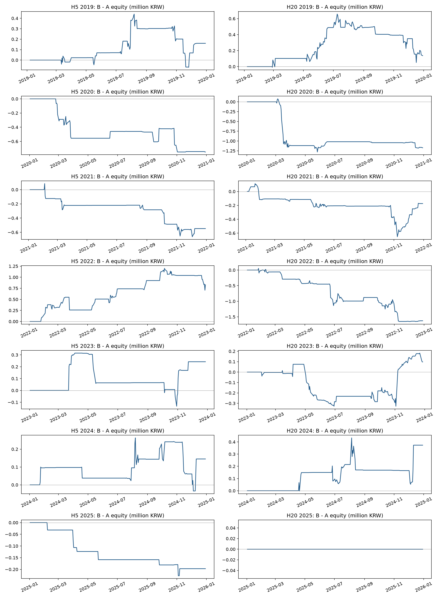
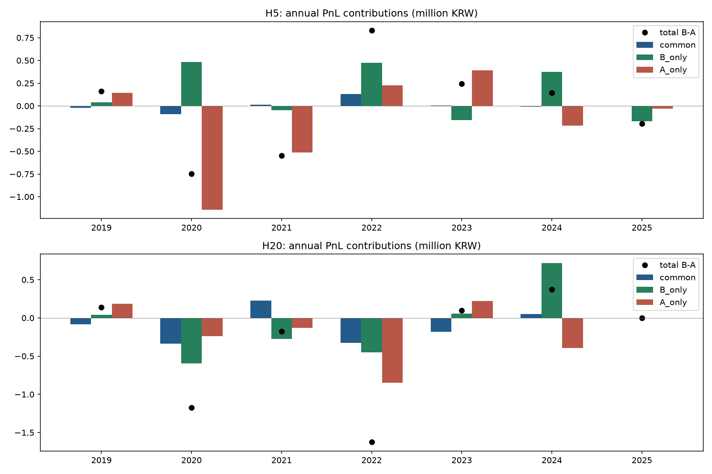

# 시장 심리 피처 A/B 결과 분석 — 2019~2025

작성일: 2026-10-14. 저장된 실험 `psychology_ab_2019_2025`, run `a6723ca89a07fbe5` 기준.

## 결론

심리 피처 4개를 추가한 B는 A보다 연도별 평균 ROC-AUC가 소폭 높았지만, 고정된 거래 규칙의 평균 수익률·Sharpe는 낮고 최대낙폭은 더 컸다. 이번 결과만으로 심리 피처 추가가 투자 성과를 개선했다고 결론 내릴 수 없다. 운영 모델을 B로 전환할 근거로도 사용하지 않는다.

연구 질문은 가격·거래량으로 만든 시장 심리 피처가 예측 신호에 보탬이 되는가다. 개인 설문 8축이나 뉴스 감성의 효과를 비교한 실험은 아니다. 모델 점수는 소프트 틸트이며 사용자의 종목 회피 하드 제약을 바꾸지 않는다.

## 비교 조건

| 항목 | 조건 |
| --- | --- |
| A | 기본 161개 + 수급 9개 = 170개 입력 |
| B | A + `psych_fear_greed`, `psych_herding`, `psych_overreaction`, `psych_disposition` = 174개 |
| 모델 | LightGBM, H5·H20 각각 A/B, 7개 평가 연도 × 4개 = 28개 모델 |
| 분할 | 직전 3년 학습 → 다음 1년 평가, 2019~2025 시간순 OOS |
| 주지표 | 7개 연도 ROC-AUC B−A 차이의 단순평균 |
| 학습 | 시드 42, 1,000 trees, learning rate 0.01, depth 5, leaves 20, min child samples 2,000, balanced class weight; 고정 설정, 내부 검증으로 모델 선택하지 않음 |
| 거래 평가 | 점수 0.65 이상 중 일별 상위 5개 후보, 다음 거래일 시가 진입, 매수·매도 각각 비용 0.105% |
| 자금 | 매년 1,000만 원으로 초기화한 독립 평가 |

상위 5개는 일별 신규 후보 제한이며 동시 보유 5종목 상한이 아니다. H5/H20은 평가 horizon이다. 현재 운영 pack 자체를 과거 7년에 적용한 성적이 아니라 각 연도 이전 자료로 학습한 별도 모델의 비교다.

전체 저장 구간의 공통 적격 입력은 1,801,501행·1,019개 종목 파일이다. 이는 평가 표본 수가 아니다. 기간 선택 후 A/B 예측 키는 horizon별 1,291,240행이며, 관측 완료 라벨로 평가한 행 수는 아래 표에 따로 적었다. 기본 적격·수급 9개·심리 4개 완전 관측의 교집합을 양쪽에 적용했다. 전체 코스피로 일반화하지 않는다.

## 주요 결과

아래 값은 연도별 지표의 단순평균이다. AUC·Sharpe 차이는 지표값의 차이, 수익률·MDD 차이는 %p다. MDD는 음수로 기록되며 더 작으면 낙폭이 더 크다. 수익률은 연속 7년 누적 수익률이나 CAGR이 아니다.

| 기간 | AUC A | AUC B | B−A | 수익률 A | 수익률 B | 차이(%p) | Sharpe A → B | MDD A → B |
| --- | ---: | ---: | ---: | ---: | ---: | ---: | ---: | ---: |
| H5 | 0.584627 | 0.584964 | +0.000336 | 12.9201% | 12.7536% | -0.1665 | 0.8279 → 0.6502 | -6.0859% → -7.3658% |
| H20 | 0.566289 | 0.566721 | +0.000432 | 7.0357% | 3.6567% | -3.3790 | 0.3184 → 0.1904 | -7.9239% → -10.0713% |

출처: [연도별 평균](comparison_mean.csv), [연도별 결과](comparison_by_year.csv).

전체 관측 라벨을 합쳐 계산한 pooled AUC는 연도별 평균과 다르다. 표본이 많은 연도의 영향이 더 커지므로 주지표와 섞지 않는다.

| 기간 | 관측 완료 행 수(A/B 동일) | pooled AUC A | pooled AUC B | B−A |
| --- | ---: | ---: | ---: | ---: |
| H5 | 1,290,408 | 0.584113 | 0.584381 | +0.000268 |
| H20 | 1,289,884 | 0.566214 | 0.566564 | +0.000350 |

출처: [예측 지표](prediction_metrics.csv), `year=0`은 pooled 결과. 상승 라벨은 `Y_Label=2`, PR-AUC는 공용 평가함수의 사다리꼴 적분이다. Rank IC의 대상은 미래 수익률이 아닌 0/1/2 라벨이다.

## 연도별 차이

모든 연도를 함께 제시한다. 최고·최저 연도만 골라 전체 효과를 주장하지 않는다.

| 기간 | 연도 | 관측 라벨 행 수 | AUC B−A | 수익률 B−A(%p) | 최종자산 B−A(원) |
| --- | ---: | ---: | ---: | ---: | ---: |
| H5 | 2019 | 179,377 | +0.000553 | +1.6051 | +160,506 |
| H5 | 2020 | 188,072 | +0.000284 | -7.4937 | -749,369 |
| H5 | 2021 | 187,341 | +0.000813 | -5.4760 | -547,600 |
| H5 | 2022 | 183,913 | +0.000391 | +8.2979 | +829,792 |
| H5 | 2023 | 180,305 | +0.000177 | +2.4216 | +242,156 |
| H5 | 2024 | 184,280 | +0.001171 | +1.4505 | +145,046 |
| H5 | 2025 | 187,120 | -0.001035 | -1.9709 | -197,093 |
| H20 | 2019 | 179,316 | +0.001103 | +1.3666 | +136,661 |
| H20 | 2020 | 188,022 | -0.000200 | -11.7283 | -1,172,827 |
| H20 | 2021 | 187,240 | +0.000054 | -1.7412 | -174,117 |
| H20 | 2022 | 183,885 | +0.001152 | -16.2601 | -1,626,010 |
| H20 | 2023 | 180,265 | +0.000467 | +0.9770 | +97,697 |
| H20 | 2024 | 184,190 | +0.000427 | +3.7331 | +373,310 |
| H20 | 2025 | 186,966 | +0.000019 | +0.0000 | +0 |

H20/2025는 A/B 모두 2건씩 체결했고 같은 자산 경로를 보여 손익 차이가 0이다. 후보 수는 A 6개·B 5개로 달랐다. 손익 차이 0을 예측 점수나 후보가 모두 같았다는 뜻으로 해석하지 않는다. 출처: [체결 연결 검증](execution_validation.csv).

## 예측력 차이와 손익 차이가 어긋나는 경로

AUC는 전체 관측 라벨의 순위를 평가하지만, 거래 평가는 0.65 임계·상위 5개·보유 상태·진입 전 현금에 따라 일부 후보만 체결한다. 작은 점수 변화도 임계 통과나 후보 순위를 바꾸고, 기존 보유와 이전 거래 손익은 다음 주문 수량에 영향을 준다. AUC 상승만으로 이 거래 경로의 수익 증가를 보장하지 않는다.

연도·종목·진입일로 공통 거래를 대응했다. 최종자산 차이는 공통 거래의 손익 차이 + B만 진입한 거래의 손익 − A만 진입한 거래의 손익으로 정산된다. 수수료·연말 평가손익을 포함한다.

| 기간 | 공통 거래 기여(원) | A만 진입의 반대 기여(원) | B만 진입 기여(원) |
| --- | ---: | ---: | ---: |
| H5 | +28,541 | -1,143,886 | +998,784 |
| H20 | -652,694 | -1,206,106 | -506,486 |

금액은 7개 독립 평가의 합이며 연속 운용 성과가 아니다. 공통 진입 609건은 진입 가격·청산 시점·가격·사유·상태가 같고 수량 차이로 손익 격차가 정산된다. 이 분해는 회계적 항등식이며 심리 피처의 인과 효과를 분리한 결과는 아니다.

예를 들어 H20/2022의 최종자산 격차는 약 −1,626,010원이다. 공통 거래 −328,166원, A만 거래의 반대 기여 −846,727원, B만 거래 −451,116원으로 나뉜다. 유리한 A 후보를 놓친 효과와 B의 단독 거래 손익, 기존 현금 경로가 함께 작용했음을 보여준다.

출처: [연도별 손익 정산](pnl_by_year.csv), [체결 연결 검증](execution_validation.csv). 그림은 기존 분석 산출물이다.

## 불확실성과 해석 한계

- 날짜 의존성을 고려해 연도 내 A/B 동일 날짜의 20·60거래일 이동 블록을 각 2,000회 재표집했다. 시드 42, 백분위 95% 구간이며 유효 날짜·반복 수를 [uncertainty.csv](uncertainty.csv)에 기록했다.
- 이 구간의 대상은 **일별 평균 AUC·Brier·Rank IC 차이**다. 주지표인 연도별 AUC 차이 평균, pooled AUC, 거래 수익률의 신뢰구간이 아니다. 일부 연도·블록의 구간이 0을 제외해도 전체 효과의 통계적 유의성을 주장하지 않는다.
- 심리 입력은 관측일 다음 해당 종목 거래일의 AvailableDate로 결합됐다. 기존 가격·수급 입력은 T일에 결합된다. 수급의 AvailableDate는 기존 결합 경로에서 제거돼 원래 Date로 합쳐졌다는 제한이 있다. 정보 시점 차이의 독립 효과는 분리되지 않았다.
- 심리 4개 피처의 gain 비중 합은 H5 연도별 3.99~5.87%, H20 3.86~5.41%다. [모델 중요도 집계](feature_importance_summary.csv)는 모델의 사용 흔적이며 추가 효과나 인과성의 증거가 아니다.
- 수정가격·수급 결측·공통 표본 선택의 제한이 남는다. 과거에 이미 분석한 평가 기간이므로 연구자가 손대지 않은 최종 holdout으로 부르지 않는다.
- 현재 자료는 고정 파라미터·임계값 아래의 결과다. 결과를 보고 유리한 임계값을 골라 같은 기간의 개선 근거로 재사용하지 않는다. 후속 검증은 설정을 고정한 이후 신규 신호로 구분한다.

## 검증과 자료 출처

완료 run은 2026-10-12 11:53~15:52 KST에 실행됐다. 기존 분석 [validation.json](validation.json)은 상태 `complete`, 재학습 없음, 원본 결과 변경 없음, 후보 미확인·진입 미연결 각각 0건을 기록한다. 14개 조합의 손익 분해 최대 잔차는 약 1.0×10⁻⁸원으로 허용 오차 1원 이내다. 공용 예측 지표 재현 허용 오차는 1e-10이다.

이번 게시 준비에서 저장 입력의 SHA-256을 다시 확인하고, 연도별 평균·B−A·손익 정산과 main의 성적표 수치를 대조했다. 확인 개수와 파일 해시는 [provenance.json](provenance.json), 원본 결과의 상대 경로·해시는 [input_hashes.csv](input_hashes.csv)에 있다.

원본 예측·모델·주문·입력 Parquet는 로컬 `backend/analysis/chart/workspace/experiments/`에 있다. 대용량 원본을 이 자료에 포함하지 않아 이 PR만으로 전체 재실행할 수는 없다. 생성 당시 HEAD `4d3199a` 외에 미커밋 실험 코드가 사용됐다. 기록된 코드 SHA-256은 게시 준비 시점 파일의 식별값이며 생성 당시 코드의 완전한 스냅샷을 보장하지 않는다. 분석 runner·학습 변경을 커밋하는 재현성 작업은 별도로 남는다.

관련: [#214 실험](https://github.com/2026Graduation-Work/take_a_look/issues/214), [#271 성적표](https://github.com/2026Graduation-Work/take_a_look/issues/271). 이미 연결된 성적표의 결과를 설명하는 연구 자료이며 운영 모델 변경이나 매매 지시를 포함하지 않는다.
