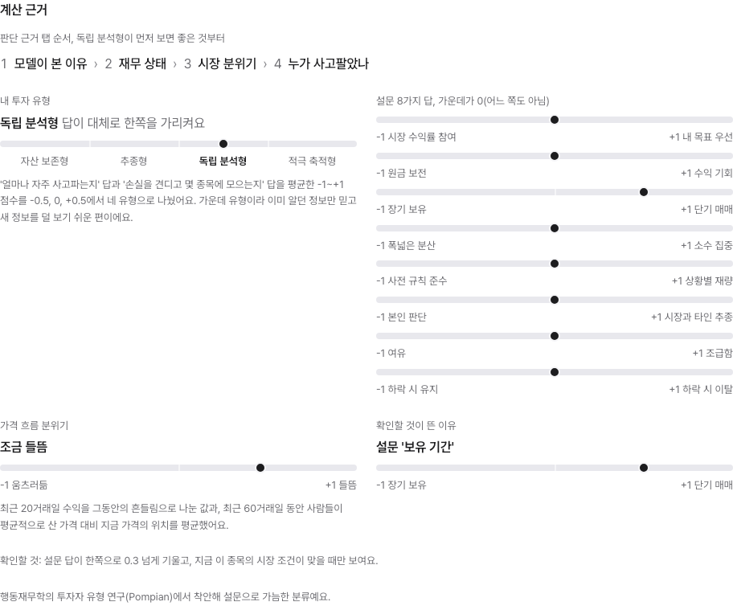
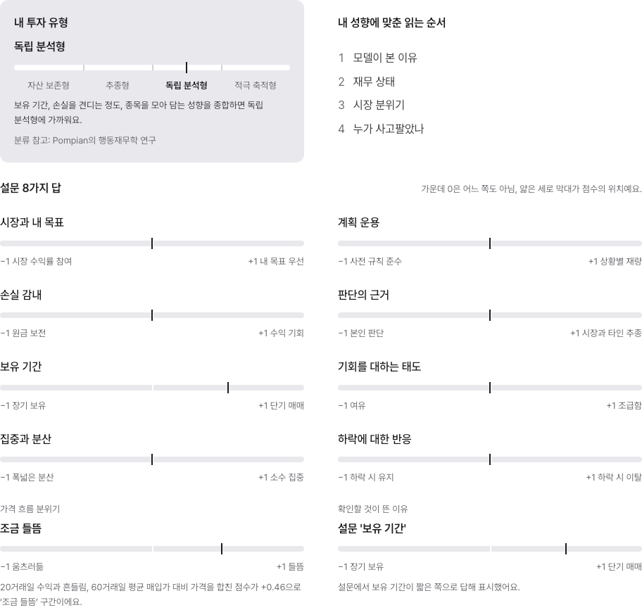
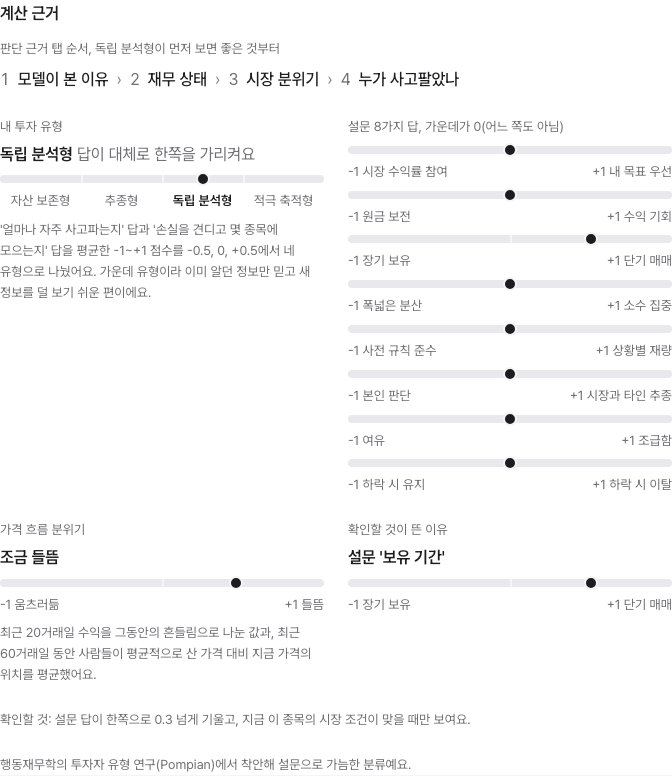
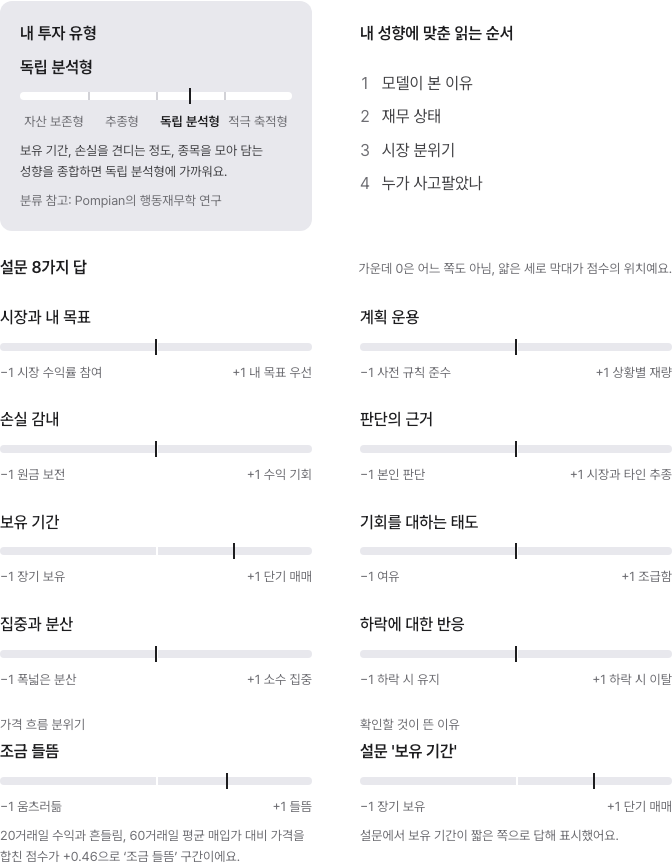
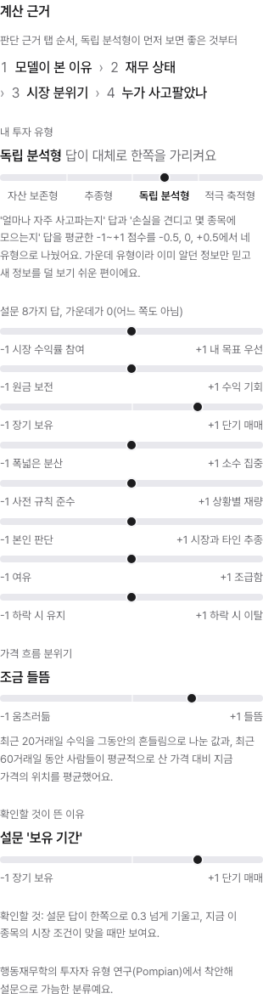
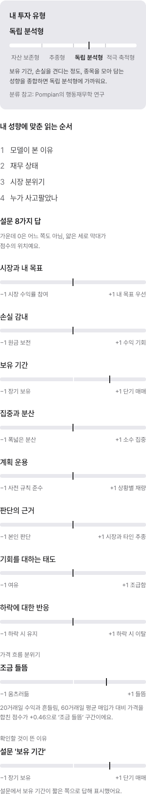
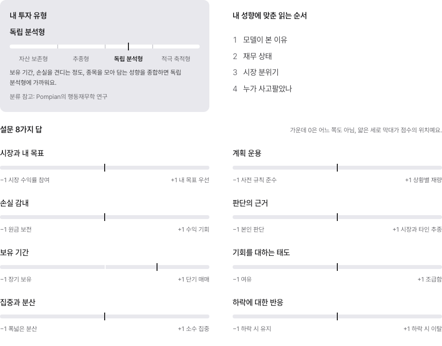

# 더 알아보기 계산 근거 전후 비교

- 날짜: 2026-10-24 KST
- 변경 전: main `aed3077`의 원본 UI. 별도 임시 체크아웃에서 촬영.
- 변경 후: `feat/readable-calculation-basis`.
- 대상: 삼성전자 상세의 계산 근거 영역. 1280 / 768 / 390px.
- 입력: 내장 데모 응답을 바탕으로 보유 기간 +0.5, 다른 축 0인 합성 설문. 수급·위험도는 테스트 스텁의 합성 입력. 가격 기록은 저장소의 2026-09-21 공개 차트 표본.
- 실제 사용자 계좌·설문 응답·보유 이미지·비밀키는 포함하지 않음.
- 섹션을 가리지 않도록 캡처할 때만 고정 헤더와 Next 개발 도구를 숨김.
- `after-without-checkpoint-1280.png`는 데이터 미제공 시 이유가 임의로 생성되지 않는 상태.

재현: `cd frontend && BASIS_SCREENSHOT_DIR=/tmp/basis-pr-screenshots corepack pnpm exec playwright test tests/e2e/calculation-basis.spec.ts --reporter=list`

| 폭 | 변경 전 | 변경 후 |
|---|---|---|
| 1280 |  |  |
| 768 |  |  |
| 390 |  |  |

데이터 미제공 상태:

