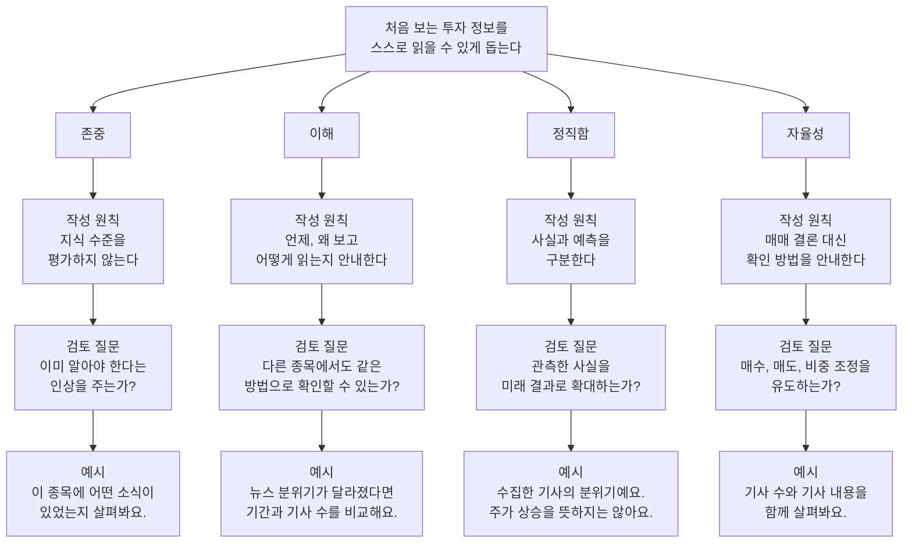

# Take a Look UX 라이팅 가이드

v0.4 초안. 2026-11-27. 사용자 이해도 검증 전.

## 핵심 문장

> 처음 보는 투자 정보를 스스로 읽을 수 있게 돕는다.

## 전체 구조

가치별 대표 원칙을 연결했다. 세부 원칙과 예시는 아래 표에 정리했다.

## 존중

모르는 상태에서도 부담 없이 시작할 수 있어야 한다.

| 작성 원칙 | 검토 질문 | 피할 예시 | 사용할 예시 |
|---|---|---|---|
| 지식 수준을 평가하지 않는다 | 이미 알아야 한다는 인상을 주는가? | 뉴스 분석 정도는 기본이에요. | 이 종목에 어떤 소식이 있었는지 살펴봐요. |
| 사용자를 탓하지 않고 가능한 다음 행동을 알려 준다 | 원인을 확인하지 않고 사용자 잘못으로 단정하는가? | 잘못 입력하셨네요. | 종목을 찾지 못했어요. 이름이나 종목 코드를 확인해 주세요. |

## 이해

어떤 상황에서 정보를 보고, 왜 필요한지 이해하며, 같은 방법으로 다른 종목도 살펴볼 수 있어야 한다.

| 작성 원칙 | 검토 질문 | 피할 예시 | 사용할 예시 |
|---|---|---|---|
| 어떤 상황에서 보는지 먼저 알려 준다 | 사용자가 자신의 궁금증과 이 항목을 연결할 수 있는가? | 순매수는 산 수량에서 판 수량을 뺀 값이에요. | 최근 어떤 투자자들이 더 샀고 더 팔았는지 궁금할 때 봐요. |
| 확인하는 이유를 설명한다 | 이 항목을 보면 무엇을 더 알 수 있는가? | 기사 수를 확인해요. | 기사가 적으면 한 기사가 전체 분위기에 미치는 영향이 커요. |
| 화면에서 읽는 방법을 안내한다 | 무엇을 어떤 순서와 기준으로 비교할지 알 수 있는가? | 뉴스 분위기를 살펴봐요. | 분위기가 달라졌다면 기간과 기사 수를 함께 비교해요. |

## 정직함

정보가 말해 주는 것과 알 수 없는 것을 구분할 수 있어야 한다.

| 작성 원칙 | 검토 질문 | 피할 예시 | 사용할 예시 |
|---|---|---|---|
| 사실과 예측을 구분한다 | 관측한 사실을 미래 결과로 확대하는가? | 뉴스가 긍정적이니 주가도 오를 거예요. | 수집한 기사의 분위기를 정리한 값이에요. 앞으로 주가가 오를지를 뜻하지는 않아요. |
| 비교 대상과 기간을 밝힌다 | 무엇과 어느 기간을 비교했는지 알 수 있는가? | 매출이 늘었어요. | 매출이 지난해 같은 분기보다 늘었어요. |
| 자료 부족과 실제 결과를 구분한다 | 자료가 없는데 변화가 없다고 말하는가? | 거래에 별다른 움직임이 없어요. | 지금은 표시할 거래 자료가 없어요. |

## 자율성

사용자가 확인할 정보를 고르고 자신의 기준으로 판단할 수 있어야 한다.

| 작성 원칙 | 검토 질문 | 피할 예시 | 사용할 예시 |
|---|---|---|---|
| 매매 결론 대신 확인 방법을 안내한다 | 매수·매도·비중 조정을 유도하는가? | 긍정적인 기사가 많으니 매수를 고려해 보세요. | 분위기가 달라졌다면 기사 수와 기사 내용도 함께 살펴봐요. |
| 안내를 중단하거나 건너뛸 선택을 존중한다 | 특정 선택에 죄책감을 주는가? | 배울 기회를 포기할까요? | 안내를 닫을까요? |

## 튜토리얼 작성 방식

탭 소개에서 언제, 왜 보는지 알려 주고, 이어지는 상세 안내에서 화면을 어떻게 읽는지 보여 준다. 말풍선마다 한 가지 읽는 법을 한두 문장으로 설명한다. 제목이나 강조된 수치를 본문에 반복하지 않는다.

| 역할 | 작성할 내용 | 수급 예시 |
|---|---|---|
| 언제 | 사용자가 가진 궁금증이나 확인할 상황 | 주가가 움직인 배경을 살필 때 봐요. |
| 왜 | 이 항목으로 추가로 알 수 있는 것 | 어느 투자자가 주로 사고팔았는지도 단서가 돼요. |
| 어떻게 | 화면에서 볼 곳, 비교 순서와 기준 | 같은 기간의 순매수를 나란히 보면, 매수나 매도가 한쪽에 몰렸는지 알 수 있어요. |

용어 정의는 기존 용어 설명, 계산식과 원자료는 '계산 근거'에서 다룬다. 튜토리얼에는 화면을 읽는 데 바로 필요한 뜻만 짧게 넣는다. 자료가 없으면 확인할 수 없는 내용과 다음에 볼 곳을 안내한다.

## 적용 기준

- 말투는 차분한 해요체를 쓴다. 과한 감탄, 농담, 근거 없는 안심은 피한다.
- 정확성과 선택권을 먼저 지킨다. 이해하기 쉽게 다듬은 뒤 불필요한 말을 줄인다.
- 예시는 해당 데이터와 기능이 있을 때만 쓴다. 각 안내에 네 가치를 설명하는 문장을 모두 넣지는 않는다.
- 학습 효과는 초보자가 언제, 왜 이 항목을 보는지 말하고 다른 종목에서도 비교할 곳을 찾는지 확인한다. 검증하지 않은 부분은 미검증으로 기록한다.
- 반복되는 오해는 해당 가치의 작성 원칙과 예시에 반영한다.

[공통 지침](../AGENTS.md)과 [화면 규칙](DESIGN.md)이 우선한다. 공통 용어는 [용어집](lib/copy-glossary.ts), 금지 표현은 [문구 검사 규칙](lib/copy-rules.ts)을 따른다. 이 기준은 고정 문구와 생성 설명에 모두 적용한다.
