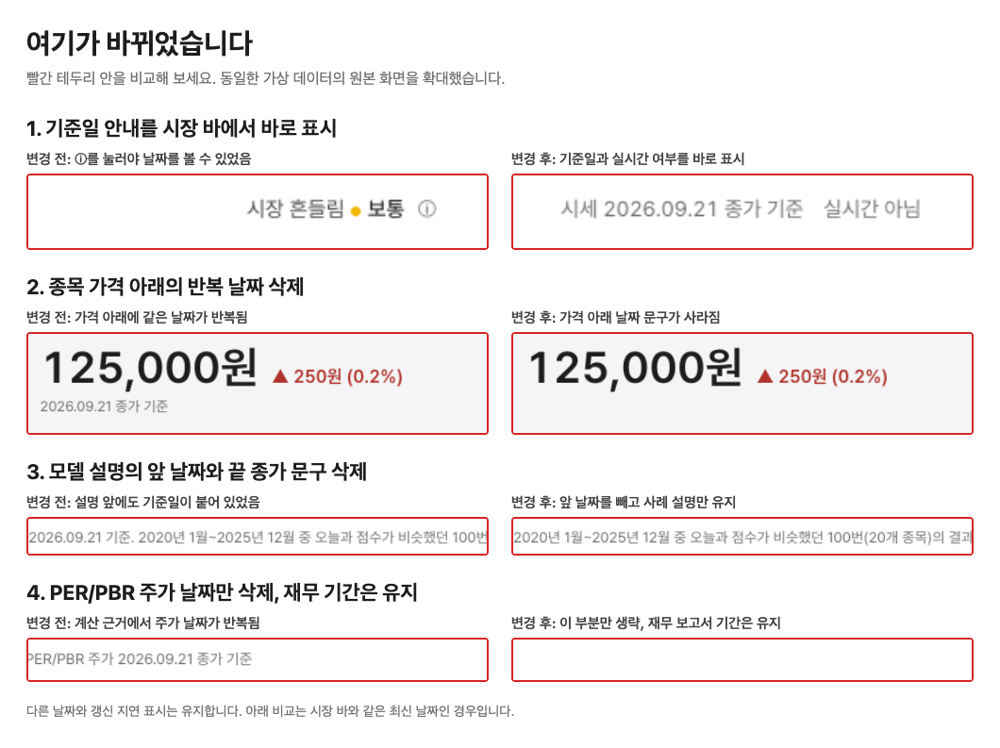
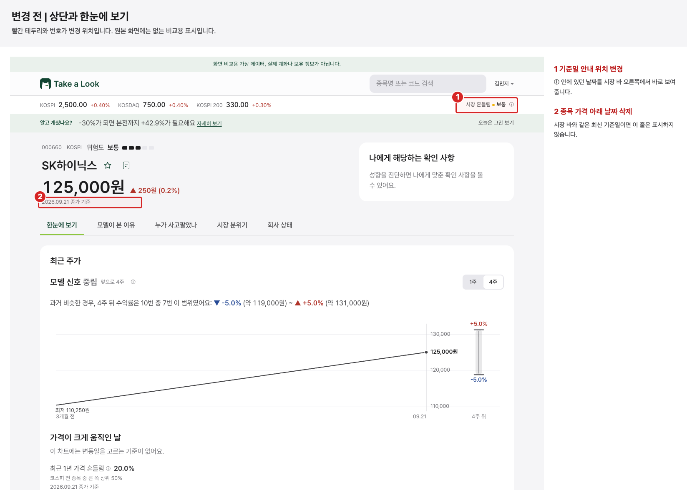
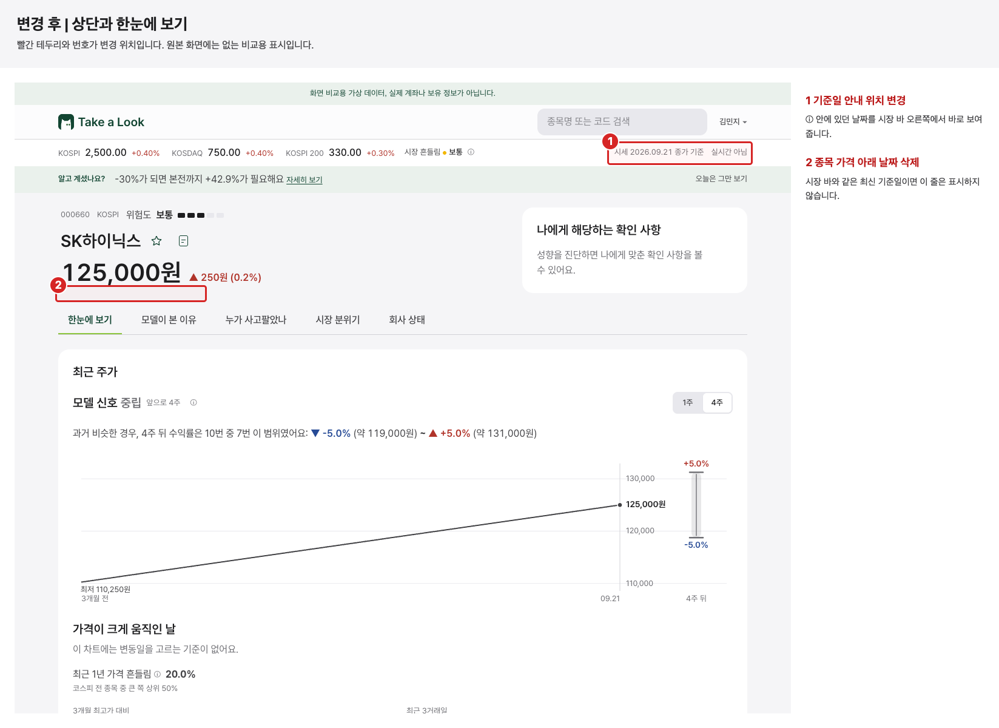
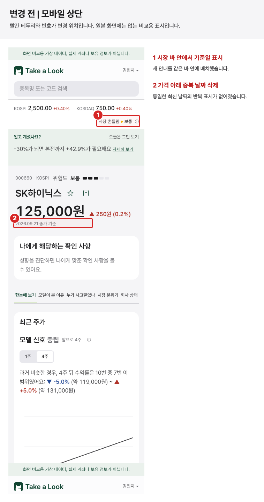
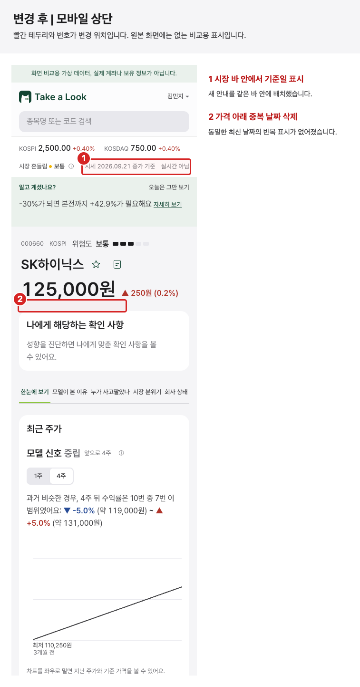
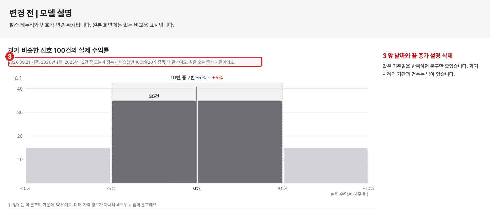
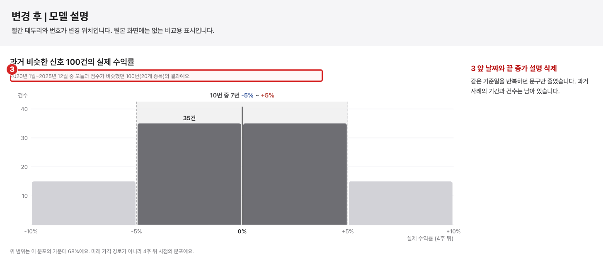
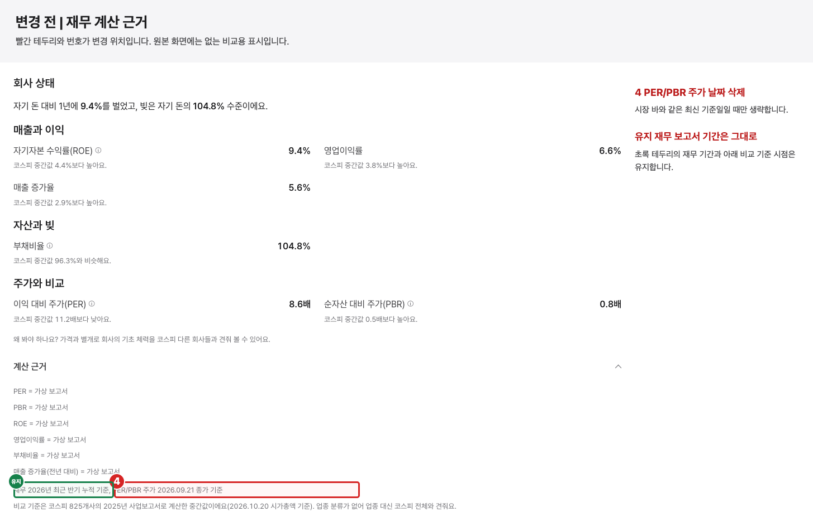

# PR #508 기준일 안내 전후 비교

## 먼저 여기만 보세요

빨간 테두리와 번호가 변경 위치입니다. 아래 확대 비교는 같은 원본 화면의 일부를 잘라 보여 줍니다. 전체 강조 화면에서는 재무 보고서 기간처럼 유지되는 부분을 초록색으로 표시했습니다.

1. **시장 바**: ⓘ 안에 있던 시세 기준일을 바 오른쪽에서 바로 보이게 했습니다.
2. **종목 가격 아래**: 같은 최신 날짜의 `2026.09.21 종가 기준` 줄을 삭제했습니다.
3. **모델 설명**: 앞의 `2026.09.21 기준.`과 뒤의 `원은 오늘 종가 기준이에요.`를 삭제했습니다. 과거 사례 기간과 건수는 유지합니다.
4. **재무 계산 근거**: `PER/PBR 주가 2026.09.21 종가 기준` 부분만 삭제했습니다. 재무 보고서 기간과 비교 지표의 시점은 유지합니다.

기준일이 서로 다르거나 갱신이 지연된 경우에는 날짜 표시를 유지합니다.

## 전체 화면에서 변경 위치 보기

사진을 누르면 원본 크기로 볼 수 있습니다. 테두리와 번호는 비교를 위한 표시이며 실제 제품 화면에는 없습니다.

| 화면 | 변경 전 | 변경 후 |
|---|---|---|
| 상단과 한눈에 보기 |  |  |
| 모바일 |  |  |
| 모델 설명 |  |  |
| 재무 계산 근거 |  |  |

## 캡처 조건과 원본

- 변경 전: f0f8491 (#500·#507 반영 main)
- 변경 후: 750213a (시세 기준일 공통 표시와 중복 문구 정리)
- 합성 데이터와 2026-09-22 12:00 KST를 사용했습니다. 실제 계좌·보유 정보는 없습니다.
- 공통 기준일: 2026-09-21. 다른 날짜·지연 날짜 보존은 자동 회귀 테스트로 검증했습니다.
- 데스크톱 1280×1040, 모바일 390×1280. 두 버전 모두 동작 줄이기 설정을 켰습니다.

| 화면 | 표시 없는 변경 전 원본 | 표시 없는 변경 후 원본 |
|---|---|---|
| 상단과 한눈에 보기 | [원본](overview-desktop-before.png) | [원본](overview-desktop-after.png) |
| 모바일 | [원본](overview-mobile-before.png) | [원본](overview-mobile-after.png) |
| 모델 설명 | [원본](model-before.png) | [원본](model-after.png) |
| 재무 계산 근거 | [원본](financial-before.png) | [원본](financial-after.png) |
