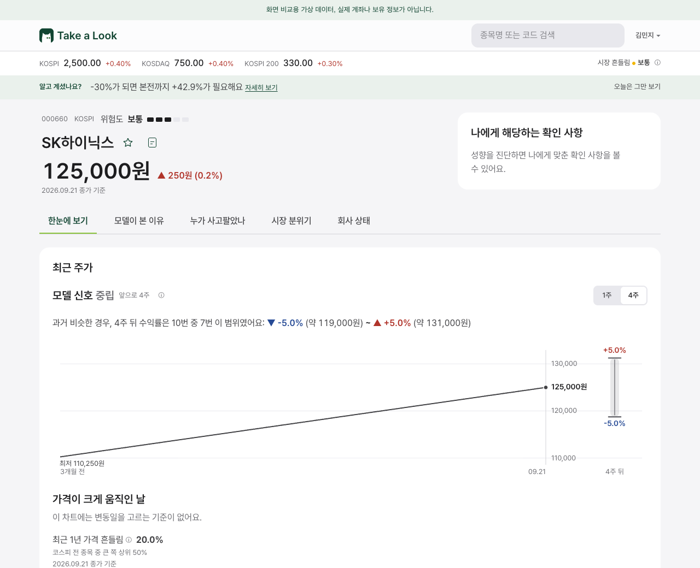
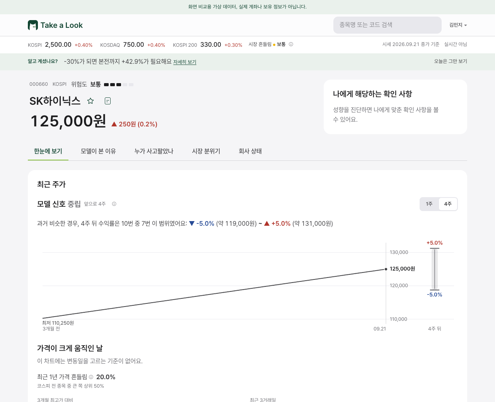
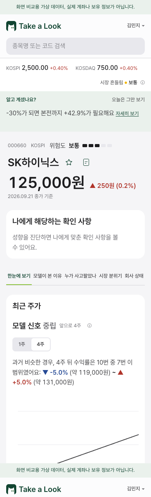
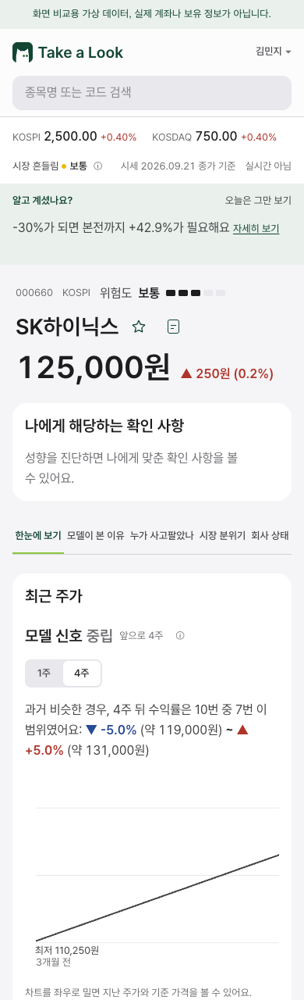
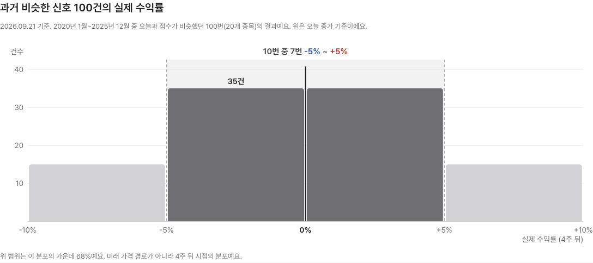
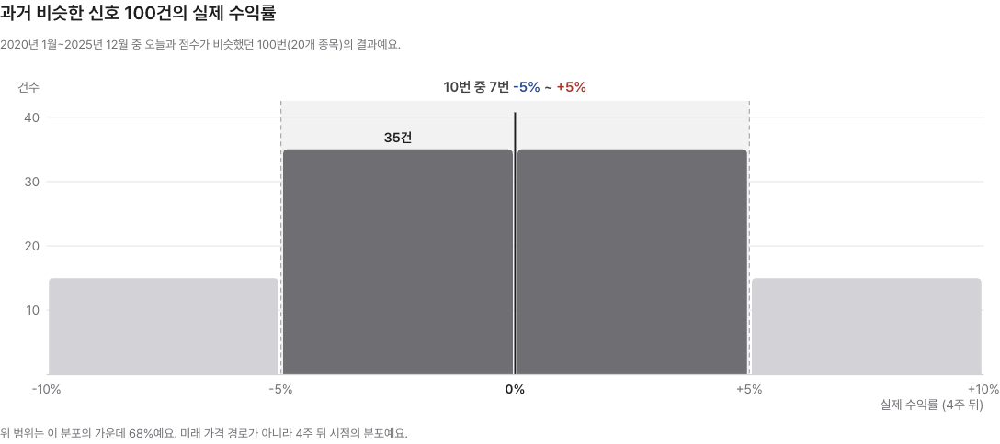
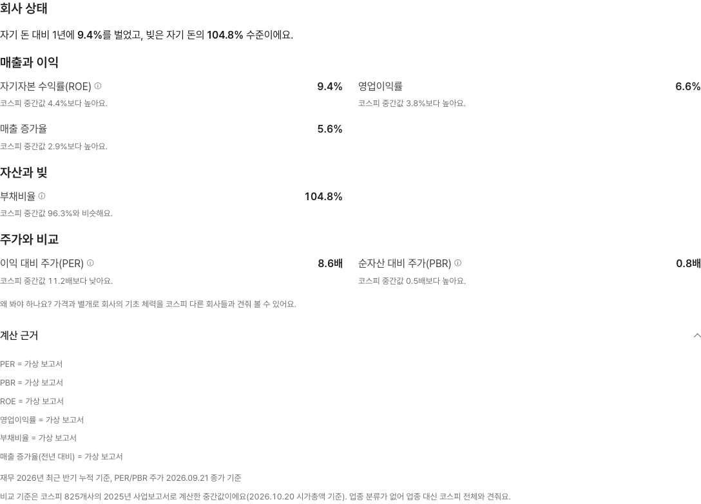
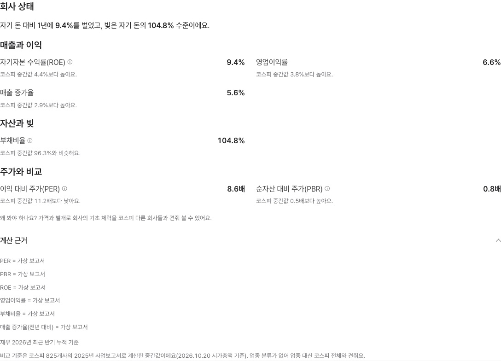

# PR #508 기준일 안내 전후 비교

- 변경 전: f0f8491 (#500·#507 반영 main)
- 변경 후: 750213a (시세 기준일 공통 표시와 중복 문구 정리)
- 동일한 화면 비교용 합성 데이터와 2026-09-22 12:00 KST를 사용했습니다. 시세·모델·재무는 가상 값이며 실제 계좌·보유 정보가 없습니다.
- 공통 기준일은 2026-09-21입니다. 다른 시점·지연 데이터의 날짜 보존은 별도 자동 회귀 테스트로 검증했습니다.
- 데스크톱 1280×1040, 모바일 390×1280. 모델·재무 사진은 동일 화면 크기에서 해당 섹션만 캡처했습니다.
- 두 버전 모두 OS 동작 줄이기를 켜 지수와 팁의 움직임을 고정했습니다.

| 화면 | 변경 전 | 변경 후 |
|---|---|---|
| 상단과 한눈에 보기 |  |  |
| 모바일 |  |  |
| 모델 설명 |  |  |
| 재무 계산 근거 |  |  |
